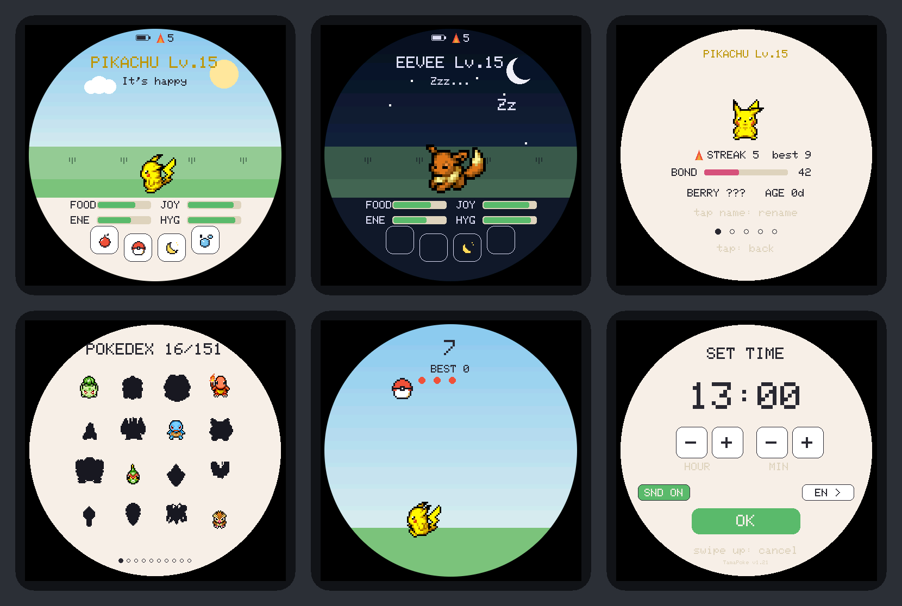
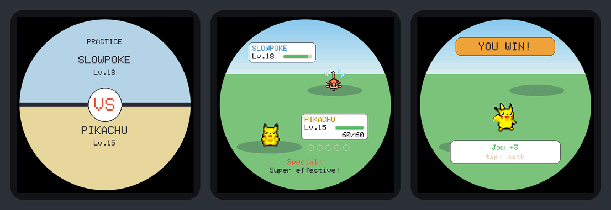
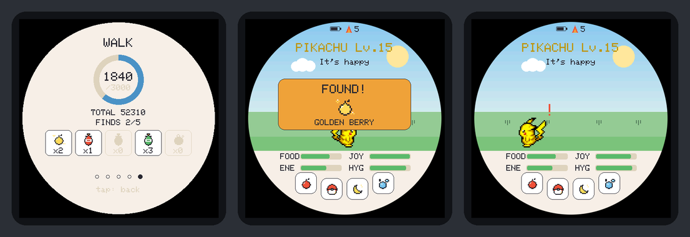

# TamaPoke


[](https://github.com/Ale-Cuevas/TamaPoke/actions/workflows/ci.yml)


A gen-1-Pokémon-inspired tamagotchi for the
**Waveshare ESP32-S3-Touch-AMOLED-2.16** (square 480×480 AMOLED, CO5300 driver
over QSPI, CST9220 touch over I2C). Raise any of the 151, evolve it, train it
and complete them all (shinies included).

This is a port of [socquique/TamaPoke](https://github.com/socquique/TamaPoke),
which was designed for the round **AMOLED-1.75**. The round screen is kept: the
game draws its original 466×466 UI and the display layer centres it on the
square panel inside a smooth round frame, with the rest of the panel black (on
an AMOLED, black pixels are simply off). How and why:
**[docs/AMOLED-2.16.md](docs/AMOLED-2.16.md)**.



<sub>Rendered from the real firmware drawing code by `tools/render/render.sh`:
these are the pixels the panel receives.</sub>

> **Personal, non-commercial fan project.** Code is MIT; the sprites are from
> PMD SpriteCollab (CC BY-NC, Pokémon © Nintendo/Game Freak). See
> **[License](#license)** and **Credits**.

## Status

**AMOLED-2.16 port (v1.19):** builds (PlatformIO and arduino-cli, pinned
versions), passes the host test suite, and every screen has been rendered and
checked on the PC. **Tested on a real 2.16" board on 2026-11-04**: bring-up and
game work; the results and the few checks still open are in
[docs/DEVICE_TESTS.md](docs/DEVICE_TESTS.md) (summary in
[docs/PENDING_TESTS.md](docs/PENDING_TESTS.md)).

**v1.20: steps and motion tricks.** The board's QMI8658 IMU now counts steps
in software (walk care, a daily goal, items found on walks, a Backpack, and a
5th **WALK** page on the stat card showing today's steps), and the board reacts
to being shaken, laid face-down or tilted. Built, host-tested against real
captures from the board and rendered on the PC; the on-board checks (step
accuracy, battery drain, 400 kHz I2C) are listed in
[docs/DEVICE_TESTS.md](docs/DEVICE_TESTS.md#steps).

**v1.24: practice battles.** PLAY now opens a small menu: the ball game, or a
**battle** against a simulated opponent of your rarity and level. Battles are
automatic and use real Gen 1 base stats and types (Flying and dual types
included); tapping the screen charges a special attack. Built, host-tested
(every one of the 151×151 pairings at three levels) and rendered on the PC; the
on-board checks are in [docs/DEVICE_TESTS.md](docs/DEVICE_TESTS.md#battle).

**v1.37: the Box.** Swipe right for a 6-slot box where pets hibernate while you
raise another; wake one to swap them back. Host-tested, including a power cut
after every single flash write of every move, and rendered on the PC; the
on-board checks are in [docs/DEVICE_TESTS.md](docs/DEVICE_TESTS.md#box-v137).

The game itself runs on the 1.75" hardware upstream. Implemented: the 151 +
shinies animated from microSD, full life cycle (egg by rarity → evolution → farewell/release/runaway, each gated
behind a decision dialog), bred-Pokédex with gallery, a 6-slot box to hibernate pets, battle stats (genes +
training), retention hooks (streak / bond / medals / name), biome + real-time
backgrounds, ball minigame, training bag, animated bath, RTC with offline
progression, battery (AXP2101) and PWR button, AMOLED burn-in protection (pixel orbit + screensaver),
**sound (ES8311)**, **8 UI languages (English default)**, **starter choice on
first run**, and a one-click **web installer**.

Pending: wild encounters / battle (designed, not implemented), 3D case, soak
test. See **Roadmap**.

## Game manual (the actual numbers)

A quick reference to how the game really works (values straight from the code).

### Time & leveling
- **1 real minute = 1 in-game minute.** Each level costs more than the last (v1.35),
  as a stronger pet is harder to raise:
  - **Lv 1–10:** 20 min per level;
  - **Lv 11–89:** a log curve, `20 + 160 · ln(L − 10) / ln 80` minutes, rising from 20 to 180;
  - **Lv 90 on:** 3 h per level.

  | Level | 10 | 16 | 20 | 25 | 31 | 36 | 40 | 50 | 55 | 90 |
  |---|---|---|---|---|---|---|---|---|---|---|
  | Reached after (no walking) | 3 h | 7.9 h | 14 h | 23 h | 36 h | 47 h | 56 h | 3.4 d | 3.9 d | 8.1 d |

- Levels come from a **growth** counter that runs with the pet's age (awake or asleep, and
  while powered off) and that the Rare Candy can push ahead. Age stays real time: the days on
  the card and the 3-day farewell don't move. Caring well doesn't speed leveling up, but
  neglect *delays evolution*.
- It keeps **aging and growing while powered off** (the RTC runs), catching up to **2 weeks** max.
- A pet from before v1.35 keeps its level and how full its bar was.
- **Level-up (v1.30):** a rising jingle as soon as it happens, even with the screen off
  (the screen stays off; asleep, it waits for the wake). On the home screen there are
  sparkles and a "LEVEL UP!" pill ("Lv.12 > Lv.18" after time away), then the ATK/DEF/SPD
  it gained.

### The four stats (0–100)
Needs: **FOOD**, **JOY**, **ENE** (energy), **HYG** (hygiene). Start 80 / 80 / 80 / 100.
While **awake**, per minute:

| Stat | Drain/min | Notes |
|---|---|---|
| FOOD | −2 | |
| ENE | −1 | −1 extra if overweight (weight > 50 → sluggish) |
| HYG | −1 | **−4 more per poop** on screen (max 3 poops) |
| JOY | −1 | **−2 extra** if FOOD < 30, **−2 extra** if HYG < 30 |

- ~**15 %/min** chance to poop (only if FOOD > 40). Poops tank hygiene fast.
- **Care slip-up** = letting any stat hit **≤ 10** (30-min cooldown so it counts once).
  Each slip-up **delays evolution by 1 level** and cools the bond.

### Actions
- 🍎 **Berry** (3 flavors): +25 FOOD. Each species has a **hidden favorite flavor**
  → +35 FOOD, +10 JOY, ♥, bond, and it gets revealed.
- 🍬 **Candy:** +10 FOOD, +12 JOY, but **+12 weight** (fattening).
- ⚽ **Play:** a menu with all the games: the **ball minigame** (+JOY, −ENE; trains **SPEED** and
  burns weight; the ball keeps speeding up as you score: twice as fast at 80 as at 1, up to 3×),
  a **practice battle** (+3 JOY, at most once an hour; see Battles below) and the training bag.
- 🥊 **Training bag** (third slot of the Play menu): trains **STRENGTH** (~4 hits = 1 pt, cap
  +18/session), tires it.
- 🫧 **Bath:** clears poops, HYG → 100.
- 👆 **Pet it:** +5 JOY + bond.
- 🌙 **Sleep:** rest — ENE **+6/min**, needs drain ~**4× slower** with floors
  (FOOD 30 / JOY 35 / HYG 45). No poops, no slip-ups, can't run away while asleep.
- **Feedback (v1.30):**
  - the bars slide, and every action floats a "+N" over what it changed;
  - bond rising shows a small heart;
  - training shows "ATK +3";
  - a slip-up shows a "!";
  - a button that can't be used (asleep) shakes;
  - celebrations (level-up, medal, streak, step goal) come one at a time, each when you
    can see it.

### Eggs & who you get (spawn odds)
- **First ever pet:** you pick a starter — **Bulbasaur / Charmander / Squirtle**.
- Hatch the egg: tap it **3×** (or wait — it hatches on its own).
- Every later egg rolls a **rarity tier** (over the ~79 base forms that come from eggs):

| Tier | Base chance | After a proper goodbye | # species |
|---|---|---|---|
| ✨ Legendary | ~3 %\* | ~10 % | 5 |
| 🔵 Rare | ~27 % | ~45 % | 27 |
| ⚪ Common | the rest | the rest | 47 |

  \* Legendaries only start appearing once you've **registered ≥ 25** Pokémon.
- A daily **streak** and high **bond** push rare/legendary odds higher.
- A clean **goodbye blesses** the next egg; a **run-away curses** it (forces Common).
- Within a tier it favors species whose **evolution line you haven't finished** (so
  all 151 are completable).
- **Shiny:** base **1 / 48** (→ **1 / 24** right after a goodbye), improved by
  streak/bond down to a best of **1 / 8**. Tracked separately in the dex.
- Every hatch rolls unique **genes** (90–110 % per stat) — no two are identical.

### Evolution
- Triggers when **level ≥ its evolution level** (16 for most base forms; ~30 for
  stone-style, ~40 for trade-style) **and every stat ≥ 40** at that moment.
- **Never automatic** — a button appears and **you tap to witness it** (with a
  flicker between the old and new form). Each **slip-up delays it by 1 level**.
- You can **decline** ("keep form"); it re-offers at the next level.
- *Eevee* branches toward whichever evolution you're still missing.

### The three endings (you choose & witness each — none auto-fire)
- 💛 **Farewell** — when it's a **final form** that has lived **3 days**. A button
  appears; triggering it **blesses your next egg**. You can **postpone** ("stay
  together", re-offered in a day). The good ending.
- 💔 **Run-away** — if you let **all four stats sit at 0 for a full hour**. A single
  act of care cancels it. It **curses the next egg** (forces Common). The sad ending.
- 👋 **Release** — long-press the creature to let it go on your terms (neutral).

After any ending, a **new egg** appears (or the egg that was waiting while you woke a pet
from the Box, see below).

### The Box (v1.37)
Swipe **right** from the home screen (pet or egg) to open the Box: **6 slots** where pets
**hibernate** while you raise another. Swipe left, tap the title or press USER to go back.
- **Store:** tap an empty slot (it shows a "+" when the current pet fits) and confirm. The
  pet goes in, and an egg takes its place: the egg that was waiting, or a new one. Storing
  is not an ending, so it doesn't change the next egg's odds. A sleeping pet can be stored
  and comes back asleep. Not while it's evolving or saying goodbye.
- **Wake:** tap a stored pet and confirm. With a hatched pet active, the two **swap
  places** in that slot (so a full box can still swap). With an egg active, the egg **waits
  as it is** (species, shiny roll, cracks; a small sleeping egg shows next to "Now") and
  comes back after your next store or ending: storing and waking never re-roll an egg, or
  spend the Shiny Charm twice.
- **Hibernation is total:** a stored pet doesn't age, grow, get hungry or slip up, not even
  while the board is off. Farewell age and evolution levels only count time spent active.
- Each pet keeps its own **bond**, daily bond cap and **medals**. Streak, steps, finds,
  goals, the Backpack, records and the Pokédex are yours and stay put; the first care of the
  day gives its +4 bond once a day, to whoever is active.
- Slots show the pet dimmed with a "z", its name, level and a star if it's shiny. A slot
  whose data is damaged shows **"?"** and is never loaded or overwritten.
- Moving a pet writes to flash at once; a light flying between the pet and its slot covers
  the ~1 s write. A power cut at any moment never loses a pet: the next boot finishes or
  undoes the move.

### Bonds, streaks, medals, Pokédex
- **Streak** (player-wide, survives across pets): first care each real day; milestones
  at **3 / 7 / 30 / 100** days; skipping a day breaks it.
- **Bond** (per pet, resets on hatch): grows with affection (**cap +10/day**, plus +4 for
  the first care of the day; petting counts once per 15 min), so max bond takes about
  8 days of full care. Cools on neglect. Both streak & bond improve egg/shiny odds.
- **9 medals** (Lv10/25/50, favorite berry found, 7-day streak, max bond, final form, 10000 steps in a day,
  "fit" = weight 0 & no slip-ups), per-pet + a global counter.
- **Pokédex:** raising a species registers it; **151 + shinies** to complete.

### Battle stats
ATK / DEF / SPD = real **Gen-1 base** × genes + level + training (STRENGTH ← bag,
SPEED ← minigame, DEFENSE ← 12 h of unbroken good care; vitamins from walks add
+3 each). They are what battles use, with the level capped at 100.

### Battles (practice, v1.24)



PLAY → the crossed swords. A battle is **automatic**: the pets take turns
attacking until one faints, in 10–20 s after a 3 s VS card and jingle.
- **Your opponent** is simulated: a Pokémon line of the same egg rarity as
  yours, at your level ±3 (evolved as far as that level allows), with average
  genes and your average training.
- **Who wins:** real **Gen 1 base stats** × genes + level + training, and the
  **Gen 1 type chart** (15 types, dual types multiply, e.g. Electric is ×4 on
  Gyarados and does nothing to Diglett). The faster pet attacks first each
  round; 1 hit in 16 is a critical (×1.5).
- Every hit takes **5–25 %** of the target's max HP, so a battle is never over
  in fewer than 7 attacks, and after **15 attacks** the pet with more HP left
  wins (an exact tie is a draw).
- **Your one input: tap the screen.** 5 taps fill the meter, and your next
  attack is a **special** (+30 % power, up to 30 %, with a flash and a shake).
  After a special the meter rests for 2 normal attacks. The opponent charges
  its own.
- **Reward:** +3 JOY whether you win or lose, at most once an hour. Practice
  isn't counted in any win/loss record. The USER key, or PWR (to the screensaver
  or off), quits with no reward.
- Battles between two boards over the air are next (see the roadmap).

### Steps, finds & the Backpack (v1.20)



Carry the board in a pocket, a bag or your hand: the IMU counts steps whenever
the board is on, screen lit, dimmed, off (PWR) or asleep. Steps only start
counting after **8 in a row**, and shaking the board pauses the counter, so
waving it around doesn't farm anything.
- **Steps today** (reset at local midnight) and a **lifetime total** belong to
  you, not to the pet: they survive a new egg and a restart.
- While the pet is **hatched and awake**, walking is care: **+1 JOY per 100
  steps** (at most +30 a day), **−1 weight per 1000**, **+1 bond per 1000** (the
  daily bond cap still applies). Walking costs no energy.
- **Daily goals: 3000, 6000 and 10000 steps**, each once a day (a banner and a
  jingle when you next look at the screen):

  | Goal | Reward |
  |---|---|
  | 3000 | **+1 level**, +10 JOY, a bonus find, and the day counts toward your **streak** |
  | 6000 | **+1 level**, +10 JOY, +2 bond, a bonus find |
  | 10000 | **+2 levels**, +15 JOY, +3 bond, and the **Marathon** medal the first time. Meant for long walks, not every day. |

  Walking can add up to 4 levels a day (v1.36). The levels keep how full the level bar was
  and don't age the pet; the banner shows "+N Lv" and the level-up plays as well. The goal
  bond comes on top of the daily bond cap. Like every walking reward, the levels and the
  rest need the pet awake: a goal crossed while it sleeps only marks the day (and the streak).
- **Finds:** every 800–1200 rewarded steps the pet finds something (at most 5 a
  day; the goals' gifts come on top). A popup shows it next time the screen is
  on; tap to dismiss.

  | Item | Odds | Use |
  |---|---|---|
  | Golden Berry | 55 % | +50 FOOD, +15 JOY, a heart |
  | Protein / Iron / Carbos | 35 % (1/3 each) | +3 ATK / DEF / SPD training (cap 100) |
  | Shiny Charm | 10 % | Held, not used: the **next egg** gets ×3 shiny odds (never better than 1/8). One at a time; a second one becomes a Golden Berry. |
  | Rare Candy | the 10000 goal, v1.25–v1.35 (it now gives +2 levels directly) | **+1 level**, keeping how full the level bar was, without ageing the pet (it can make the pet ready to evolve). Candies already in the Backpack still work. |

- The **Backpack** holds up to 9 of each item. Open it on the stat card's 5th
  page, **WALK** (swipe up, then left four times): today's steps with a ring
  toward the next goal and a flag per goal reached, the total, today's finds
  (random ones out of 5, "+n" for the goals' gifts), and the items. Tap an item to use it.

<details>
<summary>Secrets (spoilers)</summary>

- **Shake it.** On a dim or dark screen, a shake wakes the screen like a touch
  (not after you switched it off with PWR). With the screen on, a sleeping pet
  wakes up **grumpy** (−5 JOY, an anger mark) and an awake one gets **dizzy**
  (stars and a wobble; three shakes in 2 minutes cost −3 JOY). The egg wobbles.
  A jog with the board in your pocket never wakes the pet: the first shake only
  lights the screen.
- **Lay it face-down** for 3 s. At night (20:00–06:00) the pet goes to bed and
  the screen goes dark; in the daytime only the screen goes dark. Pick it up and
  the screen comes back.
- **Tilt it** sideways on the home screen: past 20° the pet walks downhill,
  past 45° it slides there with a surprised "!". Level it and it goes back to
  wandering.

</details>

## Hardware

- Board: **[Waveshare ESP32-S3-Touch-AMOLED-2.16](https://docs.waveshare.com/ESP32-S3-Touch-AMOLED-2.16)**
  (ESP32-S3R8, 16 MB flash, 8 MB PSRAM)
  - 2.16" square 480×480 AMOLED, **CO5300** driver (QSPI, 40 MHz as in Waveshare's demo)
  - Capacitive touch **CST9220** (I2C, address 0x5A)
  - **AXP2101** (power management + battery + PWR button), **PCF85063** (RTC),
    microSD slot (SDMMC 1-bit), **ES8311** audio codec (→ amplifier → speaker),
    QMI8658 IMU (steps and the motion tricks, v1.20)
  - All pins and addresses in [`board_amoled_216.h`](board_amoled_216.h), each
    tagged with its source (Waveshare's [demo repo](https://github.com/waveshareteam/ESP32-S3-Touch-AMOLED-2.16),
    schematic and ESP-IDF board package)
- Optional battery: a protected single-cell 3.7 V LiPo with an MX1.25 2-pin
  plug. Check the plug's polarity against the board's silkscreen first.
- A microSD card for the sprites (any small class-10 card; the firmware formats
  it to FAT if needed).
- The [3D-printed Pokéball case](https://makerworld.com/es/models/2937822-tamapoke-a-pokemon-pokeball-tamagotchi)
  from upstream is made for the round 1.75" board and does not fit the 2.16".

<details>
<summary>The original board (upstream TamaPoke ≤ v1.18)</summary>

- Board: [ESP32-S3-Touch-AMOLED-1.75](https://www.waveshare.com/wiki/ESP32-S3-Touch-AMOLED-1.75)
  — get the **Standard** (no case) or **-G** (GPS, also fits) version; **not the "-B"**
  (ships with a protective case that won't fit). The separate "1.75**C**" is a different board.
  - **Where to buy**: [Waveshare store](https://www.waveshare.com/esp32-s3-touch-amoled-1.75.htm) (often on backorder), or the **-G** on Amazon — TamaPoke leaves the GPS unused, the board is otherwise identical: 🇺🇸 [.com](https://www.amazon.com/dp/B0F7XWWMJW?tag=capsuleradar-20) · 🇪🇸 [.es](https://www.amazon.es/dp/B0F7XWWMJW?tag=capsuleradar-21) · 🇩🇪 [.de](https://www.amazon.de/dp/B0F7XWWMJW?tag=capsulerada03-21) · 🇬🇧 [.co.uk](https://www.amazon.co.uk/dp/B0F7XWWMJW?tag=capsulerada0d-21) · 🇮🇹 [.it](https://www.amazon.it/dp/B0F7XWWMJW?tag=capsulerada08-21) · 🇫🇷 [.fr](https://www.amazon.fr/dp/B0F7XWWMJW?tag=capsulerada0e-21) · 🇯🇵 [.co.jp](https://www.amazon.co.jp/dp/B0F7XWWMJW?tag=capsuleradar-22) · 🇨🇦 [.ca](https://www.amazon.ca/dp/B0F7XWWMJW?tag=capsulerada09-20). Optional battery — 1100 mAh protected LiPo, MX1.25 plug: 🇪🇸 [.es](https://www.amazon.es/dp/B0F1FGZQS5?tag=capsuleradar-21) · 🇺🇸 [.com](https://www.amazon.com/dp/B0F1FGZQS5?tag=capsuleradar-20) · 🇮🇹 [.it](https://www.amazon.it/dp/B0F1FGZQS5?tag=capsulerada08-21) · 🇫🇷 [.fr](https://www.amazon.fr/dp/B0F1FGZQS5?tag=capsulerada0e-21) (DE/UK: that exact pack is not listed — search for a *protected* 3.7 V LiPo, ~1100 mAh, size **102540**, 1.25 mm micro-JST plug) — check plug polarity against the board first. <sub>Amazon links are affiliate links; as an Amazon Associate I earn from qualifying purchases.</sub>
  - **MicroSD card** (holds the sprite set — any small, class-10 card works): 🇪🇸 [.es](https://www.amazon.es/s?k=microsd+32gb&tag=capsuleradar-21) · 🇺🇸 [.com](https://www.amazon.com/s?k=microsd+32gb&tag=capsuleradar-20) · 🇩🇪 [.de](https://www.amazon.de/s?k=microsd+32gb&tag=capsulerada03-21) · 🇬🇧 [.co.uk](https://www.amazon.co.uk/s?k=microsd+32gb&tag=capsulerada0d-21) · 🇮🇹 [.it](https://www.amazon.it/s?k=microsd+32gb&tag=capsulerada08-21) · 🇫🇷 [.fr](https://www.amazon.fr/s?k=microsd+32gb&tag=capsulerada0e-21) · 🇯🇵 [.co.jp](https://www.amazon.co.jp/s?k=microsd+32gb&tag=capsuleradar-22) · 🇨🇦 [.ca](https://www.amazon.ca/s?k=microsd+32gb&tag=capsulerada09-20)
- Round 466×466 AMOLED, **CO5300** driver (QSPI, 80 MHz)
- Capacitive touch **CST9217** (I2C, address 0x5A)
- **AXP2101** (power management + battery + PWR button), **PCF85063** (RTC),
  microSD slot, **ES8311** audio codec (→ amplifier → external speaker on the
  MX1.25 connector)
- Pins taken from the [official Waveshare repo](https://github.com/waveshareteam/ESP32-S3-Touch-AMOLED-1.75)

</details>

## Libraries

Pinned in [`platformio.ini`](platformio.ini) and in CI; SensorLib and XPowersLib
are the versions Waveshare's 2.16" demo ships.

| Library | Version | Author | Use |
|---|---|---|---|
| GFX Library for Arduino (`Arduino_GFX`) | 1.6.9 | moononournation | CO5300 over QSPI + framebuffer in PSRAM |
| SensorLib | 0.3.3 | Lewis He | CST9220 touch + PCF85063 RTC |
| XPowersLib | 0.2.6 | Lewis He | AXP2101 PMU (battery, brightness, PWR button) |
| U8g2 | 2.36.18 | olikraus | CJK glyphs (`unifont_t_japanese3`, the only Japanese subset that also carries `！？。、「」`; `unifont_t_korean2` for Hangul, 2350 syllables against korean1's 478); only the font data is used, not its display driver |
| ESP_I2S (bundled in the ESP32 core) | core 3.3.11 | Espressif | I2S to the ES8311 codec |

## Build and flash

### PlatformIO (recommended)

Everything is pinned (platform, arduino-esp32 core, libraries), so a build today
is the build CI checked.

```bash
pio run -e tamapoke -t upload      # build + flash the game
pio device monitor -e tamapoke     # serial console (115200)
pio run -e bringup -t upload       # hardware test firmware: flash this first on a new board
```

The `bringup` env (`bringup/main.cpp`) tests each chip on its own: panel colours
and corners, touch dots, PMU, IMU, RTC, buttons and microSD, with a log over
USB. What to look for: [docs/DEVICE_TESTS.md](docs/DEVICE_TESTS.md).

If the upload can't find the board: unplug the battery, hold **BOOT** while
plugging USB in, release BOOT, upload again. (The board has no RESET button.)

### Arduino IDE / arduino-cli

- Board: **ESP32S3 Dev Module** (core **3.3.11**) · Flash **16MB** · PSRAM
  **OPI PSRAM** (required: the 466×466×16-bit framebuffer ≈ 434 KB lives in
  PSRAM) · Partition Scheme with FAT (e.g. `16M Flash (3MB APP/9MB FATFS)`) ·
  USB CDC On Boot **Enabled**
- Libraries at the versions in the table above.

```bash
arduino-cli lib install "GFX Library for Arduino@1.6.9" "SensorLib@0.3.3" "XPowersLib@0.2.6" "U8g2@2.36.18"
FQBN="esp32:esp32:esp32s3:CDCOnBoot=cdc,FlashSize=16M,PSRAM=opi,PartitionScheme=app3M_fat9M_16MB"
arduino-cli compile --fqbn "$FQBN" .
arduino-cli upload -p /dev/ttyACM0 --fqbn "$FQBN" .
```

### Web installer

`web/index.html` flashes the firmware (ESP Web Tools) and pushes the sprites to
the SD over Web Serial, no toolchain needed. Serve it over HTTPS or `localhost`
(secure context) and open it in **Chrome/Edge**:

```bash
cd web && python3 -m http.server 8000    # then open http://localhost:8000
```

`web/firmware/tamapoke.bin` is the v1.19 image for the AMOLED-2.16
(`bash tools/build_web.sh` rebuilds it). See [`web/README.md`](web/README.md).

### See the screens without a board

```bash
tools/render/render.sh             # every screen -> .pio/render/screens/*.png
```

Compiles the real sketch and drawing code for the PC and saves each screen as
the 480×480 image the panel would show. See [`tools/render/README.md`](tools/render/README.md).

### Generate and load the sprites yourself

All sprites come from **[PMD SpriteCollab](https://github.com/PMDCollab/SpriteCollab)**
(CC BY-NC). You can regenerate the whole set and load it onto your board with the
pipeline below — the firmware accepts files over USB (PUT protocol with per-block
ACK), so you don't have to remove the card (it formats the SD to FAT if needed).

```bash
python3 tools/pack_pmd.py       # fetch + pack PMD sprites: the 151 + shiny -> tools/sdcard/mons/p[s]NNN.bin
python3 tools/make_thumbs.py    # Pokédex thumbnails (from the PMD sprites) -> thumbs.bin
python3 tools/send_sd.py        # send tools/sdcard/mons/* to the board's SD over USB
```

To make the **one-click web-installer bundle** instead of sending over USB:

```bash
python3 tools/pack_bundle.py    # bundle tools/sdcard/mons/* into web/sprites.pak
```

Then load it from the web installer's **"Load sprites"** button (or `send_sd.py`
above). `pack_pmd.py` also takes individual dex numbers, e.g. `pack_pmd.py 7 25`.
(~40 MB total, all PMD. Versioned under `tools/sdcard/`.)

## How to play

On first run you **choose a starter** (Bulbasaur / Charmander / Squirtle). After
that you start with an **egg**. Tap it 3 times or wait and it hatches. From then
on, care for your companion:

**Four stats** that decay: **FOOD**, **JOY**, **ENE** (energy), **HYG** (hygiene).
If one bottoms out it counts as a *slip-up*.

**Buttons (bottom arc, icons):**
- 🍎 **Feed** → food menu: 3 berries (each species has a hidden favourite that
  gives a bonus) and a candy (+happiness but it fattens; weight makes it sluggish).
- ⚽ **Play** → a menu with every game: the pokeball minigame (trains SPEED), a practice
  battle (crossed swords) or the training bag (red bag, trains STRENGTH).
- 🌙 **Light** → sleep/wake (recovers energy, the scene goes dark). While asleep,
  needs decay much slower (rest). The screen stays as bright as when it's awake.
- 🫧 **Bath** → a foam scene that cleans up the poops.

**Touch gestures:**
- Tap the creature = pet it (+happiness, bond).
- Swipe left = open the **Pokédex / gallery** · swipe right = open the **Box** (v1.37,
  see [The Box](#the-box-v137)), from the pet or from the egg.
- Vertical swipe up = open the **stat card** (5 pages: Profile / Battle / Medals /
  Progress / Walk; swipe between them; tap the name on Profile to rename; on Walk, tap a
  Backpack item to use it; the bag moved to the Play menu in v1.34).
- Swipe down = **set the clock** and pick the **language**, sound on/off and
  **brightness** (the sun pill: 4 levels, tap to cycle).
- Long press (3 s) on the creature = **release** dialog.

**Physical PWR button:** short = the next of three views, game → screensaver → screen off → game (v1.32) ·
long (4 s) = full power-off (the RTC stays alive, so time passes even while it's off). A screensaver that
came on by itself after 5 minutes counts as the screensaver, so one press turns the screen off; a dimmed or
face-down screen counts as the game. A touch, USER, BOOT or a shake still wakes the screensaver, and a touch
wakes the screen from off. Eating or a heart doesn't wake a screensaver you put on with PWR.

**Physical USER button:** back. It closes whatever is open on top: gallery
detail → grid → home, the Box (its store / wake question first), stat card, rename keyboard (without saving the name),
clock screen (without applying the time), the minigame or the bag (quit, no
reward), and the feed / release / evolve / farewell dialogs. On a dim or dark
screen the first press only wakes it.

**Physical BOOT button:** brightness. Each press steps through 4 levels (the
last goes back to the dimmest) and shows them for a moment; the level is kept
across restarts. The idle dimming never goes above it. On a dim or dark screen
the first press only wakes it. (Holding BOOT while plugging USB in is still how
you force upload mode.)

## Decisions: you choose, and you watch

The three life-cycle endings and evolution **don't happen on their own** — when
the conditions are met a button appears and you tap it (so you're present to
witness it), each opening a two-option dialog:

- **Evolution** (red button): *Evolve* (epic animation: halo, rays, sparkles and
  a **flicker between the old and new form**) or *Keep form* (re-offered next level).
- **Farewell** (gold button, final form + 3 days): *Say goodbye* (warm farewell,
  rising hearts → new egg) or *Stay together* (keep your companion; re-offered in
  a day). Tension: a maxed-out friend vs. completing the Pokédex.
- **Runaway** (dark button, total neglect for 1 h): a somber "feels abandoned"
  ending in the rain — caring for the creature cancels it.

## Sprites: PMD SpriteCollab everywhere

- **PMD SpriteCollab** (everything — main screen, stat card, minigame **and the
  Pokédex grid + detail view**): behaviour sprites — `tools/pack_pmd.py` packs
  actions (Idle, Walk L/R, Sleep, Eat, Hurt, Attack, Pose, Nod, DeepBreath) into
  the multi-action **TPK2** format (`/mons/pNNN.bin`). The engine in `TamaPoke.ino`
  makes the creature wander, gesture, curl up to sleep, chew and wince. Anchored by
  the feet (lowest content row), not the canvas. The Pokédex thumbnails
  (`thumbs.bin`, TPTH) are derived from these by `tools/make_thumbs.py`.
- **In-house workshop** (`tools/sprites.py`): 9 primitive-drawn sprites as a
  no-SD fallback + the UI icons. Generates `species.h`. Preview in
  `tools/sheet.png`, emit with `python3 tools/sprites.py emit`.

`sdmon.h/.cpp` loads the PMD sprites into PSRAM (`PmdMon` for TPK2) plus the
thumbnails (`SdThumbs`). `SdMon` (TPK1) remains as a dormant legacy fallback only.

## Pokédex and species data

`tools/dex_data.py` is the **single source**: name, slug, type (accent colour +
background biome), evolution line with gen-1 levels, rarities and starters.
`tools/dex_stats.py` has the real base stats (from PokéAPI). `tools/gen_names.py`
pulls the **official localized names** from PokéAPI into `tools/dex_names.py`
(only French and German differ in gen 1; Spanish, Italian and Portuguese use the
English ones). `gen_dex.py` emits `dex.h` (the `DEX_TBL[152]` table plus the
per-language name tables and the `dexName()` accessor). The pet's identity is its
Pokédex number (persisted in NVS).

- **Evolution** gen-1 style (levels 16/36/…; stones ≈30, trade ≈40; Eevee
  branches to whichever evolution you're missing). Each slip-up delays it 1
  level; it won't evolve with any stat < 40 or while asleep.

## Battle stats and training

Each creature has ATK/DEF/SPD = real gen-1 base × **genes** (90–110 %, rolled at
hatch) + level + **training**:
- SPEED ← the minigame
- DEFENSE ← sustained good care (12 h with no slip-ups)
- STRENGTH ← the training bag (whacking)

Shown on the Battle page of the stat card. Weight is extra fat (0 = fit): it goes
up +12 per candy and burns off slowly, −1 every 15 min awake (30 asleep), a little
with training and the minigame, and −1 per 1000 steps. A candy lasts about 3 h.

## Retention: streak, bond, medals, name

- **Streak** (the player's, persists across creatures): the first care of each
  real day advances the streak; 3/7/30/100 milestones are celebrated; skipping a
  day breaks it. Flame badge on the main screen.
- **Bond** (the creature's): rises slowly with care and petting, drops with slip-ups.
- **Medals** for the individual (level, berry, streak, bond, final form, fit) +
  a global counter. Medals page of the stat card.
- **Name**: touch keyboard; the nickname rules the header and the card.

High streak and bond **improve the egg roll** (rarity and shiny): caring well
always pays off.

## Life cycle, eggs by rarity, languages

The life cycle lasts **3 days** of play. Three endings (all leave a new egg):
**farewell** (final form + 3 days), **release** (long press), **runaway** (all 4
bars at zero for 1 h). Each bred species is recorded in the **bred Pokédex**
(normal and shiny separately).

The egg rolls rarity over the ~79 base forms (47 common / 27 rare / 5 legendary),
**biased towards the lines you're missing** (all 151 are completable), blessed by
a farewell and punished by a runaway. Legendaries only with 25+ registered.
**Shiny** 1/48 (better with streak/bond/farewell).

**Languages:** the UI ships in 8 languages — English (default), Spanish, French,
German, Italian, Portuguese, Japanese and Korean — switchable from the settings
screen (swipe down).
**Pokémon names are localized too**: French, German, Japanese and Korean show
the official names (Bulbizarre, Bisasam, フシギダネ, 이상해씨...). Spanish, Italian
and Portuguese use the English ones, which is what those regions officially use
for gen 1. Nidoran♀/♂ read ニドランF/M in Japanese and 니드런 암/수 in Korean: no
U8g2 unifont subset carries ♀ or ♂, so each language picks its own substitute.

## Backgrounds: biome + real time

The idle screen paints the sky from the **RTC's real time** (dawn / day / dusk /
night with moon and stars) and the ground from the **type's biome**. Sleeping
forces night.

| Biome | Types | What moves |
|---|---|---|
| Meadow | normal, fighting, flying (and the egg) | tall grass and flowers in the wind |
| Beach | water, dragon (and the sea fossils) | waves |
| Forest | grass, bug | conifer tips in the wind |
| Volcano | fire | |
| Mountain | rock, ground | |
| Snow | ice | falling snow |
| Power plant | electric | chimney smoke, swaying cables, a spark now and then, lit windows at night |
| Swamp | poison | reeds in the wind, ripples, bubbles that pop |
| Ruins | ghost, psychic | floating wisps under a violet sky (more at night) |

The meadow is **tall grass that sways in the wind**, with flowers, and a front
row of tufts brushing the pet's feet; a gust sweeps across it from left to right
every 12 s, and the forest's conifers sway with it (`wind.h`). `BIOME <n>` over
serial previews another biome without touching the pet (`BIOME` alone goes
back), and `PERF` prints how long the background takes to draw.

## Layout

- `TamaPoke.ino` — init, game loop, render of every screen, gestures, serial console, audio
- `pet.h` / `pet.cpp` — pet state and logic (stats, evolution, life cycle, streak/bond/medals, NVS)
- `sdmon.h` / `sdmon.cpp` — TPK1 (animated) and TPK2 (PMD) sprites + thumbnails, and file reception over USB (PUT/LS)
- `round_display.h` — the 466×466 canvas on the 480×480 panel, with the round frame
- `roundmask.h` / `ui_frame.h` — the round frame (pure code, tested on the PC) and its geometry
- `board_amoled_216.h` — every pin and I2C address of the board, with sources
- `rtcbat.h` / `rtcbat.cpp` — PCF85063 RTC + AXP2101 PMU (battery, brightness, PWR button)
- `imu.h` / `imu.cpp` — QMI8658 accelerometer: configuration and its own chunked FIFO reader
- `battle.h` — the battle engine: Gen 1 type chart, damage, special meter, the practice opponent
  (pure code, tested on the PC)
- `steps.h` / `motion.h` — the software step counter and the shake / face-down / tilt detectors
  (pure code, tested on the PC against captures from the board in `test/data/imu/`)
- `audio.h` / `audio.cpp` — ES8311 + I2S + Game-Boy-style tone synth (non-blocking task)
- `i18n.h` / `i18n.cpp` — the 8-language string tables
- `dex.h` — GENERATED (`gen_dex.py`): the 151 table
- `species.h` — GENERATED (`sprites.py`): fallback sprites, UI icons, colours
- `platformio.ini` — pinned build (`tamapoke` and `bringup` envs)
- `bringup/` — hardware test firmware for a new board
- `docs/` — the 2.16" port notes, the on-device test checklist and the feature
  spec (`FEATURES.md`)
- `tools/` — pipeline: `dex_data.py` (data), `dex_stats.py`, `dex_names.py` +
  `gen_names.py` (localized names), `gen_dex.py`,
  `sprites.py` (workshop), `pack_pmd.py` / `make_thumbs.py`
  (packers), `pack_bundle.py` (web bundle), `send_sd.py` (SD upload), `touch_log.py`,
  `render/` (renders the screens on the PC)
- `tools/sdcard/mons/` — the generated .bin files (animated, shiny, PMD, thumbnails)
- `web/` — the browser installer (ESP Web Tools + Web Serial sprite loader)

## Battery

The percentage on screen comes from a typical single-cell LiPo discharge curve (`batcurve.h`) over a smoothed
voltage, and only goes down while discharging; on USB or while charging the PMU's own gauge is used. When the
smoothed voltage stays under 3.30 V for 30 s the pet is saved and the PMU powers off (not in the first 30 s
after boot); the PMU itself is set to cut at 3.1 V as a backstop.

What the firmware does to save power (the policy is in `power.h`, covered by `test/test_power.cpp`):

- **Frame rate follows activity.** 10 fps while you interact; 6.7 fps after 1 min without touching;
  4 fps when the screen dims (90 s); 1 fps when it is almost off (5 min); 2 fps while the pet sleeps and
  nobody touches it. The ball minigame keeps its 85 ms step. Over 10 idle minutes this sends about 68 % fewer
  frames to the panel (each one is a full redraw plus a 434 KB QSPI transfer).
- **Burn-in protection.** Every 3 minutes the whole picture moves 4 px to the next of 9 positions around
  its usual place, so the header, bars, buttons and horizon never sit on the same pixels for long (the
  CO5300 only takes even positions; taps follow the picture). After 5 minutes untouched the screen shows a
  **screensaver** instead of the dimmed scene: black, with the pet and the clock drifting slowly around the
  circle (brightness 40, asleep or awake; most pixels are off). A touch, USER, BOOT or a shake brings
  back whatever was open; the first touch only wakes. A short PWR press shows it at once (v1.32). Face-down
  skips it (nobody is looking). `SAVER` and
  `ORBIT <n>` over serial show them at once.
- **Static screens are not redrawn.** Keyboard, clock, card pages 2-4 and the starter choice are painted once
  and again only when something on them changes.
- **Light sleep when nobody is looking.** With the screen off, or almost off (5 min), and on battery, the CPU
  sleeps until the next frame or 200 ms; a touch wakes it at once. With USB connected it never sleeps (the
  serial port for the SD card stays available), and USB is checked right before each sleep.
- **Speaker amplifier only when it can be used.** It is off while the pet sleeps and while the screen is dimmed
  or off; a sound requested meanwhile (e.g. "ready to evolve") switches it on for 4 s, and sounds wait 50 ms
  after a power-up so the start is not cut.
- **Brightness** is the level you picked (BOOT), 60 when dimmed and 40 on the screensaver, the same whether
  the pet is awake or asleep (until v1.30 a sleeping pet dropped it to 25 / 10 / 16, too dark to see).
- **Low battery (< 20 %, not charging):** brightness capped (100, then 60 under 10 %) and frames twice as slow.
- **Battery reads over I2C** every 10 s instead of 2 s when the screen is off or almost off.
- **IMU:** accelerometer only (gyro off) at 62.5 Hz. Its FIFO holds about 2 s, so it is read once a second
  while the screen is dark (about 10 ms awake at 400 kHz I2C) and every 100 ms while it is lit.
- The pet walks by real time, so lower frame rates do not slow it down.

## Serial console (115200, debug)

`STATS` (full state) · `SPEC <dex>` (change species) · `LVL <n>` · `HATCH` ·
`SHINY` · `NICK <x>` · `BYE` / `RUN` (farewell / runaway) · `ABANDON` (force the
runaway-ready state) · `WIPE` (factory reset → new game) · `BEEP` (audio test) ·
`REG` (Pokédex) · `EGGS` (simulate 20 eggs) · `GAL` (gallery) · `CAREDAY` ·
`TIME <epoch>` / `RTCSET <epoch>` · `HEALTH` (uptime + heap for the soak test) ·
`LS` / `PUT` (SD files) · `STEPS <n>` (add n steps through the IMU's path) ·
`IMU` (FIFO reads, samples/s, acceleration, tilt) · `IMULOG <s>` (stream samples
as CSV, the `test/data/imu/` format; any key stops it) · `SHAKE` /
`FACEDOWN` / `FACEDOWN 0` (inject the motion events) · `BATTLE` / `BATTLE <dex>`
(a practice battle, against a random or the given species; the result is logged) ·
`BALL <score>` (open the ball game at that score to feel its speed: 1× at 1, 2× at 80;
the result doesn't touch the record or the save) · `FX <effect>` (show a feedback effect without touching the save: `levelup`, `levelup6`,
`medal`, `streak`, `goal`, `goal3`, `stat`, `bond`, `train`, `deny`, `press`, `oops`,
`hatch`, `box`) · `PERF` (scene and effects draw time) · `PWR` (a short PWR press: prints the new view,
`on` / `saver` / `off`) · `BOX` (the Box: each slot's uid, species, level and CRC, plus the
waiting egg) · `STORE <k>` / `WAKE <k>` (store into / wake from slot k = 0–5, like tapping YES
without the light) · `BOXFILL` (made-up pets in the empty slots, for tests and screenshots) ·
`BOXCLR <k>` (empty slot k, also a damaged one) · `NVS` (used and free NVS entries).

To test fast: lower `PET_TICK_MS` and `FAREWELL_AGE_MIN` in `pet.h` (levels count game minutes, so they
speed up with the tick; the per-level costs are in `growth.h`), or jump levels with `LVL <n>` over serial.

## Roadmap

Specified in [docs/FEATURES.md](docs/FEATURES.md), each one its own task:

- ~~**Steps**~~ — done in v1.20: steps counted from the IMU feed the pet:
  walk care and items found on walks, kept in a Backpack.
- ~~**Easter eggs**~~ — done in v1.20: shake to wake, face-down lights out,
  tilt & slide.
- ~~**Practice battle**~~ — done in v1.24: the battle engine (Gen 1 types and
  stats, tap-charged special, PMD Attack/Hurt animations) against a simulated
  opponent on one board.
- ~~**Feedback effects**~~ — done in v1.30: level-up animation and jingle, one
  celebration at a time, sliding bars with "+N", button, hatch and slip-up effects.
  Specified in [docs/NEXT_FEATURES.md](docs/NEXT_FEATURES.md), with two more tasks:
  - ~~**Pet box**~~ — done in v1.37: hibernate up to 6 pets and raise another;
  - **OTA**: firmware updates over Wi-Fi.
- **Link** — two nearby boards meet over ESP-NOW for playdates (visit & play,
  gifts, friendship egg) and battles, on the v1.24 engine; includes a build for
  the round 1.75" board.
- **Wild encounters** — later, reusing the battle engine.
- **Soak test** 24–48 h (instrumentation ready: `HEALTH` command/heartbeat).

*(Done: 3D-printed case [published on MakerWorld](https://makerworld.com/es/models/2937822-tamapoke-a-pokemon-pokeball-tamagotchi); repo public with the browser installer + one-click sprite bundle.)*

## Community forks

- **[TamaPoke — Expanded](https://github.com/ShadowEnemyx/TamaPoke/tree/tamapoke-expanded-update)** by **ShadowEnemy** — a substantial community fork (different author/branch): a full **type-matchup battle system**, all **151 + shinies** with a **Pokédex / collection box** and daily goals, **6 UI languages**, **ES8311 sound**, starter choice and a one-click web installer. Worth a look. 🎮
- **[TamaPoke](https://github.com/DylanPDao/TamaPoke)** by **DylanPDao** — another substantial fork: **gym battles** and **LAN battles** between two devices, **movesets**, a **party + box** system, an **EV/IV** stat system, and coverage extended **up to Gen 3 (386)**. Keeps the PMD sprite pipeline. 🏆

## Credits

All sprites: [PMD SpriteCollab](https://github.com/PMDCollab/SpriteCollab)
(community, CC BY-NC). Base stats: [PokéAPI](https://pokeapi.co). Pokémon is a ™ of
Nintendo / Game Freak / The Pokémon Company. Non-commercial, personal-use project.
Full list in [`CREDITS.md`](CREDITS.md). Version history in
[`CHANGELOG.md`](CHANGELOG.md) — most of the fixes there came from people
who built one and reported what they found.

## License

- **Source code** (firmware + tooling): **[MIT](LICENSE)**.
- **Sprites & names**: © Nintendo / Game Freak / The Pokémon Company; pixel art
  from [PMD SpriteCollab](https://github.com/PMDCollab/SpriteCollab) (CC BY-NC 4.0).
  **Non-commercial use only.**
- **3D-printed case**: remix of *"Pokeball"* by **yoyothechicken**
  ([MakerWorld #839922](https://makerworld.com/es/models/839922-pokeball)),
  licensed **CC BY-NC-SA**, and shared here under the same terms.

This is an unofficial fan project, not affiliated with or endorsed by Nintendo.
