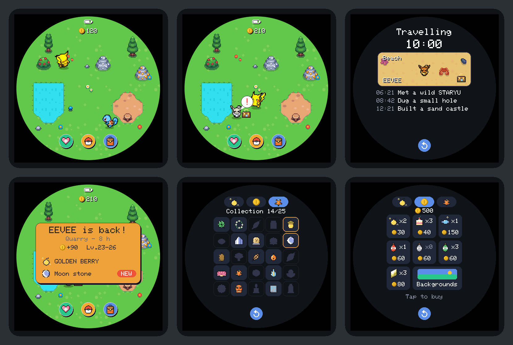
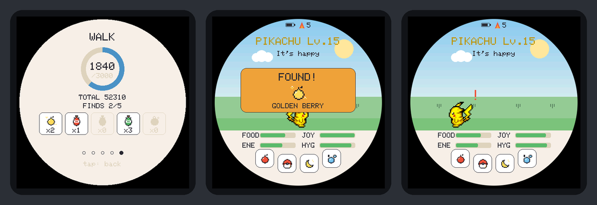

# TamaPoke


[](https://github.com/Ale-Cuevas/TamaPoke/actions/workflows/ci.yml)


A gen-1-Pokémon-inspired tamagotchi for the
**Waveshare ESP32-S3-Touch-AMOLED-2.16** (square 480×480 AMOLED, CO5300 driver
over QSPI, CST9220 touch over I2C). Raise any of the 151, evolve it, train it
and complete them all (shinies included).

This is a port of [socquique/TamaPoke](https://github.com/socquique/TamaPoke),
which was designed for the round **AMOLED-1.75**. The round screen is kept: the
game draws its original 466×466 UI and the display layer centres it on the
square panel inside a smooth round frame, with the rest of the panel black (on
an AMOLED, black pixels are simply off). The yard is the exception (v2.5): its
map fills the whole square panel, while the pets, the HUD and every tap stay
in the same circle. How and why:
**[docs/AMOLED-2.16.md](docs/AMOLED-2.16.md)**.



<sub>Rendered from the real firmware drawing code by `tools/render/render.sh`:
these are the pixels the panel receives.</sub>

> **Personal, non-commercial fan project.** Code is MIT; the sprites are from
> PMD SpriteCollab (CC BY-NC, Pokémon © Nintendo/Game Freak). See
> **[License](#license)** and **Credits**.

## Status

**v3.0: two pets at home.** Home now has two places, and both pets live at the same time: each gets hungry,
tired and bored, poops, sleeps, grows and can die on its own. Fill the second place by waking a pet from the Box
or hatching an egg from the Backpack (after updating it starts empty). Tap a pet to see its card; Care and Play
then look after that pet. Walking gives its JOY, bond and levels to both awake pets. Box pets no longer walk in
the yard. Going back to v2.x loses the pet in the second place.

**v2.0: the yard.** The home is now a top-down pixel-art yard where the pet (and the first pet of the Box)
wanders, eats food dropped on the grass, leaves poops and finds gifts where it stands, and says how it feels
in speech bubbles. A thin HUD floats on top: the battery, your **coins** and a 3-button dock
(**Care**, **Play**, **Bag**). Eggs sit in the yard and hatch in 2 h (shake the board to speed them up).
Games, stages and walks earn coins to spend in the **Shop** (a tab of the Bag): items, and new
**backgrounds** for the yard. Menus are dark panels. The maps come from the Sunnyside World tile pack and are
packed on your PC (see [Yard backgrounds](#yard-backgrounds)). Design: [docs/yard-prototype/DESIGN_YARD_UI.md](docs/yard-prototype/DESIGN_YARD_UI.md).

**v2.1: travel and the Collection.** From the Play panel, send a Box pet on a 1 h, 3 h or 8 h trip to one of
your backgrounds (real time, also with the board off; needs the clock set). The trip view shows a countdown
and a log of what happened. Back home, the pet waits in the yard with its suitcase and a "!": tap it to see
what it brought (coins: 50 / 150 / 400 for 1 h / 3 h / 8 h since v3.11, growth, sometimes an item, often a souvenir). The 25 souvenirs, 5 per background,
fill the **Collection**, the third tab of the Bag. Serial `TRAVEL`, `TRAVEL <slot> <map> <0-2>`,
`TRAVELT <min>`, `TRAVELEND`, `SOUV [mask]`.

**v2.2: wild encounters.** Once in a while (v3.11: 60 % of days, plus a 50 % chance at 3,000, 6,000 and 10,000 steps, more after trips)
a bush, rock or lump of sand starts shaking in the yard with an excited jingle. Tap it to meet a wild pet,
pick one fighter and battle it; win to grow your pet and maybe find an item, then throw a **Poké Ball** to
catch it as an egg that hatches its first form at Lv 1. Omanyte, Kabuto, Aerodactyl, Dratini and Mew only come
this way. See [Wild encounters](#wild-encounters-v22).

**v2.3: pet it.** The Care panel has a card next to the light: the heart. Tap it and the
pet gets +20 JOY (+5 before v3.1), shows a heart and does its happy pose, so JOY no longer needs food or items.

**AMOLED-2.16 port (v1.19):** builds (PlatformIO and arduino-cli, pinned
versions), passes the host test suite, and every screen has been rendered and
checked on the PC. **Tested on a real 2.16" board on 2026-11-04**: bring-up and
game work; the results and the few checks still open are in
[docs/DEVICE_TESTS.md](docs/DEVICE_TESTS.md) (summary in
[docs/PENDING_TESTS.md](docs/PENDING_TESTS.md)).

**v1.20: steps and motion tricks.** The board's QMI8658 IMU now counts steps
in software (walk care, a daily goal, items found on walks, a Backpack, and a
5th **WALK** page on the stat card showing today's steps), and the board reacts
to being shaken, laid face-down or tilted. Built, host-tested against real
captures from the board and rendered on the PC; the on-board checks (step
accuracy, battery drain, 400 kHz I2C) are listed in
[docs/DEVICE_TESTS.md](docs/DEVICE_TESTS.md#steps).

**v1.65: battle stages.** The battle button of the Play menu (v1.24 had a single
random practice fight) now opens **8 themed stages**, each with two minions and a
boss, fought by a **team of up to 4 pets** (the home pet and/or pets from the Box)
whose HP carries over from one fight to the next. Beating a boss pays once a day
per stage (growth and bond for the whole team, plus a gift) and the first clear
earns a **badge**, shown on a second page of the Box. Battles are automatic and
use real Gen 1 base stats and types (Flying and dual types included); tapping the
screen charges a special attack. See [Battles](#battles-stages-v165). Built,
host-tested and rendered on the PC; the on-board checks are in
[docs/DEVICE_TESTS.md](docs/DEVICE_TESTS.md#battle-stages-v165).

**v1.41: after an ending, you choose when to hatch.** A release, farewell or runaway (a death since v1.60) leaves
the home empty with a **Hatch an egg (N)** button; no egg comes home by itself. A farewell
leaves an egg in the Backpack, and with no egg and nobody in the Box a gift egg goes there
(v1.40). The egg waiting from the Box counts as one of yours.

**v1.43: the waterfall.** A new game in PLAY trains DEFENSE: the pet meditates under a
waterfall, you hold the screen to raise its focus and let go to lower it, and keep the gauge in
the green band for 45 s while the band slowly narrows (and from 30 s drifts up and down for bonus DEF) and surges of water push it down. A full session
also clears all of that pet's poops (since v3.1; it used to wash the pet).

**v1.44: the sled run.** Another new game in PLAY trains SPEED: the pet rides a sled down a
slope and you tilt the board to dodge rocks, logs and bushes that come faster and faster. A short
countdown takes however you hold the board as "straight", so it plays upright or lying face up.

**v1.39: eggs are found by walking.** A new egg no longer appears for free after
an ending or a store: you find eggs on walks, about 3 a week at 5000 steps a
day. With none, the home stays empty until you find one. Host-tested (300
simulated weeks, and a power cut after every flash write of the new Box moves)
and rendered on the PC; the on-board checks are in
[docs/DEVICE_TESTS.md](docs/DEVICE_TESTS.md#eggs-v139).

**v1.37: the Box.** Swipe right for a 6-slot box where pets hibernate while you
raise another; wake one to swap them back. Host-tested, including a power cut
after every single flash write of every move, and rendered on the PC; the
on-board checks are in [docs/DEVICE_TESTS.md](docs/DEVICE_TESTS.md#box-v137).

The game itself runs on the 1.75" hardware upstream. Implemented: the 151 +
shinies animated from microSD, full life cycle (egg by rarity → evolution → farewell/release/death, each gated
behind a decision dialog), bred-Pokédex with gallery, a 6-slot box to hibernate pets, 8 battle stages with
a team of up to 4 and badges (long fights end in sudden death: no defense and 10 % recoil from the 21st attack), battle stats (genes + training), retention hooks (streak / bond / medals / name), biome + real-time
backgrounds, ball minigame, training bag, RTC with offline
progression, battery (AXP2101) and PWR button, AMOLED burn-in protection (pixel orbit + screensaver),
**sound (ES8311)**, **8 UI languages (English default)**, **starter choice on
first run**, and a one-click **web installer**.

Pending: linked battles (designed, not implemented), soak test. See **Roadmap**.

## Game manual (the actual numbers)

A quick reference to how the game really works (values straight from the code). Every one of these numbers is
defined in [`tuning.h`](tuning.h): change it there to tune the game.

### Time & leveling
- **1 real minute = 1 in-game minute.** Each level costs more than the last (v1.35; faster
  curve after v1.49), as a stronger pet is harder to raise:
  - **Lv 1–10:** 20 min per level;
  - **Lv 11–89:** a log curve, `20 + 100 · ln(L − 10) / ln 80` minutes, rising from 20 to 120;
  - **Lv 90 on:** 2 h per level.

  | Level | 10 | 16 | 20 | 25 | 31 | 36 | 40 | 50 | 55 | 90 |
  |---|---|---|---|---|---|---|---|---|---|---|
  | Reached after (no walking) | 3 h | 6.8 h | 11 h | 18 h | 26 h | 34 h | 40 h | 2.4 d | 2.7 d | 5.5 d |

  Updating from the old 3 h curve keeps every pet's level (and how full its bar is), boxed pets included.

- Levels come from a **growth** counter that runs with the pet's age (awake or asleep, and
  while powered off) and that the Rare Candy can push ahead. Age stays real time: the days on
  the card and the 3-day farewell don't move. Caring well doesn't speed leveling up, but
  neglect *delays evolution*.
- It keeps **aging and growing while powered off** (the RTC runs), catching up to **2 weeks** max.
- A pet from before v1.35 keeps its level and how full its bar was.
- **Level-up (v1.30):** a rising jingle as soon as it happens, even with the screen off
  (the screen stays off; asleep, it waits for the wake). On the home screen there are
  sparkles and a "LEVEL UP!" pill ("Lv.12 > Lv.18" after time away), then the ATK/DEF/SPD
  it gained.

### The three stats (0–100)
Needs: **FOOD**, **JOY**, **ENE** (energy). Start 80 / 80 / 80. (Hygiene and the bath were removed in v3.1: poops
now weigh on JOY instead.)
While **awake** (v3.11: half as fast as before):

| Stat | Drain | Notes |
|---|---|---|
| FOOD | −1 per min | |
| ENE | −1 every 2 min | −1 extra if overweight (weight > 50 → sluggish) |
| JOY | −1 every 2 min | **−1 extra per min** if FOOD < 30; plus the stale-poop drain below |

- ~**5 %/min** chance to poop (only if FOOD > 40; about one every 20 min, it was 15 % before v1.58).
  **Tap a poop** to clear it, awake or asleep (it counts as the day's care, no bond). A poop that has been on
  the ground **more than 5 minutes** is *stale*: while the pet is awake, every 3 minutes it costs JOY — 1 with
  one stale poop, 2 with two, 4 with three. Fresh poops cost nothing, and nothing drains asleep. A full
  waterfall session clears all of that pet's poops.
- **Need alarm (v3.11):** when a need of an awake pet drops to **15 or less**, the board plays two low beeps
  every 2 seconds (also with the screen off) until you take care of it. It waits while a game, battle or
  encounter is open, stays quiet while the pet sleeps or at volume 0, and stops once every need is at 0.
- **Care slip-up** = letting any stat hit **≤ 10** (then it takes 60 awake minutes before another one can count).
  Each slip-up **delays evolution by 1 level** and cools the bond.

### Actions
**Tap a pet** in the yard to open **its menu** (v3.3), a column on the right of the screen: **Sleep** (or
**Wake**), **Food**, **Care** (the heart) and **Status** (its stat card), plus a highlighted **Evolve** or
**Farewell** row when it's ready (a "!" floats over a pet that is). The pet stands still with a ring at its feet
(if it was under the menu it first steps aside to the left, and so does the other pet). What it can't do right now is grey and shakes
(Food and Care while asleep). Tap outside the menu, swipe or press USER to close it; tap the other pet to switch the
menu to it. It closes by itself after 30 s untouched.

- 🍎 **Plain berry** (v3.2): the only **free, unlimited** food: +20 FOOD, nothing else. It is always the
  first row of the menu's food list.
- 🫐 **Coloured berries** (v3.2, six: red, blue, green, yellow, pink, orange): items you collect (Bag, page 2).
  Any coloured berry beats the plain one: **+30 FOOD, +3 JOY**. Each evolution line has one **hidden favourite
  colour**, fixed by the line's first form, so it never changes when the pet evolves. Feeding the favourite gives
  **+35 FOOD, +12 JOY, ♥, +2 bond** and reveals it: the stat card then names it and the food list marks it with a
  gold frame and a star. Every pet (including the old ones after updating) starts with its favourite unknown.
  Sources: **Shop: 25 coins for a pack of 5** (page 2, v3.11; up to 30 of each colour), stage boss loot, wild-pet drops, walk finds and trips (a random colour
  each time).
- 🍰 **Cake** (v1.54, in the food list): **limited**, found on walks
  (and won from stage bosses). It fills FOOD to 100 and **keeps it full for 3 hours** (the bar turns pink and
  the status says "So full!"; games don't make it hungry either, and the time counts while the board
  is off), +12 JOY, but **+12 weight**. It has no favourite.
- 🍽️ **The food list** (menu → Food, v3.3): the plain berry, then every food you own (coloured berries in order,
  cake, Golden Berry) with how many are left, 3 per page (the bottom row is ← back, and "1/2 ▸" with more pages).
  The food you pick appears **in front of the pet** (once it has stepped out from under the menu) and it eats it
  **as soon as it finishes what it was eating**; one food per pet at a time (the list is grey until then, and a food
  already chosen for one pet can't be given to the other). Food is only used up when the pet has eaten it.
- ⚽ **Play:** a menu with all the games (v3.3: with both home pets awake, it asks **who plays**: two cards with
  their name and level; with only one awake that one plays): the **ball minigame** (+JOY, −ENE; trains **SPEED** and
  burns weight; the ball keeps speeding up as you score: twice as fast at 80 as at 1, up to 3×),
  the **battle stages** (+3 JOY for a finished run, at most once an hour; a boss reward can bring an
  item home; see Battles below), the training bag, the
  sled run and the waterfall.
- 🥊 **Training bag** (third slot of the Play menu): trains **STRENGTH** (~4 hits = 1 pt, cap
  +18/session), tires it.
- 🛷 **Sled run** (fourth slot, v1.44): tilt the board to steer the sled around obstacles that come
  faster and faster (2× at 40 s, 3× at 80 s); three hits end it. Trains **SPEED** (1 pt per 6 rows
  dodged, so ~8 for 50 rows; cap +18/run), burns a little weight. Needs the IMU.
- 🌊 **Waterfall** (fifth slot, v1.43): hold the screen to raise the focus gauge, let go to lower
  it; keep it in the green band for 45 s. Trains **DEFENSE** (1 pt per 3.5 s in the band, cap
  +8) and clears that pet's poops; no weight burn. From 30 s the band drifts slowly up and
  down: time in it then gives **bonus DEF** (1 pt per 4 s, up to +3, so +11 for a perfect
  session).
- 💗 **Care** (the heart in the pet's menu, v2.3): +20 JOY (v3.1), a heart and its happy pose; bond at most once
  every 15 min. Free and as often as you like, awake only.
- 🌙 **Sleep:** rest — ENE **+6/min**, needs drain ~**4× slower** than awake (FOOD and JOY −1 every 4 min) with floors
  (FOOD 30 / JOY 35). No poops, no slip-ups, and neglect doesn't count while asleep.
- 🌃 **Night (v1.63, needs the clock):** from **22:00** the pet is sleepy (a thought bubble with "zzz",
  "Getting sleepy..."). Putting it to bed while it's sleepy gives **+3 bond**, once a night. At **23:00** it
  goes to bed by itself (no bond); woken before 09:00, it falls asleep again after 30 minutes awake. Asleep
  between 22:00 and 09:00 the needs drain a quarter as fast as in a nap (FOOD and JOY −1 every 16 min since v3.13),
  with higher floors (FOOD 50 / JOY 50): a pet put to bed full at 23:00 wakes up at 09:00 with about 62. At **09:00** (v3.11; it was 08:00) it wakes up by
  itself with a short tune (also with the screen dark). A nap in the afternoon isn't woken, unless it lasts
  into the night. All of this also happens with the board off.
- **Feedback (v1.30):**
  - the bars slide, and every action floats a "+N" over what it changed;
  - bond rising shows a small heart;
  - training shows "ATK +3";
  - a slip-up shows a "!";
  - a button that can't be used (asleep) shakes;
  - celebrations (level-up, medal, streak, step goal) come one at a time, each when you
    can see it.

### Eggs & who you get (spawn odds)
- **First ever pet:** you pick a starter — **Bulbasaur / Charmander / Squirtle**.
- Hatch the egg: tap it **3×** (or wait — it hatches on its own).
- **Eggs are limited (v1.39):** after the starter, you only get eggs by **walking**,
  one every 8000–15000 steps at random (about **3 a week at 5000 steps a day**, 2 to 4
  in any week). All steps count, also while the pet sleeps or an egg is at home. An
  egg goes into the Backpack (up to 9). Storing the pet in the Box brings one home; after
  an ending the home stays empty and you hatch one with its button (v1.41). With none, the home stays
  **empty** ("NO EGG", today's steps, the Pokédex, and a hint when the Box has pets
  to wake) until you find one; it then goes straight home.
- **Never stuck (v1.40):** when a pet leaves and you have no egg and nobody in the Box, a
  **gift egg** goes into the Backpack. A **farewell** always leaves an egg as its reward.
- **After an ending (v1.41)** the home is empty; with eggs it shows "Your eggs are waiting!"
  and a **Hatch an egg (N)** button.
- Every later egg rolls a **rarity tier** (over the ~79 base forms that come from eggs):

| Tier | Base chance | After a proper goodbye | # species |
|---|---|---|---|
| ✨ Legendary | ~3 %\* | ~10 % | 4 |
| 🔵 Rare | ~27 % | ~45 % | 23 |
| ⚪ Common | the rest | the rest | 47 |

  \* Legendaries only start appearing once you've **registered ≥ 25** Pokémon.
- **Not from eggs (v2.2):** Omanyte, Kabuto, Aerodactyl, Dratini and Mew only come from
  [wild encounters](#wild-encounters-v22).
- A daily **streak** and high **bond** push rare/legendary odds higher.
- **Egg colours (v2.4):** an egg shows the type of the pet inside. One type: the whole egg in
  its colour (Grass green, Fire orange, Water blue...; Normal cream). Two types: the first in the
  upper-left, the second in the lower-right, blending on a diagonal (Zapdos: yellow → sky blue).
  Eggs still in the Backpack keep the classic cream look.
- A clean **goodbye blesses** the next egg; a **death by neglect curses** it (forces Common).
- Within a tier it favors species whose **evolution line you haven't finished** (so
  all 151 are completable).
- **Shiny:** base **1 / 48** (→ **1 / 24** right after a goodbye), improved by
  streak/bond down to a best of **1 / 8**. Tracked separately in the dex.
- Every hatch rolls unique **genes** (90–110 % per stat) — no two are identical.

### Evolution
- Triggers when **level ≥ its evolution level** (16 for most base forms; ~30 for
  stone-style, ~40 for trade-style) **and every stat ≥ 40** at that moment.
- **Never automatic** — a "!" floats over the pet and its menu gets a red **Evolve** row: **you tap to witness
  it** (with a flicker between the old and new form). Each **slip-up delays it by 1 level**.
- You can **decline** ("keep form"); it re-offers at the next level.
- *Eevee* branches toward whichever evolution you're still missing.

### The three endings (you choose & witness each — none auto-fire)
- 💛 **Farewell** — when it's a **final form** that has lived **3 days**. A "!" floats
  over it and its menu gets a gold **Farewell** row; triggering it **blesses your next egg**. You can **postpone** ("stay
  together", re-offered in a day). The good ending.
- 💔 **Death by neglect** (v1.60, it replaced the run-away) — with **all three needs at 0**
  (awake, board on), the status says "It feels abandoned..." and the **bond drains** from full to 0
  in **30 minutes**. With the bond at 0 ("It's very weak!"), **30 more minutes** and the pet is
  dying. Any need above 0 stops the count, but the lost bond stays lost. Asleep or with the board
  off it never counts (the needs don't reach 0 there).
  - A dialog waits (USER doesn't close it): "X is dying... Use a Revive? (N)", and the header counts the
    **minutes left: a Revive has 1 hour** (v1.64, real time: it runs with the board off too). After that
    the dialog says "X has died... No Revive in time" with only OK, and the ending follows (the egg too).
    **YES** spends a Revive: the needs come back to 50, the bond stays at 0 and it counts a slip-up.
    **NO** (or **OK** with no Revives left) is the end: rain, the pet fades, "It has passed away...".
  - From **level 50**, there's a **60 %** chance it leaves an **egg of its line** (the first form),
    which goes straight home ("It left an egg..."). Otherwise the home is empty, as after any ending.
  - It **curses the next random egg** (forces Common). The sad ending.
- 👋 **Release** — long-press the creature to let it go on your terms (neutral).

After any ending the home is empty (v1.41). The egg that was waiting while you woke a pet from the
Box (see below) goes into the Backpack, and a farewell adds one more as its reward. With eggs, the
empty home's **Hatch an egg (N)** button brings one home when you want; with none, wait for one on
a walk or wake a pet from the Box. With no egg and nobody in the Box, a gift egg goes into the
Backpack ("A new egg will come" in the Release dialog); with pets in the Box the dialog warns "No
egg: home stays empty".

### The Box (v1.37)
Swipe **right** from the home screen (pet or egg) to open the Box: **6 slots** where pets
**hibernate** while you raise another. Swipe left, tap the title or press USER to go back.
The Box has one page (v3.4: the battle **badges** moved to the [USER page](#the-user-page-v34); until v3.3 they
were its second page). The pets in the Box can also fight in the
battle stages as part of your team, and a boss reward gives them growth and bond right in their slot.
- **Store:** tap an empty slot (it shows a "+" when the current pet fits) and confirm. The
  pet goes in, and an egg takes its place: the egg that was waiting, or one from the
  Backpack (v1.39). With neither, the dialog says "No egg: home stays empty" and the home
  stays empty ("Now: Empty"); wake any stored pet to fill it again. Storing
  is not an ending, so it doesn't change the next egg's odds. A sleeping pet can be stored
  and comes back asleep. Not while it's evolving or saying goodbye.
- **Wake:** tap a stored pet and confirm. With a hatched pet active, the two **swap
  places** in that slot (so a full box can still swap). With an egg active, the egg **waits
  as it is** (species, shiny roll, cracks; a small sleeping egg shows next to "Now") and
  comes back after your next store or ending: storing and waking never re-roll an egg, or
  spend the Shiny Charm twice.
- **Hibernation is total:** a stored pet doesn't age, grow, get hungry or slip up, not even
  while the board is off. Farewell age and evolution levels only count time spent active. The one exception is a battle stage's boss reward (+60 growth minutes, +5 bond).
- Each pet keeps its own **bond**, daily bond cap and what it already counted for your **medals** (v3.4: a pet
  counts once, wherever it goes). Streak, steps, finds,
  goals, the Backpack, records and the Pokédex are yours and stay put; the first care of the
  day gives its +4 bond once a day, to whoever is active.
- Slots show the pet dimmed with a "z", its name, level and a star if it's shiny. A slot
  whose data is damaged shows **"?"** and is never loaded or overwritten.
- Moving a pet writes to flash at once, right after a light flies between the pet and its
  slot; the write itself takes a fraction of a second. A power cut at any moment never loses a pet: the next boot finishes or
  undoes the move.

### Bonds, streaks, medals, Pokédex
- **Streak** (player-wide, survives across pets): first care each real day; milestones
  at **3 / 7 / 30 / 100** days; skipping a day breaks it.
- **Bond** (per pet, resets on hatch): grows with affection (**cap +10/day**, plus +4 for
  the first care of the day; petting counts once per 15 min), so max bond takes about
  8 days of full care. Cools on neglect. Both streak & bond improve egg/shiny odds.
- **Medals** are the player's (v3.4; until v3.3 each pet had 9 of its own): see [Medals](#medals-v34).
- **Pokédex:** raising a species registers it; **151 + shinies** to complete.

### Medals (v3.4)
**19 medals**, each with three tiers: **Bronze**, **Silver** and **Gold**. Each tier pays its coins once, the
moment you reach it: **Bronze 25, Silver 75, Gold 200**, outside the daily cap. A banner says "MEDAL!", the
medal, the tier and the coins. They're on the first page of the [USER page](#the-user-page-v34).

| Medal | What counts | Bronze / Silver / Gold |
|---|---|---|
| Growing up | pets raised to Lv 10 | 2 / 6 / 15 |
| Seasoned | pets raised to Lv 25 | 1 / 4 / 10 |
| Master raiser | pets raised to Lv 50 | 1 / 4 / 8 |
| Best friends | pets at bond 100 | 1 / 3 / 8 |
| Full grown | pets in a final form | 2 / 5 / 12 |
| In shape | pets at Lv 10 with weight 0 and no slip-ups | 1 / 3 / 8 |
| Gourmet | favourite berries found | 2 / 6 / 15 |
| Evolution | evolutions | 3 / 10 / 30 |
| Happy farewell | farewells | 1 / 3 / 8 |
| Pokédex | species registered | 15 / 50 / 120 |
| Shiny | shiny species registered | 1 / 3 / 8 |
| Daily care | best streak (days) | 7 / 30 / 100 |
| Walker | total steps | 50 000 / 250 000 / 1 000 000 |
| Marathon | days with 10 000 steps | 1 / 10 / 30 |
| Stage champion | stages beaten | 3 / 6 / 8 |
| Wild tamer | wild Pokémon beaten | 3 / 15 / 40 |
| Catcher | captures | 1 / 5 / 15 |
| Globetrotter | trips completed | 3 / 15 / 50 |
| Collector | souvenirs | 5 / 15 / 25 |

- The first seven count **pets**: each pet counts **once** for each of them, the first time it gets there, even
  if it later goes to the Box, comes back, changes home slot or loses it (bond, weight). A pet that grows in the
  Box (a boss reward, a wild win, a trip) counts when you wake it.
- Evolutions, farewells, Marathon days, wild wins, captures and trips count from v3.4 on. The rest (Pokédex,
  shinies, best streak, steps, badges, souvenirs) read what you already have.
- **Updating from v3.3:** both home pets and every Box pet count once with what they are now (level, bond, form,
  in shape, favourite found), and every tier already reached is paid in full at once, with its banners.

### Battle stats
ATK / DEF / SPD = real **Gen-1 base** × genes + level + training (STRENGTH ← bag,
SPEED ← minigame and sled run, DEFENSE ← waterfall and 12 h of unbroken good care; vitamins from walks add
+3 each). They are what battles use, with the level capped at 100.

### Battles: stages (v1.65)

PLAY → the crossed swords opens the **stage list**: 8 tiles in a 2 × 4 grid, in order. Stage 1 is open;
beating a stage's boss opens the next, and cleared stages can be replayed. A locked tile is grey and a tap
shakes it with the deny sound; an open one shows its level range; a cleared one has a green border and its
badge. An **amber dot** marks a stage whose boss reward is still available today. Tap the title to go back.

| # | Stage | Minions (level) | Minion training | Boss (level, training) |
|---|---|---|---|---|
| 1 | Grass | 15–20 | 20–35 | Ivysaur, 20, 40 |
| 2 | Water | 25–30 | 30–40 | Wartortle, 30, 50 |
| 3 | Rock / Ground | 35–40 | 50–55 | Golem, 40, 60 |
| 4 | Fire | 40–45 | 60–65 | Arcanine, 45, 65 |
| 5 | Electric | 50–55 | 60–65 | Electabuzz, 55, 65 |
| 6 | Ghost / Psychic | 60–65 | 60–65 | Gengar, 65, 70 |
| 7 | Poison / Bug | 65–70 | 60–65 | Nidoking, 70, 70 |
| 8 | Dragon | 70–80 | 70–75 | Dragonite, 80, 80 |

Each stage is **3 enemies in a row**: two minions of different species from the stage's theme (each at a random
level in the range and with its own random training per stat), then the fixed boss at the top level. Foes have
average genes (100) and are never shiny. Training is the same 0–100 scale as yours (ATK, DEF and SPD each).

**The team.** After you pick a stage, a picker shows the **home pet and every pet in the Box**. Tap a pet to add
it (a number shows its place in the order), tap it again to remove it (the ones behind move up). You can take
1 to 4; a fifth, or a pet that can't fight (one on a trip; sleeping pets can fight since v3.12), shakes with the deny sound. The last team is
pre-selected. **Start** begins; tap the title to go back to the list.

**The fight.** It is **automatic**, as before: the pets take turns attacking until one faints. What changes:
- **HP is not restored inside a stage.** When an ally faints, the next one in your order comes in against the
  *same* foe, at the foe's remaining HP. When a foe faints, the *same* ally carries on against the next foe with
  what it has left. The stage is **lost** when all your pets have fainted and **cleared** when the boss does.
- Fights go to a **knockout**: no 15-attack cap and no draws. Every hit takes **2–60 %** of the target's
  max HP (70 % for a special), so one fight is never over in fewer than 3 attacks.
- **Who wins** is as in any battle: real **Gen 1 base stats** × genes + level + training, and the **Gen 1
  type chart** (15 types, dual types multiply, and each attack uses the attacker's stronger type, e.g. Electric is ×4 on Gyarados and does nothing to Diglett). The
  faster pet attacks first each round; 1 hit in 16 is a critical (×1.5).
- On screen: one pip per team pet in your HP box (grey once fainted), the foe's HP box has "1/3", "2/3" or
  **BOSS** under it, and a caption ("Next rival" / "Go, X!") shows while the next fighter walks in.
- **Your one input: tap the screen.** 5 taps fill the meter of five arrows (`> > > > >`, with a "Tap!" box next
  to it while a tap counts) and your next attack is a **special** (+30 % power, up to 70 %, with a flash and a
  shake). After a special the meter rests for 2 normal attacks, and a new ally starts with an empty meter. Taps
  count only during the fight itself, not on the VS card or between fighters. The **first foe never uses a
  special**, the second uses it **sparingly**, the boss at the rate of the old practice opponent (about one
  attack in three).
- The USER key, PWR (to the screensaver or off) or the dying dialog **quits with no reward**: nothing is saved
  mid-run, so the stage just ends. The result ignores taps for its first 1.8 s so the taps that charged the
  special don't close it unseen, and closes by itself after 7 s.

**Rewards.**
- **Boss reward, once per day per stage:** beating the boss gives **every pet of the team** (including the ones
  in the Box and the ones that fainted) **+60 growth minutes** and **+5 bond** (outside the daily bond cap), and
  **one item from the loot table below, guaranteed**. The item arrives as a wrapped gift ("A gift at home!"
  under the title; open it to see what it is), or straight into the Backpack when the home is empty. Clearing
  the same stage again the same day pays nothing more; the amber dot goes away. A boxed pet that passes its
  evolution level this way evolves once it's woken; the home pet's level-ups celebrate as usual.
- **Badge:** the **first clear** of a stage earns its badge (ES: insignia), for good. It's the player's. The
  badges count for the **Stage champion** medal (3 / 6 / 8).
- **Joy:** a finished run, won or lost, gives the home pet **+3 JOY**, at most once an hour.
- Stage battles aren't counted in any win/loss record.

  | Loot | Odds |
  |---|---|
  | Cake | 22 % |
  | Poké Ball (v2.2) | 8 % |
  | Golden Berry | 20 % |
  | Coloured berry (v3.2) | 10 % (a random colour) |
  | Protein / Iron / Carbos | 21 % (7 % each) |
  | Rare Candy | 7 % |
  | Revive (v1.59) | 5 % |
  | Shiny Charm | 4 % (a cake if you already hold one) |
  | Egg | 3 %, the rarest |

**Badges page** (v3.4: the 3rd page of the [USER page](#the-user-page-v34); it was the Box's 2nd page). It
shows "Badges n/8" and the 8 badges: the ones you've earned in colour with the stage's name, the rest as a grey
silhouette with "???".

Battles between two boards over the air are next (see the roadmap).

### Wild encounters (v2.2)
- **When (v3.11):** one in the yard at a time, up to **four a day**. A **60 %** roll at a random time between
  9:00 and 20:00 (the same time all day, a restart doesn't change it). Walking **3,000, 6,000 and 10,000 steps**
  each adds a **50 %** roll that can bring another one even after the day's first (if one is still in the yard,
  the roll waits until it's gone). Every trip that comes back adds a roll of **3 % per hour** (1 h 3 %, 3 h 9 %, 8 h 24 %). Rolls need
  the clock set and someone to fight (the home pet or a Box pet); missed ones happen when the board turns on.
- **In the yard:** a bush (Meadow, Forest), a rock (Quarry, Ruins) or a lump of sand (Beach) that shakes every
  2.4 s with two red curved marks on each side, for **6 hours**. It plays an excited jingle when it appears
  (after the pet wakes, if it was asleep). An exclusive one sparkles.
- **The encounter:** tap it. Two black bands close in and the wild pet appears in a circle with its level;
  tap again to choose **one** fighter, then the battle (the stage rules, one foe). Its level is centred on the
  boss level of the **highest stage you've cleared** (10 with none), ±15 at most and usually within ±7; it
  has evolved as far as that level allows, and is trained like that stage's minions.
- **Who:** 95 % a common or rare line (no legendaries); lines whose type fits the yard map are **3×** as
  likely. 5 % one of the **exclusives**: Omanyte, Kabuto, Aerodactyl, Dratini (24 % each) or Mew (4 %).
  Shiny with the egg's odds.
- **Win:** the fighter gets **1 h of growth** (the home pet also +3 JOY), and **50 %** of the time an item
  goes straight into the Backpack:

  | Drop | Odds |
  |---|---|
  | Cake | 25 % |
  | Golden Berry | 25 % |
  | Coloured berry (v3.2) | 10 % (a random colour) |
  | Protein / Iron / Carbos | 21 % (7 % each) |
  | Rare Candy | 8 % |
  | Revive | 7 % |
  | Shiny Charm | 4 % (a cake if you already hold one) |

- **Poké Ball:** then "Throw a Poké Ball?" (Throw / NO). A throw **always catches**: the ball shakes three
  times and clicks, and an **egg** goes into the Backpack. It hatches the **first form** of the caught pet's
  line (a Dragonite gives a Dratini) at **Lv 1**, shiny if it was. Captured eggs come out of the Backpack
  before the others; up to 4 can wait, and the egg's bubble says "Captured egg!". NO lets it go. Balls: 3 to
  start (and once on updating), Shop 100 coins, stage boss loot (8 %), travel finds.
- **Lose** (or quit the fight with USER / PWR): it **flees**. Leaving the intro or the picker with back keeps it
  in the yard.

### Steps, finds & the Backpack (v1.20)



Carry the board in a pocket, a bag or your hand: the IMU counts steps whenever
the board is on, screen lit, dimmed, off (PWR) or asleep. Steps only start
counting after **8 in a row**, and shaking the board pauses the counter, so
waving it around doesn't farm anything.
- **Steps today** (reset at local midnight) and a **lifetime total** belong to
  you, not to the pet: they survive a new egg and a restart.
- While the pet is **hatched and awake**, walking is care: **+1 JOY per 100
  steps** (at most +30 a day), **−1 weight per 1000**, **+1 bond per 1000** (the
  daily bond cap still applies). Walking costs no energy.
- **Daily goals: 3000, 6000 and 10000 steps**, each once a day (a banner and a
  jingle when you next look at the screen):

  | Goal | Reward |
  |---|---|
  | 3000 | **+1 level**, +10 JOY, a bonus find, and the day counts toward your **streak** |
  | 6000 | **+1 level**, +10 JOY, +2 bond, a bonus find |
  | 10000 | **+2 levels**, +15 JOY, +3 bond, and the **Marathon** medal the first time. Meant for long walks, not every day. |

  Walking can add up to 4 levels a day (v1.36). The levels keep how full the level bar was
  and don't age the pet; the banner shows "+N Lv" and the level-up plays as well. The goal
  bond comes on top of the daily bond cap. Like every walking reward, the levels and the
  rest need the pet awake: a goal crossed while it sleeps only marks the day (and the streak).
- **Finds:** every 800–1200 rewarded steps the pet finds something (at most 5 a
  day; the goals' gifts come on top). Since v1.55 each find arrives **wrapped**: a small white box
  with a red ribbon on the floor of the home screen, to the right (up to 3 in a pile, "+N" for
  more). **Tap a gift** with the pet awake to open it: the pet is happy, "GIFT!" shows what it was,
  and it goes into the Backpack (tap to dismiss). Asleep, gifts wait. A tap opens the first gift that
  fits; when none fits, the popup says "Backpack full" and they stay wrapped until there's room. Up to 8 wait unopened (kept across
  restarts); past that a find goes straight into the Backpack with the popup. When the home is left
  empty (an ending, or the pet stored in the Box), gifts unwrap themselves into the Backpack, and a
  wrapped egg counts as one of your eggs.

  | Item | Odds | Use |
  |---|---|---|
  | Golden Berry | 28 % | +50 FOOD, +15 JOY, a heart |
  | Cake (v1.54) | 17 % | FOOD full for 3 h, +12 JOY, +12 weight (the pet menu's food list, or the Bag) |
  | Coloured berry (v3.2) | 10 % | A random one of the 6 colours: +30 FOOD, +3 JOY (the favourite: +35 FOOD, +12 JOY, ♥) |
  | Protein / Iron / Carbos | 30 % (1/3 each) | +3 ATK / DEF / SPD training (cap 100) |
  | Shiny Charm | 10 % | Held, not used: the **next egg** gets ×3 shiny odds (never better than 1/8). One at a time; a second one becomes a Golden Berry. |
  | Revive (v1.59) | 5 % | Not used by hand: when a neglected pet is dying, a dialog offers it to save the pet. A new game starts with **3**. |
  | Rare Candy | the 10000 goal, v1.25–v1.35 (it now gives +2 levels directly) | **+1 level**, keeping how full the level bar was, without ageing the pet (it can make the pet ready to evolve). Candies already in the Backpack still work. |
  | Egg | every 8000–15000 steps (v1.39), apart from the finds above and their daily cap; wrapped as a gift since v1.55 (straight home if the home is empty) | Not used by hand: it comes home by itself when home is free (an ending, or the pet stored in the Box). |

- The **Backpack** holds up to 9 of each item. Since v1.53 it has its own button (the
  backpack, in the middle of the dock): every item with its count (a 4 × 3 grid since v2.2), greyed
  when you have none, and a hint below. Tap an item to use it (a YES / NO dialog); with both home pets able to
  use it (foods, vitamins, Rare Candy), it asks **who gets it** instead (v3.3). The Charm, eggs,
  the Revive and the Poké Ball aren't used by hand (a tap on the Revive or the ball says what it's for). It opens while the
  pet sleeps too, just to look.
- The **WALK** page (v3.4: the 2nd page of the [USER page](#the-user-page-v34): swipe up, then left once; it was
  the stat card's 5th page) shows today's steps with a ring toward the next goal and a flag per goal reached, the
  total and today's finds (random ones out of 5, "+n" for the goals' gifts).

### The USER page (v3.4)
Swipe **up** in the yard: your page, with 4 pages you swipe **left / right** (dots at the bottom). USER, the back
button or a swipe right from the first page goes back to the yard.
1. **Medals** "Medals n/57" (tiers reached): 5 medals per sub-page ("1/4" under the title: tap it, or swipe up /
   down), each with its tier disc (none, bronze, silver, gold), a bar and the progress to the next tier ("3/6");
   with Gold, just the value. Tap a medal for its card: what it counts, your value and the three tiers with
   their coins.
2. **Walk**: today's steps, goals and finds (above).
3. **Badges**: your 8 stage badges.
4. **Collection**: the 25 trip souvenirs (tap one for its card).

The **stat card** (Status in the pet menu) has **two pages** since v3.4: **Profile** (level, name, needs,
streak, bond, favourite berry and age, the evolution line and the slip-ups, which were on the old Progress page)
and **Stats** (the old Battle page). The Medals, Progress and Walk pages are gone.

<details>
<summary>Secrets (spoilers)</summary>

- **Shake it.** On a dim or dark screen, a shake wakes the screen like a touch
  (not after you switched it off with PWR). With the screen on, a sleeping pet
  wakes up **grumpy** (−5 JOY, an anger mark) and an awake one gets **dizzy**
  (stars and a wobble; three shakes in 2 minutes cost −3 JOY). The egg wobbles.
  A jog with the board in your pocket never wakes the pet: the first shake only
  lights the screen.
- **Lay it face-down** for 3 s. At night (20:00–06:00) the pet goes to bed and
  the screen goes dark; in the daytime only the screen goes dark. Pick it up and
  the screen comes back.
- **Tilt it** sideways on the home screen: past 20° the pet walks downhill,
  past 45° it slides there with a surprised "!". Level it and it goes back to
  wandering.

</details>

## Hardware

- Board: **[Waveshare ESP32-S3-Touch-AMOLED-2.16](https://docs.waveshare.com/ESP32-S3-Touch-AMOLED-2.16)**
  (ESP32-S3R8, 16 MB flash, 8 MB PSRAM)
  - 2.16" square 480×480 AMOLED, **CO5300** driver (QSPI, 40 MHz as in Waveshare's demo)
  - Capacitive touch **CST9220** (I2C, address 0x5A)
  - **AXP2101** (power management + battery + PWR button), **PCF85063** (RTC),
    microSD slot (SDMMC 1-bit), **ES8311** audio codec (→ amplifier → speaker),
    QMI8658 IMU (steps and the motion tricks, v1.20)
  - All pins and addresses in [`board_amoled_216.h`](board_amoled_216.h), each
    tagged with its source (Waveshare's [demo repo](https://github.com/waveshareteam/ESP32-S3-Touch-AMOLED-2.16),
    schematic and ESP-IDF board package)
- Optional battery: a protected single-cell 3.7 V LiPo with an MX1.25 2-pin
  plug. Check the plug's polarity against the board's silkscreen first.
- A microSD card for the sprites (any small class-10 card; the firmware formats
  it to FAT if needed).
- The [3D-printed Pokéball case](https://makerworld.com/es/models/2937822-tamapoke-a-pokemon-pokeball-tamagotchi)
  from upstream is made for the round 1.75" board and does not fit the 2.16".

<details>
<summary>The original board (upstream TamaPoke ≤ v1.18)</summary>

- Board: [ESP32-S3-Touch-AMOLED-1.75](https://www.waveshare.com/wiki/ESP32-S3-Touch-AMOLED-1.75)
  — get the **Standard** (no case) or **-G** (GPS, also fits) version; **not the "-B"**
  (ships with a protective case that won't fit). The separate "1.75**C**" is a different board.
  - **Where to buy**: [Waveshare store](https://www.waveshare.com/esp32-s3-touch-amoled-1.75.htm) (often on backorder), or the **-G** on Amazon — TamaPoke leaves the GPS unused, the board is otherwise identical: 🇺🇸 [.com](https://www.amazon.com/dp/B0F7XWWMJW?tag=capsuleradar-20) · 🇪🇸 [.es](https://www.amazon.es/dp/B0F7XWWMJW?tag=capsuleradar-21) · 🇩🇪 [.de](https://www.amazon.de/dp/B0F7XWWMJW?tag=capsulerada03-21) · 🇬🇧 [.co.uk](https://www.amazon.co.uk/dp/B0F7XWWMJW?tag=capsulerada0d-21) · 🇮🇹 [.it](https://www.amazon.it/dp/B0F7XWWMJW?tag=capsulerada08-21) · 🇫🇷 [.fr](https://www.amazon.fr/dp/B0F7XWWMJW?tag=capsulerada0e-21) · 🇯🇵 [.co.jp](https://www.amazon.co.jp/dp/B0F7XWWMJW?tag=capsuleradar-22) · 🇨🇦 [.ca](https://www.amazon.ca/dp/B0F7XWWMJW?tag=capsulerada09-20). Optional battery — 1100 mAh protected LiPo, MX1.25 plug: 🇪🇸 [.es](https://www.amazon.es/dp/B0F1FGZQS5?tag=capsuleradar-21) · 🇺🇸 [.com](https://www.amazon.com/dp/B0F1FGZQS5?tag=capsuleradar-20) · 🇮🇹 [.it](https://www.amazon.it/dp/B0F1FGZQS5?tag=capsulerada08-21) · 🇫🇷 [.fr](https://www.amazon.fr/dp/B0F1FGZQS5?tag=capsulerada0e-21) (DE/UK: that exact pack is not listed — search for a *protected* 3.7 V LiPo, ~1100 mAh, size **102540**, 1.25 mm micro-JST plug) — check plug polarity against the board first. <sub>Amazon links are affiliate links; as an Amazon Associate I earn from qualifying purchases.</sub>
  - **MicroSD card** (holds the sprite set — any small, class-10 card works): 🇪🇸 [.es](https://www.amazon.es/s?k=microsd+32gb&tag=capsuleradar-21) · 🇺🇸 [.com](https://www.amazon.com/s?k=microsd+32gb&tag=capsuleradar-20) · 🇩🇪 [.de](https://www.amazon.de/s?k=microsd+32gb&tag=capsulerada03-21) · 🇬🇧 [.co.uk](https://www.amazon.co.uk/s?k=microsd+32gb&tag=capsulerada0d-21) · 🇮🇹 [.it](https://www.amazon.it/s?k=microsd+32gb&tag=capsulerada08-21) · 🇫🇷 [.fr](https://www.amazon.fr/s?k=microsd+32gb&tag=capsulerada0e-21) · 🇯🇵 [.co.jp](https://www.amazon.co.jp/s?k=microsd+32gb&tag=capsuleradar-22) · 🇨🇦 [.ca](https://www.amazon.ca/s?k=microsd+32gb&tag=capsulerada09-20)
- Round 466×466 AMOLED, **CO5300** driver (QSPI, 80 MHz)
- Capacitive touch **CST9217** (I2C, address 0x5A)
- **AXP2101** (power management + battery + PWR button), **PCF85063** (RTC),
  microSD slot, **ES8311** audio codec (→ amplifier → external speaker on the
  MX1.25 connector)
- Pins taken from the [official Waveshare repo](https://github.com/waveshareteam/ESP32-S3-Touch-AMOLED-1.75)

</details>

## Libraries

Pinned in [`platformio.ini`](platformio.ini) and in CI; SensorLib and XPowersLib
are the versions Waveshare's 2.16" demo ships.

| Library | Version | Author | Use |
|---|---|---|---|
| GFX Library for Arduino (`Arduino_GFX`) | 1.6.9 | moononournation | CO5300 over QSPI + framebuffer in PSRAM |
| SensorLib | 0.3.3 | Lewis He | CST9220 touch + PCF85063 RTC |
| XPowersLib | 0.2.6 | Lewis He | AXP2101 PMU (battery, brightness, PWR button) |
| U8g2 | 2.36.18 | olikraus | CJK glyphs (`unifont_t_japanese3`, the only Japanese subset that also carries `！？。、「」`; `unifont_t_korean2` for Hangul, 2350 syllables against korean1's 478); only the font data is used, not its display driver |
| ESP_I2S (bundled in the ESP32 core) | core 3.3.11 | Espressif | I2S to the ES8311 codec |

## Build and flash

### PlatformIO (recommended)

Everything is pinned (platform, arduino-esp32 core, libraries), so a build today
is the build CI checked.

```bash
pio run -e tamapoke -t upload      # build + flash the game
pio device monitor -e tamapoke     # serial console (115200)
pio run -e bringup -t upload       # hardware test firmware: flash this first on a new board
```

The `bringup` env (`bringup/main.cpp`) tests each chip on its own: panel colours
and corners, touch dots, PMU, IMU, RTC, buttons and microSD, with a log over
USB. What to look for: [docs/DEVICE_TESTS.md](docs/DEVICE_TESTS.md).

If the upload can't find the board: unplug the battery, hold **BOOT** while
plugging USB in, release BOOT, upload again. (The board has no RESET button.)

### Arduino IDE / arduino-cli

- Board: **ESP32S3 Dev Module** (core **3.3.11**) · Flash **16MB** · PSRAM
  **OPI PSRAM** (required: the 466×466×16-bit framebuffer ≈ 434 KB lives in
  PSRAM) · Partition Scheme with FAT (e.g. `16M Flash (3MB APP/9MB FATFS)`) ·
  USB CDC On Boot **Enabled**
- Libraries at the versions in the table above.

```bash
arduino-cli lib install "GFX Library for Arduino@1.6.9" "SensorLib@0.3.3" "XPowersLib@0.2.6" "U8g2@2.36.18"
FQBN="esp32:esp32:esp32s3:CDCOnBoot=cdc,FlashSize=16M,PSRAM=opi,PartitionScheme=app3M_fat9M_16MB"
arduino-cli compile --fqbn "$FQBN" .
arduino-cli upload -p /dev/ttyACM0 --fqbn "$FQBN" .
```

### Web installer

`web/index.html` flashes the firmware (ESP Web Tools) and pushes the sprites to
the SD over Web Serial, no toolchain needed. Serve it over HTTPS or `localhost`
(secure context) and open it in **Chrome/Edge**:

```bash
cd web && python3 -m http.server 8000    # then open http://localhost:8000
```

`web/firmware/tamapoke.bin` is the v1.19 image for the AMOLED-2.16
(`bash tools/build_web.sh` rebuilds it). See [`web/README.md`](web/README.md).

### See the screens without a board

```bash
tools/render/render.sh             # every screen -> .pio/render/screens/*.png
```

Compiles the real sketch and drawing code for the PC and saves each screen as
the 480×480 image the panel would show. See [`tools/render/README.md`](tools/render/README.md).

### Generate and load the sprites yourself

All sprites come from **[PMD SpriteCollab](https://github.com/PMDCollab/SpriteCollab)**
(CC BY-NC). You can regenerate the whole set and load it onto your board with the
pipeline below — the firmware accepts files over USB (PUT protocol with per-block
ACK), so you don't have to remove the card (it formats the SD to FAT if needed).

```bash
python3 tools/pack_pmd.py       # fetch + pack PMD sprites: the 151 + shiny -> tools/sdcard/mons/p[s]NNN.bin
python3 tools/make_thumbs.py    # Pokédex thumbnails (from the PMD sprites) -> thumbs.bin
python3 tools/send_sd.py        # send tools/sdcard/mons/* to the board's SD over USB
```

To make the **one-click web-installer bundle** instead of sending over USB:

```bash
python3 tools/pack_bundle.py    # bundle tools/sdcard/mons/* into web/sprites.pak
```

Then load it from the web installer's **"Load sprites"** button (or `send_sd.py`
above). `pack_pmd.py` also takes individual dex numbers, e.g. `pack_pmd.py 7 25`.
(~40 MB total, all PMD. Versioned under `tools/sdcard/`.)

## How to play

On first run you **choose a starter** (Bulbasaur / Charmander / Squirtle). After
that you start with an **egg**. Tap it 3 times or wait and it hatches. From then
on, care for your companion:

**Three stats** that decay: **FOOD**, **JOY**, **ENE** (energy).
If one bottoms out it counts as a *slip-up*.

**The dock (three round buttons at the bottom, v2.0; v3.3: Play, Bag, Shop):**
- ⚽ **Play** → the games: the pokeball minigame (SPEED), the battle stages, the training bag (STRENGTH), the
  sled run (SPEED) and the waterfall (DEFENSE). Each result pays a few coins. With both home pets awake a game
  first asks **who plays** (tap a card); battles keep their team picker.
- 🎒 **Bag** → your items and eggs (tap one to use it; swipe or tap the "1/2" for page 2, the coloured berries).
  The Collection of trip souvenirs moved to the USER page in v3.4.
- 🪙 **Shop** → its own screen: buy items and backgrounds with coins (page 2 sells the berries; the Backgrounds card
  opens the map picker).

(The Care button is gone since v3.3: sleep, food, the heart and the stat card are in each pet's menu.)

**In the yard:** tap a pet to open **its menu** on the right (Sleep / Wake, Food, Care, Status, and Evolve or
Farewell when ready; see Actions above); tap a poop to clear it, tap a gift to open it. An egg placed from the
Bag sits in the yard: tap it to see the time left, shake the board to speed it up.

**Coins (v2.0):** each minigame pays 3–8 by result, a stage's first clear 50 and a repeat clear 10 (once per
stage per day), walk goals 10 / 20 / 40. Games and repeat clears stop at 150 a day. They are spent in the
Shop: Golden Berry 30, coloured berries 25 each, cake 40, protein / iron / carbos 60, Revive 80, Poké Ball 100 (v2.2), rare candy 150, and backgrounds 150–250.
Backgrounds are yours, not the pet's: you start with the meadow, and a map you buy works for every pet.

**Touch gestures:**
- Tap the creature = **its menu** (v3.3; before, its stat card): Sleep / Wake, Food, Care, Status (the stat card)
  and Evolve / Farewell when ready.
- Swipe left = open the **Pokédex / gallery** · swipe right = open the **Box** (v1.37,
  see [The Box](#the-box-v137)), from the pet or from the egg.
- Vertical swipe up = open the **USER page** (v3.4: Medals / Walk / Badges / Collection, see
  [The USER page](#the-user-page-v34)). The **stat card** (Profile / Stats; tap the name on Profile to rename)
  opens from Status in the pet menu.
- Swipe down = **set the clock** and pick the **language**, sound on/off and
  **brightness** (the sun pill: 4 levels, tap to cycle).
- Long press (3 s) on the creature = **release** dialog.

**Physical PWR button:** short = the next of three views, game → screensaver → screen off → game (v1.32) ·
long (4 s) = full power-off (the RTC stays alive, so time passes even while it's off). A screensaver that
came on by itself after 2 minutes counts as the screensaver, so one press turns the screen off; a dimmed or
face-down screen counts as the game. A touch, USER, BOOT or a shake still wakes the screensaver, and a touch
wakes the screen from off. Eating or a heart doesn't wake a screensaver you put on with PWR.

**Physical USER button:** back. It closes whatever is open on top: gallery
detail → grid → home, the Box (its store / wake question first), stat card, USER page (an open medal or souvenir
card first), rename keyboard (without saving the name),
clock screen (without applying the time), the minigame or the bag (quit, no
reward), the pet menu (the food list first goes back to the menu), the "who plays?" picker, and the release /
evolve / farewell dialogs. On a dim or dark
screen the first press only wakes it.

**Physical BOOT button:** brightness. Each press steps through 4 levels (the
last goes back to the dimmest) and shows them for a moment; the level is kept
across restarts. The idle dimming never goes above it. On a dim or dark screen
the first press only wakes it. (Holding BOOT while plugging USB in is still how
you force upload mode.)

## Decisions: you choose, and you watch

The three life-cycle endings and evolution **don't happen on their own** — when
the conditions are met a button appears and you tap it (so you're present to
witness it), each opening a two-option dialog:

- **Evolution** (red button): *Evolve* (epic animation: halo, rays, sparkles and
  a **flicker between the old and new form**) or *Keep form* (re-offered next level).
- **Farewell** (gold button, final form + 3 days): *Say goodbye* (warm farewell,
  rising hearts → new egg) or *Stay together* (keep your companion; re-offered in
  a day). Tension: a maxed-out friend vs. completing the Pokédex.
- **Revive** (v1.60, total neglect: the bond fades in 30 min, 30 more and it's dying): *YES* spends a
  Revive and brings it back, within 1 hour (v1.64); *NO* is a somber ending in the rain (from level 50 it may leave an egg).

## Sprites: PMD SpriteCollab everywhere

- **PMD SpriteCollab** (everything — main screen, stat card, minigame **and the
  Pokédex grid + detail view**): behaviour sprites — `tools/pack_pmd.py` packs
  actions (Idle, Walk L/R, Sleep, Eat, Hurt, Attack, Pose, Nod, DeepBreath) into
  the multi-action **TPK2** format (`/mons/pNNN.bin`). The engine in `TamaPoke.ino`
  makes the creature wander, gesture, curl up to sleep, chew and wince. Anchored by
  the feet (lowest content row), not the canvas. The Pokédex thumbnails
  (`thumbs.bin`, TPTH) are derived from these by `tools/make_thumbs.py`.
- **In-house workshop** (`tools/sprites.py`): 9 primitive-drawn sprites as a
  no-SD fallback + the UI icons. Generates `species.h`. Preview in
  `tools/sheet.png`, emit with `python3 tools/sprites.py emit`.

`sdmon.h/.cpp` loads the PMD sprites into PSRAM (`PmdMon` for TPK2) plus the
thumbnails (`SdThumbs`). `SdMon` (TPK1) remains as a dormant legacy fallback only.

## Pokédex and species data

`tools/dex_data.py` is the **single source**: name, slug, type (accent colour +
background biome), evolution line with gen-1 levels, rarities and starters.
`tools/dex_stats.py` has the real base stats (from PokéAPI). `tools/gen_names.py`
pulls the **official localized names** from PokéAPI into `tools/dex_names.py`
(only French and German differ in gen 1; Spanish, Italian and Portuguese use the
English ones). `gen_dex.py` emits `dex.h` (the `DEX_TBL[152]` table plus the
per-language name tables and the `dexName()` accessor). The pet's identity is its
Pokédex number (persisted in NVS).

- **Evolution** gen-1 style (levels 16/36/…; stones ≈30, trade ≈40; Eevee
  branches to whichever evolution you're missing). Each slip-up delays it 1
  level; it won't evolve with any stat < 40 or while asleep.

## Battle stats and training

Each creature has ATK/DEF/SPD = real gen-1 base × **genes** (90–110 %, rolled at
hatch) + level + **training**:
- SPEED ← the minigame
- DEFENSE ← sustained good care (12 h with no slip-ups)
- STRENGTH ← the training bag (whacking)

Shown on the Stats page of the stat card (it was the Battle page until v3.3). Weight is extra fat (0 = fit): it goes
up +12 per cake (the candy before v1.54) and burns off slowly, −1 every 15 min awake (30 asleep), a
little with training and the minigame, and −1 per 1000 steps. A cake's weight lasts about 3 h.

## Retention: streak, bond, medals, name

- **Streak** (the player's, persists across creatures): the first care of each
  real day advances the streak; 3/7/30/100 milestones are celebrated; skipping a
  day breaks it. Flame badge on the main screen.
- **Bond** (the creature's): rises slowly with care and petting, drops with slip-ups.
- **Medals** (v3.4): 19 player medals with Bronze / Silver / Gold tiers that pay coins; each pet counts once.
  See [Medals](#medals-v34) and the USER page.
- **Name**: touch keyboard; the nickname rules the header and the card.

High streak and bond **improve the egg roll** (rarity and shiny): caring well
always pays off.

## Life cycle, eggs by rarity, languages

The life cycle lasts **3 days** of play. Three endings (each brings home the next egg, if
you have one: eggs are found on walks since v1.39):
**farewell** (final form + 3 days), **release** (long press), **death** (all 4
bars at zero: the bond fades in 30 min, then 30 more; a Revive saves it, v1.60). Each bred species is recorded in the **bred Pokédex**
(normal and shiny separately).

The egg rolls rarity over the ~79 base forms (47 common / 27 rare / 5 legendary),
**biased towards the lines you're missing** (all 151 are completable), blessed by
a farewell and punished by a death. Legendaries only with 25+ registered.
**Shiny** 1/48 (better with streak/bond/farewell).

**Languages:** the UI ships in 8 languages — English (default), Spanish, French,
German, Italian, Portuguese, Japanese and Korean — switchable from the settings
screen (swipe down).
**Pokémon names are localized too**: French, German, Japanese and Korean show
the official names (Bulbizarre, Bisasam, フシギダネ, 이상해씨...). Spanish, Italian
and Portuguese use the English ones, which is what those regions officially use
for gen 1. Nidoran♀/♂ read ニドランF/M in Japanese and 니드런 암/수 in Korean: no
U8g2 unifont subset carries ♀ or ♂, so each language picks its own substitute.

## Yard backgrounds

The yard is a **map from the SD card** (`/yard/NN.bin`): 01 meadow, 02 quarry, 03 forest, 04 beach and 05 ruins
(a ghostly purple one with mist). Everyone starts with the meadow; the others are bought in the Shop and
picked in its background picker. The **RTC's real time** tints the map for dawn, dusk and night, and sleeping
forces night. Without the SD map the yard is a flat ground in the colour of the pet's biome.

The maps are made from the [Sunnyside World](https://danieldiggle.itch.io/sunnyside) tile pack by Daniel
Diggle, whose licence doesn't allow sharing the tiles, so they are not in this repo or the web installer. To
make them: buy/download the pack, unzip it into `tools/yard/tilesets/sunnyside/`, then

```bash
uv run --no-project --with pillow tools/pack_yard.py   # tools/yard/maps/*.txt -> tools/yard/out/NN.bin (+ previews)
python3 tools/send_sd.py --yard                          # send them to the board's /yard/
```

Each map is a 15×15 text grid (`tools/yard/maps/NN-name.txt`) with a legend
(`tools/yard/legends/sunnyside.txt`); the packer also writes the walk mask (where pets may stand) and keeps
the HUD, the dock and the round edge clear. Serial `YARDBG <n>` previews a map without buying it.

## Layout

- `TamaPoke.ino` — init, game loop, render of every screen, gestures, serial console, audio
- `yard_ui.h` — the v2.0 look: palette, sizes and tap zones of panels, pills, dock, chevrons, back button
- `yard.h` / `yardbg.h` — the yard: walking on the walk mask, food drops; the `TPY1` map files and their tint
- `economy.h` / `shop.h` — coins earned and prices; the Shop and background picker rules
- `eggtimer.h` — the yard egg's hatch time and shake bonus
- `pet.h` / `pet.cpp` — pet state and logic (stats, evolution, life cycle, streak/bond/medals, NVS)
- `sdmon.h` / `sdmon.cpp` — TPK1 (animated) and TPK2 (PMD) sprites + thumbnails, and file reception over USB (PUT/LS)
- `round_display.h` — the 466×466 canvas on the 480×480 panel, with the round frame
- `roundmask.h` / `ui_frame.h` — the round frame (pure code, tested on the PC) and its geometry
- `board_amoled_216.h` — every pin and I2C address of the board, with sources
- `rtcbat.h` / `rtcbat.cpp` — PCF85063 RTC + AXP2101 PMU (battery, brightness, PWR button)
- `imu.h` / `imu.cpp` — QMI8658 accelerometer: configuration and its own chunked FIFO reader
- `battle.h` — the battle engine: Gen 1 type chart, damage, special meter (pure code, tested on the PC)
- `stage.h` — the 8 battle stages: the table of foes and the run (team, HP carried over, rewards' rules)
  (pure code, tested on the PC)
- `steps.h` / `motion.h` — the software step counter and the shake / face-down / tilt detectors
  (pure code, tested on the PC against captures from the board in `test/data/imu/`)
- `audio.h` / `audio.cpp` — ES8311 + I2S + Game-Boy-style tone synth (non-blocking task)
- `i18n.h` / `i18n.cpp` — the 8-language string tables
- `dex.h` — GENERATED (`gen_dex.py`): the 151 table
- `species.h` — GENERATED (`sprites.py`): fallback sprites, UI icons, colours
- `platformio.ini` — pinned build (`tamapoke` and `bringup` envs)
- `bringup/` — hardware test firmware for a new board
- `docs/` — the 2.16" port notes, the on-device test checklist and the feature
  spec (`FEATURES.md`)
- `tools/` — pipeline: `dex_data.py` (data), `dex_stats.py`, `dex_names.py` +
  `gen_names.py` (localized names), `gen_dex.py`,
  `sprites.py` (workshop), `pack_pmd.py` / `make_thumbs.py`
  (packers), `pack_bundle.py` (web bundle), `send_sd.py` (SD upload), `pack_yard.py` (yard maps), `touch_log.py`,
  `render/` (renders the screens on the PC)
- `tools/sdcard/mons/` — the generated .bin files (animated, shiny, PMD, thumbnails)
- `web/` — the browser installer (ESP Web Tools + Web Serial sprite loader)

## Battery

The percentage on screen comes from a typical single-cell LiPo discharge curve (`batcurve.h`) over a smoothed
voltage, and only goes down while discharging; on USB or while charging the PMU's own gauge is used. When the
smoothed voltage stays under 3.30 V for 30 s the pet is saved and the PMU powers off (not in the first 30 s
after boot); the PMU itself is set to cut at 3.1 V as a backstop.

What the firmware does to save power (the policy is in `power.h`, covered by `test/test_power.cpp`):

- **Frame rate follows activity.** 10 fps while you interact; 6.7 fps after 1 min without touching;
  4 fps when the screen dims (90 s); 1 fps on the screensaver (2 min); 2 fps while the pet sleeps and
  nobody touches it. The ball minigame keeps its 85 ms step. Over 10 idle minutes this sends about 77 % fewer
  frames to the panel (each one is a full redraw plus a 434 KB QSPI transfer).
- **Burn-in protection.** Every 3 minutes the whole picture moves 4 px to the next of 9 positions around
  its usual place, so the header, bars, buttons and horizon never sit on the same pixels for long (the
  CO5300 only takes even positions; taps follow the picture). After 2 minutes untouched the screen shows a
  **screensaver** instead of the dimmed scene: black, with the pet and the clock drifting slowly around the
  circle (at your brightness level, asleep or awake; most pixels are off). A touch, USER, BOOT or a shake brings
  back whatever was open; the first touch only wakes. A short PWR press shows it at once (v1.32). Face-down
  skips it (nobody is looking). `SAVER` and
  `ORBIT <n>` over serial show them at once.
- **Static screens are not redrawn.** Keyboard, clock, the card's Stats page, the USER page and the starter choice are painted once
  and again only when something on them changes.
- **Light sleep when nobody is looking.** With the screen off, or on the screensaver (2 min), and on battery, the CPU
  sleeps until the next frame or 200 ms; a touch wakes it at once. With USB connected it never sleeps (the
  serial port for the SD card stays available), and USB is checked right before each sleep.
- **Speaker amplifier only when it can be used.** It is off while the pet sleeps and while the screen is dimmed
  or off; a sound requested meanwhile (e.g. "ready to evolve") switches it on for 4 s, and sounds wait 50 ms
  after a power-up so the start is not cut.
- **Brightness** is the level you picked (BOOT), 60 when dimmed (never above the level) and the same level on the screensaver, the same whether
  the pet is awake or asleep (until v1.30 a sleeping pet dropped it to 25 / 10 / 16, too dark to see).
- **Low battery (< 20 %, not charging):** brightness capped (100, then 60 under 10 %) and frames twice as slow.
- **Battery reads over I2C** every 10 s instead of 2 s when the screen is off or on the screensaver.
- **IMU:** accelerometer only (gyro off) at 62.5 Hz. Its FIFO holds about 2 s, so it is read once a second
  while the screen is dark (about 10 ms awake at 400 kHz I2C) and every 100 ms while it is lit.
- The pet walks by real time, so lower frame rates do not slow it down.

## Serial console (115200, debug)

`STATS` (full state; v3.4: with a medal summary) · `MEDALS` (every medal: value, tier paid, next threshold, and
what each home and Box pet counted) · `MEDAL <i> <v>` (set the counter of a pet medal 0–6 or an event medal 7, 8,
13, 15, 16, 17; pays the tiers it reaches) · `USER [page]` (open the USER page: 0 medals, 1 walk, 2 badges,
3 collection) · `SPEC <dex>` (change species) · `LVL <n>` · `HATCH` ·
`SHINY` · `NICK <x>` · `BYE` (farewell) · `ABANDON` (all three needs to 0: the bond starts
fading) · `NEGLECT <min>` (fast-forward the neglect count, 0–60: up to 30 the bond as if fading that long,
above it bond 0 and the rest toward death) · `DIE` (dying now: the Revive dialog) · `DYING <min>` (minutes
already spent dying, 60 = too late for a Revive) · `NIGHT` (the night routine's state) · `WIPE` (factory reset → new game) · `BEEP` (audio test) ·
`REG` (Pokédex) · `EGGS` (simulate 20 eggs) · `GAL` (gallery) · `CAREDAY` ·
`TIME <epoch>` / `RTCSET <epoch>` · `HEALTH` (uptime + heap for the soak test) ·
`LS` / `PUT` (SD files) · `STEPS <n>` (add n steps through the IMU's path) ·
`IMU` (FIFO reads, samples/s, acceleration, tilt) · `IMULOG <s>` (stream samples
as CSV, the `test/data/imu/` format; any key stops it) · `SHAKE` /
`FACEDOWN` / `FACEDOWN 0` (inject the motion events) · `STAGE <1-8>` (start that battle stage, even if
it's locked, with the last team, or the home pet and the Box pets in slot order; the result is logged;
`BATTLE` is the same as `STAGE 1`) · `STAGEDAY` (today's boss rewards available again) ·
`BADGES [mask]` (the badge mask, today's paid stages and the last team; with a number 0–255, set the badges) ·
`BALL <score>` (open the ball game at that score to feel its speed: 1× at 1, 2× at 80;
the result doesn't touch the record or the save) · `FX <effect>` (show a feedback effect without touching the save: `levelup`, `levelup6`,
`medal`, `streak`, `goal`, `goal3`, `stat`, `bond`, `train`, `deny`, `press`, `oops`,
`hatch`, `box`) · `PERF` (scene and effects draw time) · `PWR` (a short PWR press: prints the new view,
`on` / `saver` / `off`) · `BOX` (the Box: each slot's uid, species, level and CRC, plus the
waiting egg) · `STORE <k>` / `WAKE <k>` (store into / wake from slot k = 0–5, like tapping YES
without the light) · `BOXFILL` (made-up pets in the empty slots, for tests and screenshots) ·
`BOXCLR <k>` (empty slot k, also a damaged one) · `NVS` (used and free NVS entries) ·
`EGG` (eggs in the Backpack, the waiting egg, steps to the next one, empty home or not) · `EGG <n>` (set the
Backpack to n eggs, for tests) · `REVIVES [n]` (Revives in the Backpack; with n, set it, v1.59) · `RELEASE` (release without the dialog) · `AGE <min>` (the pet's age in game minutes, for tests: 4320 on a final
form shows the farewell button) · `TAP <x> <y>` (a tap at
canvas coordinates, through the same path as a finger; prints the battle phase) · `COINS [n]` (coins and
today's capped earnings; with n, set them) · `SHOP` (prices, counts, maps owned) · `BUY <item>` /
`BUYMAP <n>` (buy as if from the Shop) · `FEED <f>` (feed the focused pet food f without the yard: 0 plain, 1–6 the coloured berries R B G Y P O, 7 cake, 8 Golden Berry; spends the item as usual, v3.2; `STATS` prints the berries and each slot's favourite) · `YARDBG <n>` (show yard map n, 0 = the chosen one) · `EGGD <dex>` (the egg at home becomes that species, for its colours) · `EGGT <min>`
(fast-forward the yard egg) · `ENC [dex]` (a wild encounter appears now; with a dex number, that
species) · `ENC?` (today's rolls, the base roll's time, the wild pet, the captured eggs) · `ENCEND` (it goes
away) · `BALLS [n]` (Poké Balls; with n, set them).

To test fast: lower `PET_TICK_MS` and `FAREWELL_AGE_MIN` in `pet.h` (levels count game minutes, so they
speed up with the tick; the per-level costs are in `growth.h`), or jump levels with `LVL <n>` over serial.

## Roadmap

Specified in [docs/FEATURES.md](docs/FEATURES.md), each one its own task:

- ~~**Steps**~~ — done in v1.20: steps counted from the IMU feed the pet:
  walk care and items found on walks, kept in a Backpack.
- ~~**Easter eggs**~~ — done in v1.20: shake to wake, face-down lights out,
  tilt & slide.
- ~~**Practice battle**~~ — done in v1.24: the battle engine (Gen 1 types and
  stats, tap-charged special, PMD Attack/Hurt animations) against a simulated
  opponent on one board. Replaced in v1.65 by the 8 battle stages with a team.
- ~~**Feedback effects**~~ — done in v1.30: level-up animation and jingle, one
  celebration at a time, sliding bars with "+N", button, hatch and slip-up effects.
  Specified in [docs/NEXT_FEATURES.md](docs/NEXT_FEATURES.md), with two more tasks:
  - ~~**Pet box**~~ — done in v1.37: hibernate up to 6 pets and raise another;
  - **OTA**: firmware updates over Wi-Fi.
- **Link** — two nearby boards meet over ESP-NOW for playdates (visit & play,
  gifts, friendship egg) and battles, on the v1.24 engine; includes a build for
  the round 1.75" board.
- ~~**Wild encounters**~~ — done in v2.2: a rustling bush, rock or sand in the yard, one fighter against a
  wild pet, and Poké Balls to catch it as an egg.
- **Soak test** 24–48 h (instrumentation ready: `HEALTH` command/heartbeat).

*(Done: 3D-printed case [published on MakerWorld](https://makerworld.com/es/models/2937822-tamapoke-a-pokemon-pokeball-tamagotchi); repo public with the browser installer + one-click sprite bundle.)*

## Community forks

- **[TamaPoke — Expanded](https://github.com/ShadowEnemyx/TamaPoke/tree/tamapoke-expanded-update)** by **ShadowEnemy** — a substantial community fork (different author/branch): a full **type-matchup battle system**, all **151 + shinies** with a **Pokédex / collection box** and daily goals, **6 UI languages**, **ES8311 sound**, starter choice and a one-click web installer. Worth a look. 🎮
- **[TamaPoke](https://github.com/DylanPDao/TamaPoke)** by **DylanPDao** — another substantial fork: **gym battles** and **LAN battles** between two devices, **movesets**, a **party + box** system, an **EV/IV** stat system, and coverage extended **up to Gen 3 (386)**. Keeps the PMD sprite pipeline. 🏆

## Credits

All sprites: [PMD SpriteCollab](https://github.com/PMDCollab/SpriteCollab)
(community, CC BY-NC). Base stats: [PokéAPI](https://pokeapi.co). Pokémon is a ™ of
Nintendo / Game Freak / The Pokémon Company. Non-commercial, personal-use project.
Full list in [`CREDITS.md`](CREDITS.md). Version history in
[`CHANGELOG.md`](CHANGELOG.md) — most of the fixes there came from people
who built one and reported what they found.

## License

- **Source code** (firmware + tooling): **[MIT](LICENSE)**.
- **Sprites & names**: © Nintendo / Game Freak / The Pokémon Company; pixel art
  from [PMD SpriteCollab](https://github.com/PMDCollab/SpriteCollab) (CC BY-NC 4.0).
  **Non-commercial use only.**
- **3D-printed case**: remix of *"Pokeball"* by **yoyothechicken**
  ([MakerWorld #839922](https://makerworld.com/es/models/839922-pokeball)),
  licensed **CC BY-NC-SA**, and shared here under the same terms.

This is an unofficial fan project, not affiliated with or endorsed by Nintendo.
