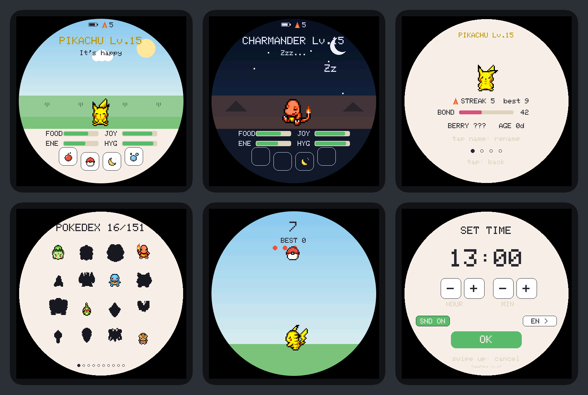

# TamaPoke on the Waveshare ESP32-S3-Touch-AMOLED-2.16

TamaPoke was written for the round **ESP32-S3-Touch-AMOLED-1.75** (466x466
AMOLED). This fork runs it on the square **ESP32-S3-Touch-AMOLED-2.16**
(480x480 AMOLED). This page explains what changed, why, and where each
hardware fact comes from.



## The display: the round screen inside the square one

The whole UI (every coordinate in the 2,700-line sketch) is laid out for a
466x466 round screen centred on (233, 233). Re-laying it out for a square would
have meant touching every screen; scaling it by 480/466 would have blurred the
pixel art. Instead the game keeps drawing in its 466x466 space and the display
layer frames it:

```
 panel 480 x 480 (black pixels are off on an AMOLED)
 +--------------------------------------------+
 | 6 px                                       |
 |   +------------------------------------+   |
 |   |        .--~~~~~~~~~~~~~~~--.       |   |
 |   |     .~    466 x 466 canvas   ~.    |   |  8 px
 |   |    |   (the original round UI)  |  |   |
 |   |     `~.                     .~'    |   |
 |   |        `--~~~~~~~~~~~~~~~--'       |   |
 |   +------------------------------------+   |
 +--------------------------------------------+
```

- `RoundCanvas` (`round_display.h`) is the same Arduino_GFX canvas the game
  always drew into, blitted to the panel at (6, 6). Every `gfx->flush()` first
  applies `RoundMask` (`roundmask.h`): pixels outside a centred disc go black,
  and the pixels the edge crosses are darkened by how much of them is inside
  (a one-pixel anti-aliased edge). Cost per frame: 93 KB of memset and 1,440
  pixel blends, against a 434 KB transfer; the mask itself takes 7.6 KB of RAM.
- Why (6, 6) and not the centred (7, 7): the CO5300 only accepts address
  windows that start on an even pixel and span an even number of pixels
  (Waveshare's LVGL demo rounds every area for this). The canvas is one pixel
  off-centre, which on a 2.16" screen is invisible.
- The disc is centred on the UI's own centre (pixel 233) with radius 232.5,
  the largest that fits the canvas. The UI's round backgrounds
  (`fillCircle(233, 233, 231)`) sit fully inside it, so the frame never cuts
  into them. All of this is checked in `test/test_roundmask.cpp`.
- After `gfx->begin()` the panel gets MADCTL 0xA0 (as in Waveshare's demo) and
  is cleared to black once. The border around the canvas is never drawn again;
  the panel keeps it in its own memory.
- `-D TP_ROUND_FRAME=0` shows the whole square canvas instead. It is not the
  default: the main screen's scenery fills the square, but the card, settings,
  gallery and keyboard screens are drawn as discs, and the mix looks unfinished.

Touch arrives in panel pixels and is moved into canvas pixels (`panelToUi()`,
minus 6). A tap in the black border lands outside every button; a swipe that
starts there still counts, since only its length matters.

### A fix the square panel exposed

Rendering without the frame showed one element outside the circle: the daily
streak badge, drawn at (26, 16) of the canvas. It was never visible on the
round 1.75" screen either. It now sits next to the battery icon at the top, the
pair centred as a group.

## Hardware changes

Every pin and address lives in `board_amoled_216.h`, each tagged with its
source. The two boards turn out to share most of their wiring.

| What | 1.75" (before) | 2.16" (now) | Source |
|---|---|---|---|
| Panel | CO5300 466x466, column offset 6 | CO5300 480x480, offsets 0, MADCTL 0xA0 | demo, BSP |
| Panel bus | QSPI: CS 12, SCLK 38, D0-D3 4-7, RST 39 | same | demo |
| QSPI clock | 80 MHz | 80 MHz (`BOARD_LCD_QSPI_HZ`; 40 MHz if the panel shows noise) | TamaPoke 1.75 |
| Panel power | `pmuEnablePanel()` turned AXP2101 BLDO1 on | no rail touched | demo, BSP |
| Touch | CST9217 at 0x5A, INT 11, RST 40, mirror X+Y | CST9220 at 0x5A, same pins, swap XY + mirror X | demo |
| I2C | SDA 15, SCL 14 | same | demo |
| PMU | AXP2101 | same, plus the 4.2 V charge target the demo sets | demo |
| RTC | PCF85063 | same | lib |
| Audio | ES8311 at 0x18, MCLK 42, BCLK 9, LRCK 45, DOUT 8, DIN 10, amp 46 | same | demo, BSP |
| microSD | SDMMC 1-bit: CLK 2, CMD 1, D0 3 | same | BSP |
| PWR key | AXP2101 PWRON (IRQ: short = screen, 4 s = off) | same | schematic |
| IMU | QMI8658, unused | QMI8658, unused | schematic |

Sources:
- **demo**: [waveshareteam/ESP32-S3-Touch-AMOLED-2.16](https://github.com/waveshareteam/ESP32-S3-Touch-AMOLED-2.16)
  at `225a62b` (`examples/arduino`).
- **BSP**: Waveshare's ESP-IDF board package,
  [Waveshare-ESP32-components](https://github.com/waveshareteam/Waveshare-ESP32-components)
  `bsp/esp32_s3_touch_amoled_2_16` at `23a6012`. Its CO5300 driver in
  Arduino_GFX 1.6.9 is byte-identical to the copy in the demo.
- **schematic**: `schematic/ESP32-S3-Touch-AMOLED-2.16-Schematic.pdf` in the demo repo.
- **lib**: default addresses in SensorLib 0.3.3 / XPowersLib 0.2.6, the
  versions the demo ships.

Note on the microSD: the schematic labels its lines for SPI (MOSI 1, SCK 2,
MISO 3, CS 41), but Waveshare's own BSP mounts the card over SDMMC in 1-bit
mode on the same wires, which is what TamaPoke already did on the 1.75".

### Fixed along the way

SensorLib's `TouchDrvCST92xx::getPoint()` copies every finger the chip
reports (up to two) whatever count it is asked for, and `handleTouch()` passed
single `int16_t` variables: a two-finger touch wrote past them. It now passes
arrays.

## Build

`platformio.ini` pins everything: pioarduino platform 55.03.311,
arduino-esp32 3.3.11, GFX Library for Arduino 1.6.9, SensorLib 0.3.3,
XPowersLib 0.2.6, U8g2 2.36.18. The CI builds the same sketch with arduino-cli
and the same versions.

| Env | What |
|---|---|
| `tamapoke` | the game |
| `bringup` | `bringup/main.cpp`: each chip on its own (panel colours and corners, touch dots, PMU, IMU, RTC, buttons, SD), logged over USB. Flash it first on a new board. |

## How it was checked

Without the board:
- `pio run` builds both envs with no warnings; CI also builds with arduino-cli.
- `test/run_tests.sh --asan`: the existing game-logic suite plus
  `test_roundmask.cpp` (frame geometry, symmetry, edge, alignment, touch mapping).
- `tools/render/render.sh` compiles the real sketch and the real canvas for the
  PC and saves every screen as the 480x480 PNG the panel would show (the image
  at the top). See [`tools/render/README.md`](../tools/render/README.md).

On the board: nothing yet. The checks to run, in order, are in
[DEVICE_TESTS.md](DEVICE_TESTS.md), with a one-line list in
[PENDING_TESTS.md](PENDING_TESTS.md).
