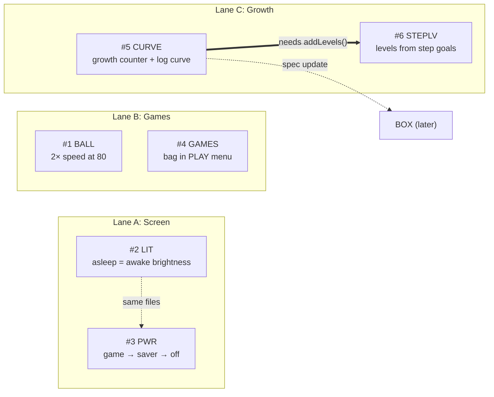

# Gameplay tuning plan: ball speed, sleep brightness, PWR cycle, games menu, level curve, walk levels

Six changes the user asked for on 2026-11-06, on top of v1.30 (main `977d32d`).

Each task has a short code so it doesn't clash with `FEATURES.md` Tasks 1–3, the day-1 plan's Tasks 1–6,
or FX / BOX / OTA. The number is the user's original order.

| # | Code | What | Size | Lane |
|---|------|------|------|------|
| 1 | **BALL** | Ball game speeds up all the time: 2× at score 80 compared to score 1 | S | Games |
| 2 | **LIT** | Same screen brightness when the pet sleeps as when it's awake | S | Screen |
| 3 | **PWR** | PWR short press cycles: game → screensaver → off → game | M | Screen |
| 4 | **GAMES** | Strength training moves into the PLAY menu, next to ball and battle | S–M | Games |
| 5 | **CURVE** | New level pace: 20 min per level (Lv 1–10), a log curve 20 → 180 min (Lv 11–89), 3 h per level (Lv 90+) | L | Growth |
| 6 | **STEPLV** | Step goals give levels: 3000 → +1, 6000 → +1, 10000 → +2 | S | Growth |

---

## Dependencies: what can run in parallel



The same thing as text:

```
Lane A  Screen   #2 LIT  - - - - ->  #3 PWR        soft: both edit power.h + test_power.cpp
Lane B  Games    #1 BALL      #4 GAMES             independent (different functions in TamaPoke.ino)
Lane C  Growth   #5 CURVE ======>  #6 STEPLV       hard: STEPLV calls CURVE's addLevels()
                     \
                      - - -> BOX spec (a boxed pet must keep its growth counter)

=====>  hard dependency: needs the other task's code
- - ->  soft: same files; do them one after the other to avoid conflicts, not because of logic
```

**Parallel:** the three lanes don't depend on each other, and BALL and GAMES don't depend on each other
either. The only hard order is **CURVE before STEPLV**.

**What still conflicts when running in parallel:** every branch bumps `FW_VERSION`
(`TamaPoke.ino:46`) and `web/manifest.json`, and adds lines to `CHANGELOG.md`,
`docs/PENDING_TESTS.md`, `docs/DEVICE_TESTS.md` and `README.md`. Those conflicts are trivial. Give
each branch its version when it merges, in merge order, not when it starts.

**Suggested order, one at a time** (the way the day-1 plan ran): LIT → PWR → BALL → GAMES → CURVE →
STEPLV. Quick wins come first. CURVE is the only large one, and it changes the live pet on the
board, so it gets a clean slot. That gives v1.31 … v1.36. BOX and OTA move to 1.37 and 1.38.
Doing all six before BOX is better: BOX then only has to pack the new growth counter once.

---

## How every task runs (shared checklist)

This is the same checklist as the day-1 plan.
- **Branch:** one branch per task, off an up-to-date `main`.
- **Release files:** version bump, `CHANGELOG.md` entry, `PENDING_TESTS.md` / `DEVICE_TESTS.md` rows.
- **Verify:**
  - `test/run_tests.sh`
  - `tools/render/render.sh`
  - `pio run -e tamapoke`
  - flash, then check over serial on /dev/ttyACM0 (rts=False, dtr=True)
  - the user does the physical checks
- **Merge:** `--no-ff` into `main` and push.

The board has the user's real pet on it (shiny Wartortle, Lv.31). Never use `LVL` or `SPEC` on it.
Each task below adds a serial command that only changes what's on screen, so it can be checked
without touching the save.

---

## #1 BALL: the ball game speeds up all the time

### Today

`TamaPoke.ino:1959–2037` has three separate ramps, and all of them stop early:

| Value | Formula | Stops at |
|-------|---------|----------|
| Spawn drift | `1.6 + 0.05·score` | 4.0, at score 48 |
| Gravity | `0.40 + 0.013·score` | 0.80, at score 31 |
| Tap lift | `6.6 + 0.22·score` | +3.5, at score 16 |

Gravity and lift grow together, so the time the ball stays in the air barely changes (about 33
frames at score 1, about 25 at score 31). After score ~48 nothing changes at all. That's the boring
part.

### Change

Make speed one number that scales time for the whole simulation.

- Formula: `ballSpeed(score) = 1 + (score − 1) / 79`, so score 1 → 1.00×, 40 → 1.49× and 80 → **2.00×**.
- It keeps rising at the same rate past 80, with a cap of 3.0× (score 159). The cap keeps one frame
  from moving the ball too far.
- In `stepGame()`: `k = min(dt/85, 3) · ballSpeed(score)`. The lateness clamp applies before the
  speed factor.
- Fix the shape of the arc at today's score-1 values: gravity 0.413, lift 6.82, spawn drift 1.65.
  These become named constants and the three ramps go away. Now the path is the same at every score
  and only how fast the ball moves along it changes. "2× at 80" then means exactly that: the time in
  the air is cut in half.
- The pet's chase step already uses `k`, so the pet keeps up on its own.

### Where

- New pure header `ballgame.h`: `ballSpeed()` and the constants. This follows `power.h` and
  `burnin.h`, which keep their logic testable on the PC.
- In `TamaPoke.ino`: `respawnBall()`, `gameTap()`, `stepGame()`.

### Tests and checks

- Host test (`test_ballgame.cpp`):
  - `ballSpeed(1) == 1`, `ballSpeed(80) == 2`;
  - the speed only goes up as the score rises, and it stops at the cap;
  - a short simulation with the shared constants: the time in the air at score 80 is half the time at score 1.
- New serial command `BALL <score>` opens the game at that score, so 1×, 1.5× and 2× can be felt
  without playing up to them.
- The renders don't change.
- Board check by the user: is it still playable at 80, and fun on the way there?

### Note

The saved high score `gameHi` was set under the old ramps. It stays as it is.

---

## #2 LIT: the screen stays as bright while the pet sleeps

### Today

`brightnessFor()` (`power.h:70–81`) lowers the screen whenever the pet is asleep:

| State | Awake | Asleep |
|-------|-------|--------|
| Active | the chosen level (50 / 100 / 150 / 220) | **25** |
| Dimmed after 90 s | 60 | **10** |
| Screensaver after 5 min | 40 | **16** (`SAVER_BRIGHT_SLEEP`) |

### Change

- Remove the asleep values from `brightnessFor()`. The chosen level, the 60 when dimmed and the 40 of
  the screensaver now apply whether the pet is awake or asleep.
- Delete `SAVER_BRIGHT_SLEEP`.
- The screensaver clock turns darker gray while the pet sleeps (`TamaPoke.ino:4385`, `0x4208`). It
  now uses the awake gray (`0x8410`).
- **Unchanged:**
  - the night scene still draws with the lights off (`gNight`): that's the look of the scene, not
    the panel brightness;
  - 500 ms frames while the pet sleeps untouched;
  - the speaker amplifier stays off;
  - the low-battery caps (100 / 60).

### Battery

Asleep and untouched, the screen still dims after 90 s and switches to the screensaver after 5 min.
The only lasting cost is the screensaver at 40 instead of 16. The screensaver is mostly black pixels,
so that's small. Note the next overnight battery reading in `PENDING_TESTS.md`.

### Tests and checks

- `test/test_power.cpp`: the five `sleeping = true` cases change (lines 38, 93, 107, 183, 214).
- Add a test: for every stage and brightness level, the result is the same asleep and awake.
- Over serial: `BRIGHT` prints the current value, so compare it with the pet asleep (LIGHT) and awake.

---

## #3 PWR: game → screensaver → off → game

### Today

A short press toggles the screen on and off (`TamaPoke.ino:391–401`). The screensaver only comes up
after 5 min idle (`saverOn()`, `TamaPoke.ino:1206`).

### Change

A short press moves to the next of three views:

| Now showing | Short press goes to |
|-------------|---------------------|
| **ON:** the game, including dimmed at 90 s and face-down | **SAVER** |
| **SAVER:** from the button or after 5 min idle | **OFF** |
| **OFF** | **ON** |

- **Pure logic:** add `enum PwrView { VIEW_ON, VIEW_SAVER, VIEW_OFF }` and `pwrNext()` to `power.h`.
  The current view is `screenOff ? OFF : saverOn() ? SAVER : ON`.
- **Into SAVER:** use the trick the `SAVER` serial command already uses (`TamaPoke.ino:705`): set
  `lastInteract = now − POWER_DIM2_MS − 1` and `gFaceDown = false`. The screensaver's power rules
  then all apply as they are: 1 s frames, light sleep without USB, brightness 40, amplifier off.
  Touch, USER, BOOT and a shake still wake it, as they do today.
- **Into OFF:** `screenOff = true`, as today.
- **Back to ON:** `screenOff = false; wakeUI()`, as today.

### Edge cases

- **Battle:** going into SAVER closes a running battle, the same way OFF does today. The battle only
  advances while it's being drawn.
- **Visible events:** `updateBrightness()` wakes the screen for eating, hearts, evolving and
  ceremonies (`TamaPoke.ino:545`). A press during an eating animation would bounce straight back to
  the game. Fix: add a `saverPinned` flag, set by the button and cleared by any touch, key or shake.
  The automatic wake skips while it's set.
- **Unchanged:**
  - a long press (4 s) still powers the board off (AXP2101); it doesn't raise the short-press IRQ;
  - a level-up with the screen off still chimes without turning the screen on (FX decision);
  - a touch while OFF still turns the screen on.

### Tests and checks

- `test_power.cpp`: the `pwrNext()` cycle, and `saverActive()` after the forced idle.
- New serial command `PWR`: acts like a short press and prints the new view, so the whole cycle can
  be checked over serial.
- Docs: README line 407 changes from "short = screen on/off" to "short = screensaver → off → on".
  Also update the DEVICE_TESTS power section.
- Board check by the user: press three times from the game, then the same with the pet asleep.

---

## #4 GAMES: all games in the PLAY menu

### Today

- PLAY opens a 132×64 menu with two choices, ball and battle (`TamaPoke.ino:1085–1093`, `1890–1895`).
- The training bag only opens from the "STRENGTH TRAINING" button on the stats card, page 1
  (`renderCardStats()`, `TamaPoke.ino:3008–3013`; the tap is handled at `1040–1043`).

### Change

- **Menu:** the PLAY menu grows to three slots of 66 px, the same width as the food menu's slots:
  ball | battle | training bag.
  - Width 198, `PLAY_MENU_X = CX − 99`, and the tapped slot is `(x − PLAY_MENU_X) / 66`.
  - Battle keeps its refusal (shake plus the deny sound) when the pet can't battle.
  - The bag uses `startSack()`'s own conditions. The menu only opens when the pet is hatched and
    awake anyway.
- **Icon:** a new 16×16 `ICON_SACK` in `tools/sprites.py`, a small red punching bag that matches the
  bag scene. Regenerate the sprites; `test_tools.py` checks them.
- **Stats card:** remove the button from page 1, along with its tap branch. A tap anywhere on the
  card closes it again. Space the four bars out to use the freed room.
- **String:** `S_TRAIN_STR` becomes unused. Remove it from `i18n.h` / `i18n.cpp`; `test_i18n` checks
  the tables.

### Tests and checks

- Renders: `play-menu` (3 icons), `card-battle` (no button), `sack`.
- Board check by the user: each of the three slots starts its game, and the battle slot still
  refuses while evolving.
- Docs: README ("STRENGTH ← bag", the card description) and DEVICE_TESTS.

---

## #5 CURVE: the level pace follows how hard the pet is to raise

### Today

`level() = 1 + ageMinutes / 60` (`pet.h:210`): one level per hour of age, forever. The Rare Candy
pushes `ageMinutes` forward (`pet.cpp:749`), which also ages the pet.

### The curve

`cost(L)` is the minutes from level L to L+1:

- **Lv 1–10:** 20 min.
- **Lv 11–89:** `cost(L) = 20 + 160 · ln(L − 10) / ln(80)`, rounded to the minute. That's 20 at
  Lv 11 and 180 at Lv 89–90, without a jump at either end.
- **Lv 90 and up:** 180 min.

What that gives, from hatching, with no walking:

| Level | 10 | 12 | 16 | 20 | 25 | 31 | 36 | 40 | 50 | 55 | 72 | 90 |
|-------|----|----|----|----|----|----|----|----|----|----|----|----|
| Cost of the next level (min) | 20 | 45 | 85 | 104 | 119 | 131 | 139 | 144 | 155 | 159 | 171 | 180 |
| Reached after | 3.0 h | 3.7 h | 7.9 h | 14.1 h | 23.3 h | 35.8 h | 47 h | 56 h | 3.4 d | 3.9 d | 5.9 d | 8.1 d |

Compared with today:
- First evolutions (Lv 16) come sooner: 7.9 h instead of 15 h.
- Second evolutions (Lv 32–36) come later: about 2 days instead of about 1.5.
- 3 days of age is Lv 46 instead of Lv 72. After Lv 90 the pet gains 8 levels a day.

A pure log curve climbs fastest right after Lv 10 (20 → 45 → 60 min for Lv 11 → 12 → 13).
- If that feels abrupt, there's one knob: `cost = 20 + 160 · ln(1 + (L−11)/s) / ln(1 + 79/s)`.
- `s = 1` is the formula above. A larger `s` softens the start and still ends at 180.
- The plan uses `s = 1`, which is what was asked for.

### Design: a growth counter separate from age

- **New field:** `uint32_t growMin` in `Pet`, NVS key `"grow"` (+1 NVS entry).
- **Ticking:** it goes up by 1 wherever `ageMinutes++` runs for a hatched pet, offline catch-up included.
- **Level:** `level()` reads the growth counter instead of the age.
- **Why separate:**
  - Age stays real time for everything that is about time: days on the profile card, the 3-day
    farewell, `declineFarewell` (+1 day), the "is shiny" line in the first 15 min.
  - Levels can then be pushed by the Rare Candy and STEPLV without ageing the pet.
  - With up to 4 walking levels a day at 3 h each, pushing age instead would age the pet by 12 h a day.
- **Pure header `growth.h`:**
  - `LV_COST[]`: a const table for Lv 11–90. A host test recomputes it from the formula, so the
    board and the PC never disagree on floats.
  - `levelStart(L)`, `levelFor(growMin)` (capped at 999), `levelInto(growMin)`.
  - `addLevels(growMin, n)`: jumps n levels and keeps how full the bar was (into × new cost / old
    cost), so walking never throws away progress.
- **Migration:** a save without `"grow"` gets
  `growMin = levelStart(oldLv) + (ageMinutes % 60) · cost(oldLv) / 60`, where `oldLv = 1 + ageMinutes/60`.
  The user's Wartortle stays Lv.31 with the same bar.

### Everything else that assumes 60 min per level

- **Stats card progress page** (`TamaPoke.ino:3063–3070`): the bar and "next level in N min" use
  `levelInto()` / `cost()`. `into` becomes `uint16_t`.
- **Rare Candy** (`pet.cpp:749`): `growMin = addLevels(growMin, 1)`. Age is no longer touched.
- **`LVL n` serial command** (`TamaPoke.ino:625`): sets `growMin = levelStart(n)`, not the age.
- **Render tool** (`tools/render/render.cpp:182, 207, 281`).
- **`MINUTES_PER_LEVEL`:** goes away (or is kept only as the old-save migration constant).
- **Tests:**
  - The level tests in `test/test_pet.cpp:272–287` are rewritten around `growMin`.
  - `test_dex.cpp:128` ("every line reaches its final form before the farewell, Lv 72") no longer
    holds. Three days is now Lv 46, and the Dratini line evolves at 55 (3.9 days of growth without
    walking). The farewell already waits for the final form (`canFarewellNow` needs
    `evolvesTo == 0`), so nothing breaks in the game.
  - The test changes to: every line reaches its final form by `levelFor(4 days)`, which is Lv 55,
    with the 3-day level printed for reference. See the open questions.
- **Docs:** README "Time & leveling" (line 70) is rewritten with the table above.
  `docs/NEXT_FEATURES.md` BOX: a boxed pet's record must include `growMin`.

### Tests and checks

- **Host tests:**
  - the table matches the formula;
  - `cost(10) = cost(11) = 20` and `cost(89) = cost(90) = cost(200) = 180`;
  - `levelFor(levelStart(L)) == L` for L = 1…999;
  - `addLevels` keeps the fraction;
  - migration from an old save with `age = 30·60 + 15` gives Lv 31 at 25 % of the bar;
  - age and growth advance together while offline.
- **On the board:** before flashing, `STATS` (note level and age); flash; `STATS` again → same level,
  same age. Don't use `LVL` on the board.

### Built in v1.35

- `growth.h` as planned: `LV_COST` (Lv 11–90), `levelCost`, `levelStart`, `levelFor`, `levelInto`,
  `addLevels`, and `growthFromLegacyAge` for the migration. `MINUTES_PER_LEVEL` is gone; the migration
  uses `LEGACY_MINUTES_PER_LEVEL` (60).
- `Pet::growMin` (NVS `"grow"`) ticks right after the egg check in `tick()` and in the offline loop, so it
  never counts egg minutes. Helpers on `Pet`: `levelMinutesInto()`, `levelMinutesCost()`, `setLevel()`.
- Migration runs in `load()` when `"grow"` is missing (an egg gets 0). Host test
  `growth_pet.un_guardado_sin_grow_conserva_el_nivel` loads a Wartortle save with the key removed:
  Lv 31, same age, bar at 42 × 131 / 60.
- `LVL n` now gives level n exactly (it used to give n + 1, through the age) and prints `lv=… grow=…`.
  `STATS` has a new line `grow=… lv=… into=…/… age=…`.
- The home/card repaint key includes `growMin`, so a level jump without an age change repaints the card.
- At Lv 999 the progress card shows a full bar and no "next level" line.
- `test_dex`: every line reaches its final form by `levelFor(4 days)` = Lv 55; the 3-day level (46) is
  checked for reference.

---

## #6 STEPLV: walking speeds up levelling

**Needs CURVE** (`addLevels`, the growth counter).

### Change

- **Rewards:** in `goalReward()` (`pet.cpp:665`), when the pet gets the reward:
  - the 3000 goal → `addLevels(1)`;
  - the 6000 goal → `addLevels(1)`;
  - the 10000 goal → `addLevels(2)`.
  - "Gets the reward" means hatched, awake, no ceremony: the same rule as every other walking reward.
- **Daily total:** up to +4 levels a day. That's about 8.9 h of growth at Lv 31 and 12 h at Lv 90+.
  If one `addSteps()` crosses all three goals, the four levels arrive together.
- **On screen:**
  - The FX level watch already sees jumps. After the goal banner, the level-up banner shows
    "Lv.31 > Lv.33" with its jingle, one at a time as FX queues them.
  - Each goal banner gets a "+1 Lv" / "+2 Lv" line.
  - The 10000 banner shows the Rare Candy today (`TamaPoke.ino:2727`). It shows "+2 Lv" instead.
- **Rare Candy (default, see the open questions):**
  - The 10000 goal gives +2 levels directly and no longer hands out a Rare Candy.
  - Candies already in the backpack still work (+1).
  - The item stays in the save layout, which is stored by position.
  - The Marathon medal and the other 10000 rewards don't change.
- **Docs:** README's step-goals table (line 225) and the WALK page notes.

### Tests and checks

- Host tests (`test_pet` / `test_steps`):
  - 3000 → +1 level, 6000 → +1, 10000 → +2;
  - one big `addSteps` crossing all three → +4;
  - asleep → no levels (the banner still shows);
  - the next day the goals reward again;
  - Lv 998 + 2 → capped at 999.
- On the board: `FX goal` / `FX levelup` show the banners without touching the save. The user's real
  walk confirms the levels.

### Built in v1.36

- `STEP_GOAL_LEVELS[] = { 1, 1, 2 }` in `pet.h`; `goalReward()` calls `addLevels()` for a rewarded goal
  and then `checkMedals(false)`, so a goal that reaches Lv 10/25/50 gives its medal at once.
- Defaults taken for open questions 1 and 2: the 10000 goal gives +2 levels and no Rare Candy (it no longer
  counts as a bonus find either); no levels while the pet sleeps.
- The levels gained since the last banner travel with it: `takeGoalBanner(&levels)` → the FX event's `b`.
  The banner prints "+N Lv" (the total when several goals came together, e.g. "+4 Lv"), and nothing for
  a goal crossed asleep.
- **Order on screen differs from the plan text:** FX shows a level-up before a goal banner (its existing
  priority: level, medal, streak, goal), so the "Lv.a > Lv.b" pill comes first and the goal banner follows.
- The `found-candy` render scene is gone (the candy is no longer found); `goal-3000` shows the small banner.

---

## Open questions (the plan goes with the default unless the user says otherwise)

1. **Rare Candy at 10000 (STEPLV).** Default: the goal gives +2 levels directly and no candy.
   Alternative: keep the candy too, which makes 3 levels in total.
2. **Steps while the pet sleeps (STEPLV).** Default: no levels, the same rule as every walking reward
   since v1.25. Alternative: give the levels anyway, since the walk happened.
3. **Farewell vs the slower curve (CURVE).** Three days of age is now Lv 46. Default: keep the 3-day
   farewell, which already waits for the final form. Dratini owners just get it later.
   Alternative: tie the farewell to growth or to a level.
4. **Night scene (LIT).** Default: only the panel brightness changes, and the scene keeps its
   lights-off night look. Alternative: also lighten the night scene while the pet sleeps.
5. **Past score 80 (BALL).** Default: keep speeding up at the same rate, capped at 3× (score 159).
   Alternative: hold at 2× from score 80.
6. **Minigames when PWR goes to SAVER (PWR).** Default: only a battle is closed. The ball game and the
   bag freeze and carry on when woken, as they do with OFF today. Alternative: quit them with no
   reward.
