# TamaPoke game logic

> **Written from firmware v2.3, commit `364621f` (main, 2026-11-17).**
> If `FW_VERSION` in `TamaPoke.ino` or `git log` is past this, sections may be stale. The rule (CLAUDE.md) is that
> every commit that changes game logic updates this guide in the same commit, including this line.

This guide has two jobs:

1. Explain how the game works: the loop, the pet's life, the screens and the systems around them.
2. Tell a developer, or Claude Code, **where each piece lives**, so a task starts from the right file and function
   instead of a read of the whole repo.

Pointers are `file:line` at the commit above. Line numbers drift, so **search by the function or constant name**
and treat the line as a hint. Player-facing numbers are in `README.md` ("Game manual"). This guide gives the code
side and flags where the README and the code disagree (§18).

---

## Contents

0. [Where is X? (quick lookup)](#0-where-is-x-quick-lookup)
1. [Architecture](#1-architecture)
2. [The runtime: setup, loop, tick, render](#2-the-runtime-setup-loop-tick-render)
3. [Screens and input](#3-screens-and-input)
4. [The pet simulation (per-minute tick)](#4-the-pet-simulation-per-minute-tick)
5. [Life cycle: eggs, evolution, endings](#5-life-cycle-eggs-evolution-endings)
6. [The Box](#6-the-box)
7. [The yard (home screen)](#7-the-yard-home-screen)
8. [Minigames](#8-minigames)
9. [Battles and stages](#9-battles-and-stages)
10. [Wild encounters](#10-wild-encounters)
11. [Steps, items, gifts and coins](#11-steps-items-gifts-and-coins)
12. [Travel and the Collection](#12-travel-and-the-collection)
13. [Persistence and offline catch-up](#13-persistence-and-offline-catch-up)
14. [Power, screen, celebrations, audio](#14-power-screen-celebrations-audio)
15. [Data pipeline, sprites, i18n](#15-data-pipeline-sprites-i18n)
16. [Serial debug commands](#16-serial-debug-commands)
17. [Tests and developer workflow](#17-tests-and-developer-workflow)
18. [Gotchas and known doc/code mismatches](#18-gotchas-and-known-doccode-mismatches)

---

## 0. Where is X? (quick lookup)

| I want to change… | Look at |
|---|---|
| How fast needs drain, poops, slip-ups, neglect | `Pet::tick` `pet.cpp:340`, `sleepMinute` `pet.cpp:916`, constants in `pet.h` |
| Level curve / growth | `growth.h` (`levelCost`, `levelFor`, `addLevels`); `growMin` in `Pet` |
| Night / sleep schedule | `Pet::nightMinute` `pet.cpp:948`, `goToBed` `pet.cpp:935`, hours in `pet.h:39-47` |
| Feeding, cake, bath, pet it | `feedBerry` `pet.cpp:773`, `eatCake` `:790`, `clean` `:1012`, `cleanPoop` `:1000`, `caress` `:1022` |
| Egg odds, shiny odds, genes | `pickEggSpecies` `pet.cpp:476`, `shinyOdds` `:253`, `hatch` `:707`, `newEgg` `:63` |
| Evolution rules | `canEvolveNow` `pet.cpp:738`, `evolve` `:745` |
| Farewell / release / death / Revive | `canFarewellNow` `pet.cpp:622`, `release` `:697`, `startDying` `:640`, `revive` `:657`, `letGo` `:674`, `endLife` `:182` |
| Box store/wake and power-cut safety | `Pet::store` `pet.cpp:2466`, `wake` `:2473`, `boxBoot` `:2520`, `box.h` |
| A minigame's rules | `ballgame.h`, `zengame.h`, `dashgame.h` (pure); the bag is only in `TamaPoke.ino` (`startSack` `:2754`) |
| A minigame's reward | `Pet::playResult` `pet.cpp:804`, `trainStrength` `:822`, `zenResult` `:848`, `dashResult` `:869` |
| Battle damage / types / special | `battle.h` (`hitDamage` `:126`, `TYPE_CHART` `:52`, `SpecialMeter` `:258`) |
| Stages, foes, team | `stage.h` (`STAGES` `:49`, `stageRollFoes` `:88`, `StageRun` `:132`) |
| Stage rewards / loot | `Pet::stageDone` `pet.cpp:1649`, `rollBattleItem` `:1384`, `BDROP_*` `pet.h:171` |
| Wild encounters | `encounter.h` (rolls, level, species), `Pet::encCheck` `pet.cpp:1753`, `encounterDone` `:1822`, `captureWild` `:1866` |
| Coins, prices, daily cap | `economy.h`; `Pet::addCoins` `pet.cpp:1438`, `spendCoins` `:1457`, `buyItem` `:1464` |
| Items, Backpack, gifts | `IT_*` enum `pet.h:151`, `useItem` `pet.cpp:1301`, `giveGift` `:1177`, `openGift` `:1220` |
| Steps and walk rewards | `steps.h` (counter), `Pet::addSteps` `pet.cpp:1063`, `goalReward` `:1135` |
| Travel and souvenirs | `travel.h` (`travelRoll` `:78`), `Pet::startTravel` `pet.cpp:1531`, `travelComplete` `:1565` |
| Yard movement, food walking | `yard.h` (`yardStep` `:402`, BFS paths, food phases); `renderYardHome` `TamaPoke.ino:8558` |
| Yard maps / backgrounds | `yardbg.h` (TPY1), `yardEnsureMap` `TamaPoke.ino:7657`, `tools/pack_yard.py` |
| A screen's drawing or taps | §3 table; everything UI is in `TamaPoke.ino` |
| A string / translation | `i18n.h` (`StrId`), `i18n.cpp` (8 rows), `tools/test_i18n_formats.py` |
| Species data | `tools/dex_data.py` + `tools/gen_dex.py` → `dex.h` (generated) |
| Save format / NVS keys | `Pet::save` `pet.cpp:1910`, `Pet::load` `:2029` |
| Brightness, dim, saver, PWR | `power.h`, `burnin.h`, `pwrPress` `TamaPoke.ino:~724`, `updateBrightness` `:~754` |
| Celebrations / "+N" floaters | `fx.h`, `fxCollect` `TamaPoke.ino:3997`, `fxFrame` `:4068` |
| Sounds | `audio.h` (`Sfx` enum), `sfxPlay` |

---

## 1. Architecture

The firmware is an Arduino sketch: `TamaPoke.ino` at the repo root (about 10.5 k lines) plus top-level `.h`/`.cpp`
files. PlatformIO builds with `src_dir = .` and `build_src_filter = -<*> +<*.ino> +<*.cpp>`, so **any new top-level
`.cpp` goes into the firmware**. Comments in the code are in Spanish.

The code is split into three layers:

- **Pure logic, host-tested.** These are header-only modules plus `pet.cpp`. They have no hardware access and are
  compiled on the PC by `test/Makefile`.
- **State and rules.** The `Pet` class (`pet.h:250`, `pet.cpp`) holds the active pet, player-wide state (steps,
  coins, badges, Backpack, Pokédex, souvenirs), the Box, and the NVS save.
- **Glue, screens and input.** `TamaPoke.ino` holds `setup()`, `loop()`, every screen, touch and button handling,
  the battle and minigame UI, and the yard drawing. It is not host-tested; it is checked with the renderer and on
  the board.

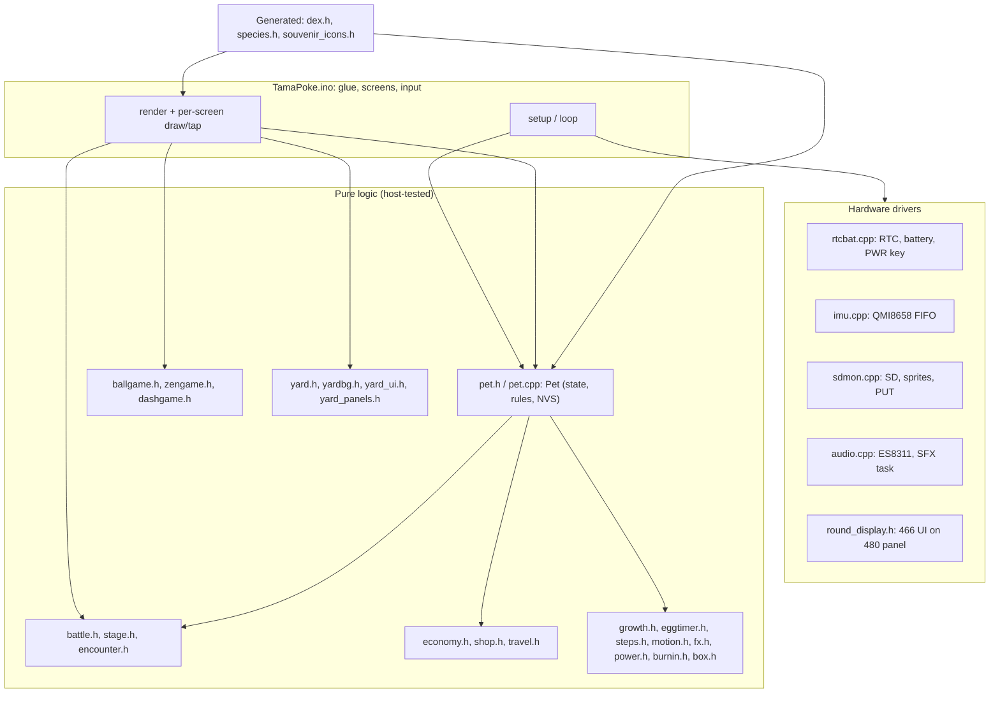

### Source files

| File | Lines | Role |
|---|---|---|
| `TamaPoke.ino` | 10534 | Whole runtime: setup/loop, input, every screen, games and battle UI, yard, encounters |
| `pet.h` / `pet.cpp` | 859 / 2563 | `Pet`: tick, growth, sleep/night, eggs, Box, NVS save/load/migrations, items, steps, travel, encounters, rewards |
| `growth.h` | 164 | Level curve (growth minutes ↔ level), `gcv` migration helpers |
| `eggtimer.h` | 60 | Yard egg: 2 h real time, shakes cut 5 min |
| `box.h` | – | `PetRecord` (55 B packed + CRC), slot states |
| `battle.h` | 290 | Battle engine: stats, gen-1 type chart, damage, special meter |
| `stage.h` | 222 | 8 stages, foe rolls, `StageRun` (team carry-over), wild runs |
| `encounter.h` | 177 | Wild encounters: daily rolls, species, level, lifetime |
| `ballgame.h` / `zengame.h` / `dashgame.h` | 87 / 165 / 252 | Ball (SPD), waterfall (DEF) and sled (SPD) logic |
| `economy.h` / `shop.h` | 71 / 52 | Coin amounts, prices, daily cap; shop checks, map picker |
| `travel.h` / `travel_ui.h` | 229 / 174 | Trips and souvenirs; travel screen geometry, Bag tabs |
| `yard.h` / `yardbg.h` / `yard_ui.h` / `yard_panels.h` | 700 / 131 / 133 / 71 | Yard walk planner and food; TPY1 maps; HUD and dock kit; Care/Play panel geometry |
| `fx.h` | 348 | Celebration queue, "+N" overlays, change watchers |
| `power.h` / `burnin.h` | 133 / 69 | Dim, saver, frame pacing, light sleep; AMOLED orbit and saver path |
| `steps.h` / `motion.h` / `imu.h` / `imu.cpp` | 101 / 292 / 42 / 250 | Software step counter; shake, face-down, tilt; IMU reader |
| `rtcbat.h/.cpp`, `batcurve.h` | – | RTC, AXP2101, PWR key; voltage → % curve |
| `audio.h/.cpp`, `volume.h` | – | Sound effects (`Sfx` enum), 4-level volume |
| `sdmon.h/.cpp` | 66 / 327 | SD mount, PMD sprite (TPK2) / thumbs / yard map loaders, serial `PUT` |
| `i18n.h` / `i18n.cpp` | 141 / 877 | 8-language string tables |
| `dex.h`, `species.h`, `souvenir_icons.h` | – | **Generated** (see §15); do not hand-edit |
| `round_display.h`, `roundmask.h`, `ui_frame.h`, `blit.h`, `board_amoled_216.h` | – | Display layer, pins |
| `wind.h` | 49 | Grass sway for the old side-view scene (not the v2.0 yard) |
| `button.h` | 27 | Key debounce |

`bringup/main.cpp` is a separate hardware-test firmware (`pio run -e bringup`).

---

## 2. The runtime: setup, loop, tick, render

### setup() — `TamaPoke.ino:395-510`

1. Serial: 8 KB RX buffer and **`setTxTimeoutMs(0)`**, so printing never blocks without a host (`:396-401`).
2. `loadLang()`, then I²C at 400 kHz with a 50 ms timeout. One bus is shared by touch, PMU, RTC, codec and IMU.
3. Display `gfx->begin` (QSPI 40 MHz) and `roundDisplayBegin`, then brightness from NVS `"bri"`, then `applyLangFont()`.
4. Touch CST9220: 3 begin attempts, `touch.reset()`, and an interrupt on the INT pin (`touchIsr`, `gTouchIrq`).
5. USER and BOOT keys.
6. `pet.timedEggs = true`, then `pet.begin()` (NVS load, migrations, `boxBoot`), then `sdBegin()` and `thumbs.load()`.
7. `rtcBegin`, `batBegin`, `pwrSetup`, `imuBegin`.
8. If the RTC is invalid, it is seeded from the saved `"seen"` epoch, so time never goes backwards (`:472-487`).
9. **`fxArmWatches()` before `pet.syncClock()`**, so levels gained while off are announced once.
10. `pet.syncClock(epoch)` runs the offline catch-up (§13).
11. `audioBegin()` plays the boot jingle.

### loop() — `TamaPoke.ino:512-638`

There is no scheduler; every pass runs this list in order:

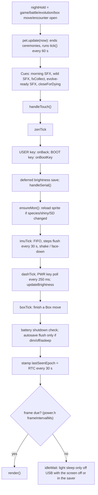

**Game time.** One game minute is one real minute. `Pet::update` (`pet.cpp:328`) calls `tick()` every `PET_TICK_MS =
60000` (`pet.h:12`) using `millis()`, and loops to catch up. The RTC is used only for offline catch-up, the
real-time timers (yard egg, travel, Revive window, encounters, cake) and the hour of day.

**Render.** `render()` (`TamaPoke.ino:2450`) does three things:

- It expires dialog timers, then dispatches by priority (§3).
- "Static" screens (Box, menus) hash a `screenKey()` (`:2384`) and redraw only when it changes.
- The home path draws the yard background, the yard (`renderYardHome`), fx overlays, the evolve or farewell
  button, celebration banners, walk news, the return banner and dialogs, then calls `gfx->flush()`.

The canvas is a 466×466 `RoundCanvas` centred on the 480×480 panel, with a round mask and the burn-in orbit shift.

---

## 3. Screens and input

There is **no single screen enum**. Each screen is a global flag (`galleryOpen`, `boxOpen`, `stagesOpen`,
`teamOpen`, `gameOpen`, `sackOpen`, `zenOpen`, `dashOpen`, `bt.phase`, `encUi`, `kbOpen`, `clockOpen`, `cardOpen`,
`bagOpen`, `panelKind`, …; most are declared at `TamaPoke.ino:90-390`). `render()`, `onTap()` and `onBack()` check
them in the same priority order:

> saver → starter → yardDemo → gallery → encounter → team → stages → box → ball → sack → sled → waterfall → battle →
> keyboard → clock → card → bag → panel (Care/Play/Travel) → home (yard, egg, vacant, ceremony, dying)

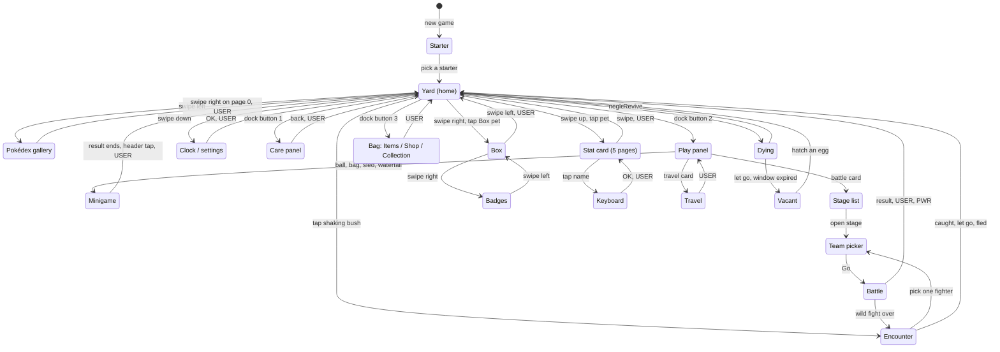

Independently of the screen, the display has its own views: **game → screensaver → screen off → game** (short PWR
press), and an idle ladder: dim at 90 s, saver at 120 s.

### Screen map

| Screen | Flag | Draw | Tap / open |
|---|---|---|---|
| Yard (home) | default; `yardHomeNow()` `:7605` | `renderYardHome` `:8558` | `yardTap` `:8572` (dock → egg → wild → poop → gift → pets) |
| Starter choice | `pet.awaitingStarter()` | `renderStarterSelect` `:2221` | `onTap` `:1686` → `pet.chooseStarter` |
| Gallery | `galleryOpen`, `galleryPage`, `galleryDetail` | `renderGallery` `:5507` | `galleryTap` `:5577` |
| Box / badges | `boxOpen`, `boxPage`, `boxAsk`, `boxMove` | `renderBox` `:5909`, `renderBadges` `:6594` | `boxTap` `:6028`, `boxTick` `:6087` |
| Stat card | `cardOpen`, `cardPage` | `renderCard` `:5352` → Profile `:4518`, Battle `:4585`, Medals `:4613`, Progress `:4638`, Walk `:4718` | swipes (`onSwipe` `:1522`) |
| Rename keyboard | `kbOpen` | `renderKeyboard` `:5386` | `keyboardTap` `:5411` |
| Clock / settings | `clockOpen` | `renderClock` `:3846` | `clockTap` `:3905` (time, brightness, language, volume) |
| Care / Play / Travel panel | `panelKind` (`yard_panels.h:11`) | `renderCarePanel` `:6915`, `renderPlayPanel` `:6952`, `renderTravelSetup` `:7168`, `renderTravelTrip` `:7241` | `carePanelTap` `:6975`, `playPanelTap` `:7027`, `travelTap` `:7312` |
| Bag | `bagOpen`, `bagTab` | `renderBag` `:5188`, `renderShop` `:4935`, `renderCollection` `:5160`, `renderPicker` `:5008` | `bagTap` `:5269`, `shopTap` `:5067`, `collectionTap` `:5181`, `pickerTap` `:5029` |
| Stages / team | `stagesOpen`, `teamOpen`, `teamWild` | `renderStages` `:6411`, `renderTeam` `:6517` | `openStages` `:6309`, `openTeam` `:6318`, `teamTap` `:6546` |
| Battle | `bt.phase` (`BT_INTRO/FIGHT/SWAP/END`, `:9360`) | `renderBattle` `:10067` | `battleTap` `:9591`; `closeBattle` `:9441` |
| Encounter | `encUi` (`ENCU_INTRO/BALL/THROW/DONE`, `:149`) | – | `openEncounter` `:10292`, `encTap` `:10328` |
| Minigames | `gameOpen`, `sackOpen`, `zenOpen`, `dashOpen` | `renderGame` etc. | §8 |
| Release dialog | `confirmUntil` | inline in `render()` `:2632` | long press 3 s on pet (`:1482`) |
| Evolve / farewell dialog | `choiceKind` 1 / 2 | `drawChoiceDialog` `:8725` | buttons `drawEvolveButton` `:8752`, `drawFarewellButton` `:8767` |
| Dying / Revive | `pet.isDying()` | `drawDyingScreen` `:8833` | `dyingTap` `:8885` |
| Screensaver | `saverOn()` `:1877` | `renderScreensaver` `:9817` | any touch, key or shake wakes |

### Input routing

- **Touch.** `handleTouch` (`TamaPoke.ino:1383`) is polled every 20 ms and gated by the INT line. Coordinates are
  shifted by the orbit offset.
  - Some screens take raw presses first: bag (every press is a hit), waterfall (finger held), sled (header only),
    battle (any press charges the meter).
  - Everything else goes through a gesture machine:
    - a horizontal swipe (|dx| > 80, < 800 ms) → `onSwipe` `:1522`;
    - a vertical swipe → `onSwipeV` `:1505`;
    - a tap (< 1500 ms, < 40 px) → `onTap` `:1682`;
    - a 3 s still hold on the pet → the release dialog.
  - A touch on a dim or dark screen only wakes it (`swallowGesture`).
- **USER key** = back. `onBack` (`:1614`) peels the topmost layer. Quitting a game or battle with USER pays nothing.
- **BOOT key** = brightness. `onBootKey` (`:1604`) → `cycleBright` (4 levels, NVS `"bri"`).
- **PWR short.** `pwrPress` (`:~724`) cycles game → saver → off. Entering saver or off abandons a battle, an
  encounter, the waterfall and the sled. **PWR long (4 s)** is a hardware power-off; the RTC keeps time.
- **IMU.** In `imuTick`:
  - Shake → `onShake` (`:665`): wakes the screen; with the screen on, the pet wakes grumpy or gets dizzy, and the
    yard egg wobbles and loses 5 min.
  - Face-down for 3 s → `onFaceDown` (`:677`): the pet goes to bed if the hour is 20–06, and the screen goes dark.
  - Tilt drives the yard walk and the sled.

---

## 4. The pet simulation (per-minute tick)

### Data model (`Pet`, `pet.h:250-859`)

| Group | Fields | Notes |
|---|---|---|
| Needs 0–100 | `fullness`, `joy`, `energy`, `hygiene` (start 80/80/80/100), `poops` (≤ `POOP_MAX` 3), `weight` | `lowestStat()` `pet.h:479`; `mood()` `pet.cpp:1903` |
| Identity | `speciesId` (−1 = egg or vacant), `vacant`, `shiny`, `nick[12]`, `uid` (0 for egg/vacant), `berryKnown` | `isEgg()` is **also true for a vacant home**; use `isVacant()` |
| Time | `ageMinutes` (real age), `growMin` (level comes only from this), `lastSeenEpoch` | `level() = levelFor(growMin)` |
| Battle | `geneAtk/Def/Spe` (90–110), `trAtk/Def/Spe` (0–100) | §9 |
| Care | `careMistakes`, `mistakeCooldown`, `sleeping`, `satedUntil` (cake) | |
| Bond and records | `bond`, `bondToday/bondDay`, `streak`, `bestStreak`, `lastCareDay`, `medals`, `totalMedals` | |
| Ending | `ceremony`, `lastEnd` (`CER_*` `pet.h:84`), `dying`, `dyingMin`, `neglectMin`, `deathMin`, `deathEgg` | `busyEnding()` blocks most actions |
| Egg | `eggTarget`, `eggShiny`, `eggTaps`, `eggPlaced`, `eggHeldFlag`, capture queue `capN/capDex` | |
| Player-wide (survive a new pet) | steps, `items[]`, gifts, coins, badges, dex bitmaps, souvenirs, owned maps, high scores | |

### One tick — `Pet::tick`, `pet.cpp:340-447`

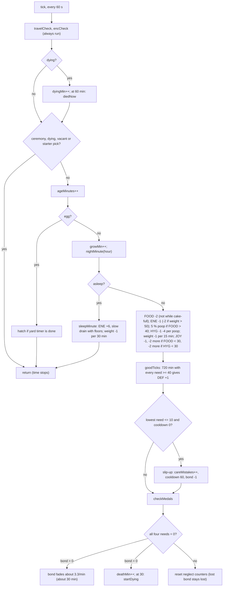

**Sleep drain** (`sleepMinute`, `pet.cpp:916`): ENE +6/min.

| | FOOD, JOY | HYG |
|---|---|---|
| Day nap | −1 every 2 min, floors 30 / 35 | −1 every 3 min, floor 45 |
| Night (22:00–08:00) | −1 every 4 min, floor 50 | −1 every 6 min, floor 55 |

`dropTo(v, d, floor)` (`pet.cpp:266`) applies the floors. No poops, slip-ups or neglect happen while asleep.

### Sleep and night (needs the clock)

Constants are at `pet.h:39-47`: `EVENING_HOUR` 20, `SLEEPY_HOUR` 22, `BED_HOUR` 23, `WAKE_HOUR` 8,
`NIGHT_RESLEEP_MIN` 30, `BED_BOND` 3.

- **22:00** `sleepy()` (`pet.h:344`): a "zzz" bubble. Putting the pet to bed now gives **+3 bond**, once a night
  (`goToBed`, `pet.cpp:935`).
- **23:00** auto-sleep (`nightMinute`, `pet.cpp:948`). If it is woken before 08:00, it sleeps again after 30 min
  awake. `nightHold` delays this while a game, battle, evolution or Box move is open.
- **08:00** a night sleep (`nightSleep`, set for bedtimes 20:00–07:59) wakes by itself and plays `SFX_MORNING`. A
  nap is not woken.
- Shaking the board while the pet sleeps calls `wakeGrumpy()` (`pet.cpp:1329`): −5 JOY.

### Care actions

| Action | Code | Effect |
|---|---|---|
| Berry (3 colours) | `feedBerry` `pet.cpp:773` | +25 FOOD. The favourite (`speciesId % 3`) gives +35 FOOD, +10 JOY, bond +2 and reveals the flavour |
| Cake | `eatCake` `:790` | FOOD 100 and kept full for 180 min (`satedUntil`), +12 JOY, +12 weight |
| Bath | `clean` `:1012` | Poops cleared, HYG 100, bond +1 |
| Tap a poop | `cleanPoop` `:1000` | +10 HYG, works asleep |
| Pet it (heart) | `caress` `:1022` | +5 JOY; bond +1 at most every 15 min; awake only |
| Light | `toggleLight` `:901` | Sleep or wake |
| Item | `useItem` `:1301` (gate `canUseItem` `:1288`) | Golden Berry +50 FOOD +15 JOY; vitamins +3 training; Rare Candy +1 level |

In the yard, food is not applied when tapped. It **drops, the pet walks to it and eats it**, and only then does
`yardFoodEaten` (`TamaPoke.ino:7903`) call `feedBerry` or `eatCake` (§7).

### Bond, streak, medals

- **`registerCare()`** (`pet.cpp:523`) runs on the first care of each calendar day. It updates the streak (+1 if
  yesterday, else 1), gives bond +4 (outside the cap), and records milestones at 3, 7, 30 and 100 days.
- **`addBond()`** (`pet.cpp:550`) enforces `BOND_DAY_CAP` 10 per day. Outside the cap: the first care of the day,
  bedtime +3, walk goals, stage boss +5.
- **Bond losses:** −1 per slip-up (floor 1), and the neglect fade.
- **`careBonus()`** (`pet.cpp:516`) = min(streak, 30)/3 + bond/25, at most 14. It improves egg and shiny odds.
- **`checkMedals()`** (`pet.cpp:564`) checks 9 medals: Lv10, Lv25, Lv50, berry found, 7-day streak, max bond, final
  form, fit, and Marathon (10 000 steps).

### Growth and level

- Level comes from `growMin`, which counts every minute alive (awake or asleep, and offline). Care does not speed
  it up.
- **Cost per level** (`growth.h` `levelCost` `:56`): 20 min for levels 1–10, the `LV_COST[]` table for 11–90
  (20 → 120 min, log curve), and 120 min from 90.
- **Jumps:** `addLevels` keeps the bar fill. It is used by Rare Candy, walk goals (+1/+1/+2) and, via growth
  minutes, by stage bosses and wild wins (+60 min).
- **Migration:** `gcv` is the curve version. `migrateGrowthCurve` (`pet.cpp:2270`) converts the home pet, every Box
  slot and `boxT`, staged through `gmig` so it survives a power cut.
- **Level-up detection lives in the UI, not in `Pet`.** `fxLevelW` watches the level, `fxCollect` plays the jingle
  at once, and queues the banner for when the screen is visible.

---

## 5. Life cycle: eggs, evolution, endings

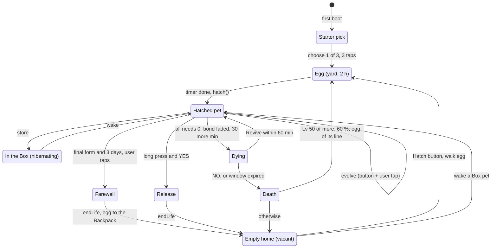

### Eggs

- **`newEgg()`** (`pet.cpp:63`) picks the species (`pickEggSpecies` `:476`) and rolls the shiny, spending the Shiny
  Charm if held. `placeEgg()` then puts it in the yard. With 0 registered species, the starter pick runs instead.
- **Yard egg timer** (`eggtimer.h`): `EGG_HATCH_MIN` 120 real minutes from `eggPlaced`, running with the board off.
  Each shake (`Pet::shaken` `pet.cpp:1346`) takes 5 min off, at most once per 30 s and 60 min in total. Crack stages
  come from `eggCracksFor`.
- **Rarity** (`pickEggSpecies`):
  - After a death, only Common.
  - Otherwise rare = (27, or 45 after a farewell) + `careBonus()`.
  - Legendary = 0 until 25 species are registered, then (3, or 10 after a farewell) + `careBonus()/3`.
  - Inside a tier it prefers lines with unregistered members.
  - Tiers are `R_EVO/R_COMUN/R_RARO/R_LEGENDARIO/R_ENCUENTRO` (`dex.h:33`). `R_ENCUENTRO` species (Omanyte, Kabuto,
    Aerodactyl, Dratini, Mew) never come from eggs.
- **Shiny** (`shinyOdds` `pet.cpp:253`): 1 in (48 − careBonus), 1 in 24 after a farewell, never better than 1 in 8.
  The charm divides the odds by 3.
- **`hatch()`** (`pet.cpp:707`): genes 90–110 per stat, training, bond and medals reset, a new `uid`, the Pokédex
  registration, then save.
- **Where eggs come from:**
  - walking, one every 8 000–15 000 steps (§11);
  - a farewell;
  - a gift egg when there is no egg anywhere and the Box is empty;
  - a death egg;
  - stage loot (3 %);
  - a wild capture: up to 4 queued (`capN`), hatching the base form at Lv 1 and leaving the Backpack first.

### Evolution

- **`canEvolveNow()`** (`pet.cpp:738`) needs all of: hatched, awake, not busy, `evolvesTo != 0`,
  `level() >= evolveLevel + careMistakes`, and **every need ≥ 40 right now**.
- It never fires by itself. `wantEvolveButton()` shows the red button, and the user taps then confirms
  (`choiceKind == 1`). "Keep form" sets `evoDeclinedLv`, so it is offered again at the next level.
- **`evolve()`** (`pet.cpp:745`): Eevee branches to 134–136, preferring an unregistered form. If the new form's
  favourite berry differs, `berryKnown` resets.

### Endings

All endings go through `endLife(cer)` (`pet.cpp:182`). It unwraps gifts into the Backpack, moves a waiting incubator
egg to the Backpack, adds the gift egg if needed, and leaves the home **vacant**. A vacant home shows "Hatch an egg
(N)" (`hatchFromBag` `pet.cpp:221`).

| Ending | Trigger | Code |
|---|---|---|
| Farewell (good) | Final form and `ageMinutes >= FAREWELL_AGE_MIN` (3 days); button, then a dialog; "Stay together" postpones 1 day | `canFarewellNow` `:622`, `startFarewell` `:627` |
| Release (neutral) | Long press 3 s, then YES | `release` `:697` |
| Death by neglect (bad) | All needs 0 (awake, board on): bond fades over ~30 min, then 30 more min | `startDying` `:640` rolls `deathEgg` (Lv ≥ 50, 60 %) |
| Revive | Dialog with a 60-minute real-time window (`REVIVE_LIMIT_MIN`); YES spends a Revive, needs → 50, bond stays 0, counts a slip-up | `revive` `:657`; `letGo` `:674` |

A death sets `lastEnd = CER_DEATH`, which curses the next random egg to Common. A farewell blesses it.
`CER_RUNAWAY` is dead code, kept only because old saves may hold it.

---

## 6. The Box

There are 6 slots where pets **hibernate**: no ageing, growth, drain or slip-ups. The one exception is that stage
and wild rewards and trips add growth directly to the slot record.

- **Record.** `PetRecord` (`box.h:27-48`) is 55 bytes packed, with a version and CRC16. It is valid only if the
  version is known, the CRC matches, `uid != 0` and the species is 1–151. An invalid slot shows "?" and is never
  loaded or overwritten; only `WIPE` or `BOXCLR` clears it.
- **What is stored.** Only the individual goes into the record. Streak, steps, Backpack, Pokédex and the incubator
  egg stay with the player. The cake effect and cooldowns are not saved.
- **RAM copies.** `pet.boxRec[]` and `boxSt[]` mean the UI never reads flash.
- **NVS keys.** `box0`–`box5` hold the slots. `boxT` is a transfer copy whose presence means a move was cut off.
  `eggH` means an egg waits while a pet is out. Also `vac` and `uid`.
- **Gates.** `canBoxMove()` = not ending, not evolving, not choosing a starter. `canStore` also needs an empty slot
  and a hatched pet. Pets on a trip cannot move.

**Power-cut-safe writes** (comment at `pet.cpp:2234-2240`, tested by `test/test_box.cpp` with a cut after every
write). The rule is: write the full copy of the moving pet first, delete the surplus last, and have `save()` write
`uid` as its last key. At worst a pet exists twice, never zero times.

| Move | Write order |
|---|---|
| Store A into slot k | 1. `box k = A` · 2. home becomes an egg or vacant, `save()` |
| Wake B with A at home (swap) | 1. `boxT = B` · 2. `box k = A` · 3. B active, `save()` · 4. delete `boxT` |
| Wake B with an egg or vacant home | 1. `eggH = 1` (**before** `boxT`) · 2. `boxT = B` · 3. B active, `save()` · 4. clear slot k · 5. delete `boxT` |

`boxBoot()` (`pet.cpp:2520-2570`) reconciles at boot. It finishes or undoes a cut move, makes a slot copy win over a
duplicate, and clears a stray `eggH`.

**UI.** `boxTap` (`TamaPoke.ino:6028`) → `boxStartMove` (`:6015`, `BOXMV_STORE/WAKE/SWAP`). The light animation
plays for 600 ms, then `boxTick` (`:6087`) calls `pet.store()` or `pet.wake()` while the last frame is on screen.

---

## 7. The yard (home screen)

Since v2.0 the home is a top-down 466×466 yard. `renderYardHome` (`TamaPoke.ino:8558`) does update and draw in one
call, every frame:

`yardSyncPets` (`:7834`) → `yardTick` (`:7920`) → `yardSyncThings` (`:8198`) → draw things, pets, bath, Box appear,
bubble, food fx → `yardDrawHud` (`:8543`)

- **Two walkers.** `YardWorld` (`yard.h`) holds `p[0]`, the home pet, and `p[1]`, the first Box pet that is not
  travelling. A returned traveller replaces `p[1]` and stands still with a suitcase and a "!".
- **Movement.** `yardStep` (`yard.h:402`) decides between idle, walk and gesture. Targets are random free cells
  reached by a BFS path over the walk mask, at 30 px/s, keeping 64 px between pets. Tilting the board makes the
  pet walk or slide downhill.
- **Walk mask.** The map's 15×15 grid of 32 px cells (`yardWalk`, `:7640`) keeps only the largest connected region.
  `yardWalkNow()` (`:7889`) also blocks the egg and the wild-encounter cells.
- **Food.** A Care card calls `yardDropFood(kind)` (`:8393`). The food goes through `YF_FALL` (650 ms) → `YF_NOTICE`
  "!" (700 ms) → `YF_WALK` (up to 15 s) → `YF_EAT` (900 ms) → `yardFoodEaten` applies the effect. One food item at
  a time; food cards are grey while it is on the floor. If the pet can no longer eat, nothing is spent.
- **Poops, gifts, egg.** Counts are saved in NVS; positions are RAM-only and re-scattered at boot. Up to 3 gift boxes
  are shown out of 8 held.
  - A poop tap calls `pet.cleanPoop`.
  - A gift tap calls `openGiftTap` (`:9248`).
  - An egg tap shows the time left (the starter egg needs 3 taps instead).
- **Bubbles.** `yardEventMsg` (`:8412`) picks a recent event; otherwise `yardNeedList` (`:8425`) lists needs below
  25 in rotation. The neglect text replaces all of them.
- **HUD.** Battery, coins, and the dock: Care (green), Play (amber), Bag (blue) (`yDock` `:6767`; `yardDockOff`
  `:8536` greys buttons for an egg or sleep).
- **Panels** (`yard_panels.h`):
  - Care: 3 berries, cake, light, bath, heart.
  - Play: ball, battle, bag, sled, waterfall, travel. With the home pet asleep or an egg but pets in the Box, Play
    jumps straight to the stages.
- **Maps.** Files `/yard/NN.bin` on the SD in TPY1 format (`yardbg.h:9-12`, 240×240 doubled to 480 and cropped to
  466). They are built by `tools/pack_yard.py`. There are 5 maps: meadow (free), quarry, forest, beach, ruins
  (`economy.h:77`).
  - `yardEnsureMap` (`:7657`) chooses, in order: the serial override, the shop preview, the travel preview, then
    `pet.yardMapWanted()`. Without the SD it falls back to map 1, then to a plain floor.
  - The palette is tinted by hour (`yardTintAt`), and the result is cached in PSRAM.

---

## 8. Minigames

All four games are launched from the Play panel (`playPanelTap` `TamaPoke.ino:7027`). Each needs the pet awake and
not an egg or ending; the sled also needs the IMU.

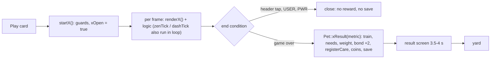

| Game | Stat | Logic | Rules | Reward (`pet.cpp`) |
|---|---|---|---|---|
| Ball | SPD | `ballgame.h`; `startGame` `:2680`, `stepGame` `:2715` | Tap the ball to keep it up; 3 floor misses end it. Speed 1× → 2× at 80 points → 3× cap | `playResult` `:804`: SPD += score/5 (no per-session cap), JOY +5…+35, ENE down, weight −score/2, coins |
| Training bag | ATK | `.ino` only; `startSack` `:2754` | 10 s of tapping | `trainStrength` `:822`: ATK += hits/4, cap 18, JOY +6, weight −hits/10, coins |
| Sled | SPD | `dashgame.h`; `startDash` `:3184` | Tilt to dodge rows. 2 s calibration takes the current angle as straight. Speed 1 + t/40 s, cap 3×. 3 hits end it | `dashResult` `:869`: SPD += rows/6, cap 18, JOY +5…+35, weight −rows/8, coins |
| Waterfall | DEF | `zengame.h`; `startZen` `:2884` | Hold to raise the gauge, release to lower it; stay in the band for 45 s. The band narrows; from 30 s it drifts (bonus time). Surges push it down | `zenResult` `:848`: DEF += min(8, t/3.5 s) + bonus min(3, …), **HYG +10**, no weight burn, coins. **Only a full session pays** |

**Coins** (`economy.h`): `coinsForGame` gives 0 if the metric is 0, else 3 + metric/div, at most 8. The divisors
are ball 10, bag 8, sled 10, waterfall 2. Paid with `addCoins(n, capped=true)`, which counts toward
`ECO_DAILY_CAP` 150.

Every game also gives bond +2 and `registerCare()`. FOOD and ENE are lowered with `dropTo` (floor 5); FOOD is
skipped while cake-full.

---

## 9. Battles and stages

### Engine (`battle.h`, pure, deterministic for a given seed)

- **Stats** (`makeFighter` `:103`, same formula as `Pet::calcStat` `pet.cpp:591`):
  - `maxHp = baseHp + L + 10`;
  - ATK/DEF/SPD = `base × gene/100 + L + training`;
  - L is capped at 100.
- **Damage** (`hitDamage` `:126`): a gen-1-style formula × type effectiveness × a roll of 85–100 %; a crit (1 in
  16) is ×1.5.
  - Each hit is **clamped to 2–60 % of the target's max HP** (70 % for a special), so a fight is never over in
    fewer than 3 attacks.
  - Immune gives 0 damage. In a stage, if neither side can hurt the other, hits count as ×0.25.
- **Types** (`TYPE_CHART` `:52`): the 15 gen-1 types. The attacker uses **the better of its two types**
  (`bestEff4`); the defender's two types multiply.
- **Order:** the faster fighter opens each round; ties are a coin flip.
- **Sudden death:** from attack 21 (`SUDDEN_DEATH_AT` 20, zero-based), DEF counts as 1 and an attacker whose target
  survives takes 10 % recoil.
- **Special** (`SpecialMeter` `:258`): 5 taps arm it, it adds +30 % power, then rests for 2 attacks. The player
  charges it by tapping during `BT_FIGHT`. The AI gets `aiTaps` per attack: minion 1 has 0, minion 2 has 1, the
  boss has 2, a wild foe has 1.
- **How the `.ino` drives it** (`TamaPoke.ino:9360-9700`): `battleStep` (`:9644`) calls `run.attack()` once every
  `ATTACK_MS` 1300. After a KO, `battleAfterKo` (`:9622`) calls `run.advance()`. Phases are `BT_INTRO` (VS card) →
  `BT_FIGHT` ↔ `BT_SWAP` → `BT_END` (7 s; taps ignored for the first 1.8 s).

### Stages (`stage.h`)

- **Definitions.** `STAGES[8]` (`:49-66`) holds each stage's level and training ranges, boss and minion pool. The
  table with values is in the README.
- **Foes.** `stageRollFoes` (`:88`) makes 2 minions of different species with a random level and training each,
  plus the fixed boss at the top level. Foes have genes 100 and are never shiny.
- **Unlocking.** `stageUnlocked(s)` = `s == 0 || hasBadge(s−1)`. `badges` is an 8-bit mask, NVS `"bdg"`, and
  belongs to the player.
- **Team.** 1–4 fighters from the home pet (if awake) and the Box pets that are not travelling (`teamCanFight`
  `pet.cpp:1427`). The last team is pre-selected.

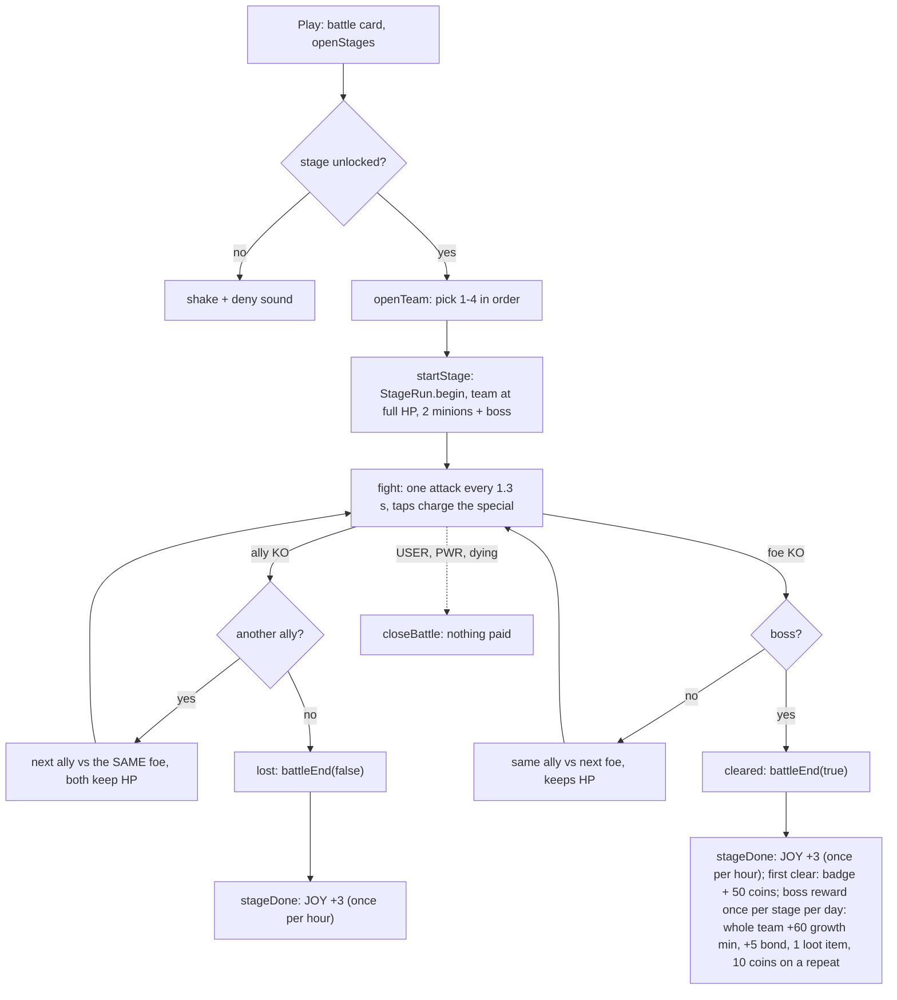

- **Rewards.** `Pet::stageDone` (`pet.cpp:1649`) pays once. It writes in a fixed order for power-cut safety: badge
  → daily mask → Box records → `save()`.
  - The daily boss mask is `stM`/`stD`, one bit per stage per day.
  - Box team members get their growth through `writeSlot`; they evolve once woken.
- **Loot** (`rollBattleItem` `:1384`, `BDROP_*` `pet.h:171`): cake 27, Golden Berry 25, vitamins 21, Poké Ball 8,
  Rare Candy 7, Revive 5, charm 4, egg 3. It arrives as a wrapped gift, or straight into the Backpack when the home
  is vacant.

---

## 10. Wild encounters

`encounter.h` holds the pure rules; the state and rewards are in `pet.cpp`. At most **one per calendar day**. Once
one spawns, `ENC_ROLL_SPAWNED` blocks further rolls that day.

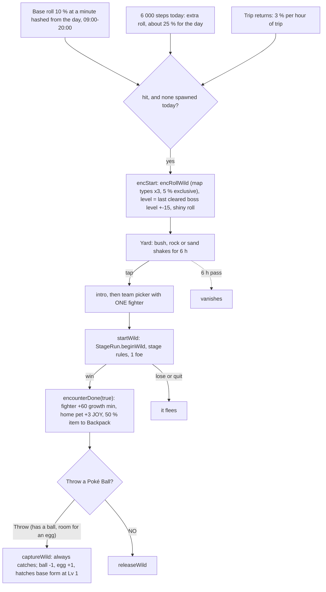

- **Rolls.** `Pet::encCheck` (`pet.cpp:1753`) is called from `tick`, `syncClock` and `addSteps`. It needs the clock
  set and someone able to fight.
- **Species.** `encPickBase` takes a common or rare base form (×3 weight if its type fits the map) or, 5 % of the
  time, an exclusive: Omanyte, Kabuto, Aerodactyl, Dratini (24 each), Mew (4).
- **Level.** The centre is the boss level of the highest stage cleared (10 with none). The species is evolved to
  fit the level (`evolveForLevel`).
- **State.** NVS `"enc"` (16 bytes). The object type depends on the map (`encMapObject`): rock for quarry and ruins,
  sand for the beach, bush otherwise.
- **Drops** (`WDROP_*` `pet.h:190`): cake 30, Golden Berry 30, vitamins 21, Rare Candy 8, Revive 7, charm 4. A wild
  win never gives coins or Poké Balls.
- **Capture** (`captureBlock` `pet.cpp:1856`, `captureWild` `:1866`) fails only with no ball or no room (Backpack
  eggs at 9, or 4 captured eggs queued). You start with 3 balls (`BALL_START`); the Shop sells them for 100.

---

## 11. Steps, items, gifts and coins

### Steps

- **Counter** (`steps.h`): software peak detection on the QMI8658 FIFO (the chip's pedometer is dead on this
  board). It counts only after 8 steps in a row and pauses on a shake.
- **Flush.** `imuTick` calls `pet.addSteps()` every 30 s (`STEP_FLUSH_MS`).
- **`Pet::addSteps`** (`pet.cpp:1063`) never writes flash; it only marks a pending save. It gives:
  - Walk care, only if the pet is hatched and awake: +1 JOY per 100 steps (max 30 a day), −1 weight and +1 bond
    per 1 000.
  - Finds every 800–1 200 rewarded steps, up to 5 a day (`findItem` `:1163`): Golden Berry 35, cake 20, vitamin
    30, charm 10, Revive 5. They arrive as **wrapped gifts**.
  - An egg every 8 000–15 000 steps. All steps count, even asleep. It goes straight home if the home is vacant,
    otherwise it is wrapped.
  - Goals 3 000 / 6 000 / 10 000 (`goalReward` `:1135`) give levels +1/+1/+2, JOY +10/+10/+15, bond 0/+2/+3,
    coins 10/20/40, a find on the first two, and the Marathon medal on the third. Coins are always paid; the rest
    needs the pet awake.
  - Then `encCheck()`.

### Items and the Backpack

- **Item enum** `IT_*` (`pet.h:151`): GOLDEN, PROTEIN, IRON, CARBOS, CHARM, RARECANDY, EGG, CAKE, REVIVE, BALL.
  **It is a save format:** `items[]` is stored by position in NVS `"bpack"`, so new items go at the end.
  `economy.h` and `travel.h` have numeric tables checked by `static_assert`s (`pet.cpp:1506`).
- **Caps.** `ITEM_MAX` 9 per item; the charm is capped at 1.
- **Not used by hand:** the charm (it boosts the next egg's shiny odds), eggs, the Revive (offered at death) and the
  Poké Ball (thrown after a wild win).
- **Gifts:** `giveGift` (`pet.cpp:1177`) holds up to 8 wrapped gifts (NVS `"gifts"`); beyond that an item goes
  straight to the Backpack. `openGift` (`:1220`) opens the first gift that fits. `unwrapGifts` (`:1243`) empties
  them into the Backpack when the home is freed.

### Coins and the Shop

- **Storage.** `Pet::coins`, NVS `"cn"`, max 9 999. The daily cap counter is `coinToday`/`coinDay`.
- **Functions.** `addCoins(n, capped)` (`pet.cpp:1438`) only marks a pending save. `spendCoins` and `buyItem`
  (`:1457`, `:1464`) and `buyMap` save at once.
- **Prices** (`ECO_ITEM_PRICE` `economy.h:49`): berry 30, cake 40, vitamins 60, Revive 80, Poké Ball 100, Rare
  Candy 150. Maps cost 150, 150, 200 and 250 (owned mask NVS `"ybgO"`). Purchases check, in order: not sold, then
  full, then not enough coins (`shopCheckItem`).

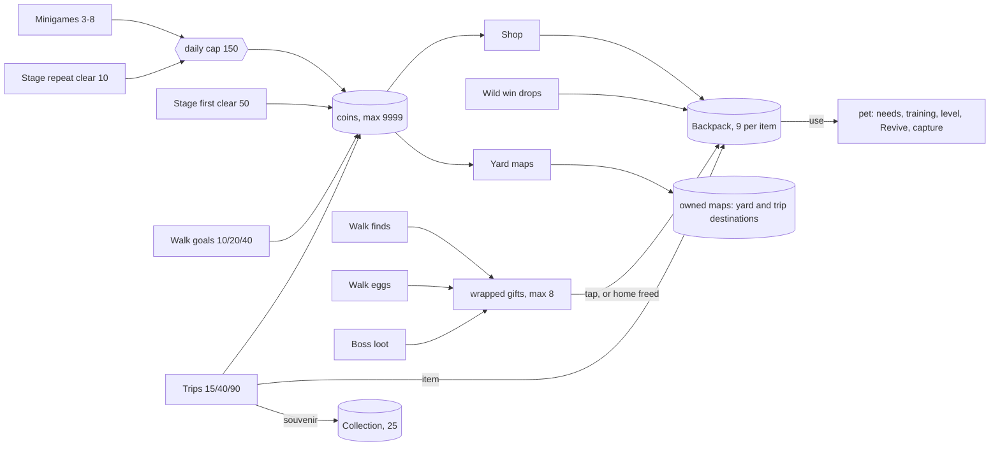

---

## 12. Travel and the Collection

- **Rules.** Only a Box pet travels (never the home pet), one trip at a time, to an owned map. Trips run on real RTC
  time, also with the board off, and need the clock set.
- **Code.** `canTravel` `pet.cpp:1517`, `startTravel` `:1531` (one 16-byte NVS record `"trv"` with a fixed seed),
  `travelCheck` `:1552` (from tick and syncClock), `travelComplete` `:1565`, `takeTravelResult` `:1603`.
- **Outcome.** `travelRoll` (`travel.h:78`) computes everything from the saved seed, so the result is the same
  whenever it is evaluated.

| Trip | Coins | Growth | Item | Souvenir | Log events |
|---|---|---|---|---|---|
| 1 h | 15 | 30 min | 25 % | 40 % | 1 |
| 3 h | 40 | 90 min | 50 % | 75 % | 2 |
| 8 h | 90 | 240 min | 100 % | 100 % | 3 |

- **Souvenirs.** 25 in all, 5 per map (id = (map−1)·5 + i; i 0–1 common, 2–3 uncommon, 4 rare). A duplicate is
  rolled again once, then becomes +10 coins. Stored in NVS `"souv"` and `"souvD"`. They are shown in the Bag's
  Collection tab.
- **Write order** in `travelComplete` (comment `:1558-1564`): growth goes to the Box record, then `"trv"` is
  removed, then coins, item and souvenir are paid, then the result is stored (`"trvR"`). Coins can never be paid
  twice after a power cut; growth can be (accepted).
- **Encounter.** A completed trip also rolls a wild encounter (`encTravelRoll`).

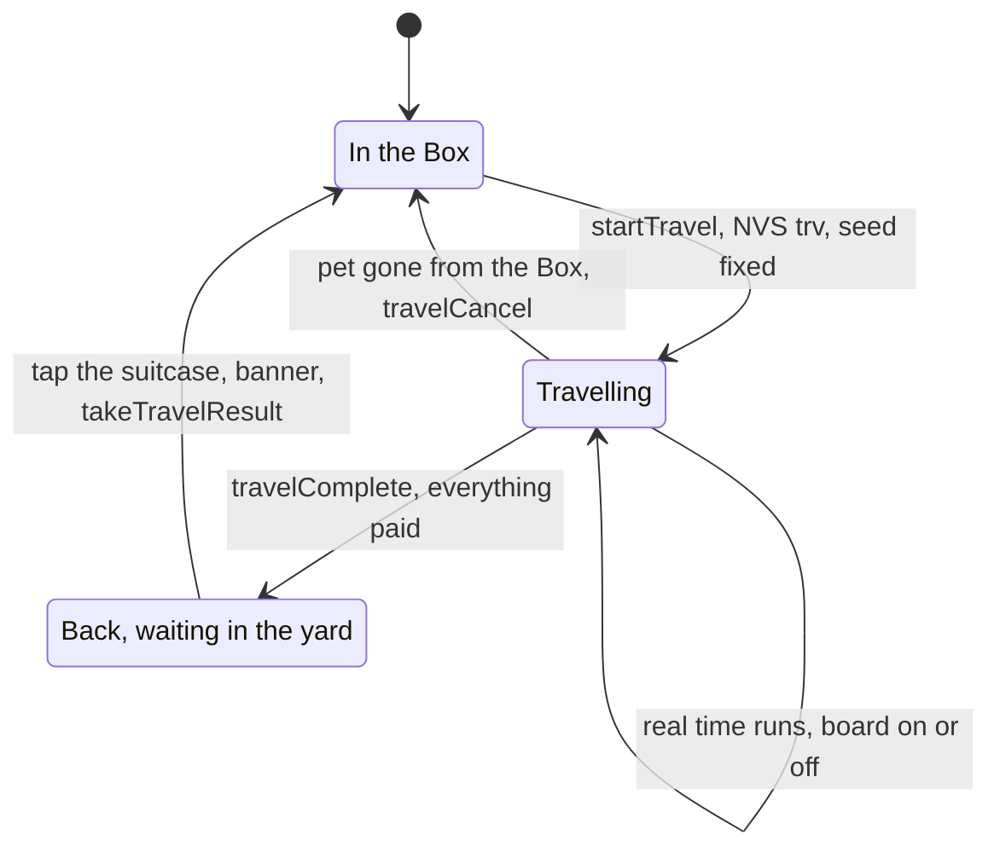

**UI.** `openTravel` (`TamaPoke.ino:7093`) opens `PANEL_TRAVEL`. A running trip shows a countdown and a log
(`travelEvent`) and cannot be cancelled. The returned pet is found by `trvBackSlot` (`:7382`); the banner is
`drawReturnBanner` (`:7397`).

---

## 13. Persistence and offline catch-up

- **NVS namespace `"tamapoke"`** holds one key per field, not a single struct. See `Pet::save` (`pet.cpp:1910`) and
  `Pet::load` (`:2029`) for the full list. Common keys:
  - Needs: `full`, `joy`, `ene`, `hyg`, `poop`.
  - Growth and time: `age`, `grow`, `seen`.
  - Care: `bond`, `strk`.
  - Items and gifts: `bpack`, `gifts`.
  - Progress: `dexreg`, `bdg`.
  - Coins and yard: `cn`, `ybg`, `ybgO`.
  - Systems: `trv`, `trvR`, `enc`, `souv`, `team`, `cegg`.
  - Box: `box0-5`, `boxT`, `eggH`, `vac`.
  - Identity and versions: `uid` (written last), `init`, `gcv`.
  - Kept outside `Pet`: `bri` (brightness), `vol` and `snd` (audio), `lang`.
- **Save cadence.**
  - User actions call `save()` at once (`persist(true)`).
  - Ticks, steps and IMU events only set `pendingSave`, plus a periodic mark every 5 ticks.
  - The loop calls `flushSave()` **only when the screen is dim or off, or the pet sleeps**, because an NVS write
    freezes both cores for about 1 s.
  - `lastSeenEpoch` is stamped into RAM every 30 s and saved with the next write.
- **Migrations.**
  - A new game writes `gcv` before `init`.
  - `migrateGrowthCurve` is staged through `gmig`.
  - The one-shot flags `rvg` (3 Revives) and `ballg` (3 Poké Balls) are written after the data, so a power cut
    re-runs them.
  - Old saves without a `uid` get one.
- **Offline catch-up** (`Pet::syncClock`, `pet.cpp:276`, called once from `setup`). Minutes off = (RTC − `seen`)/60.
  - Travel and encounters are checked first.
  - The Revive window keeps counting.
  - It is skipped if under 2 min, ending or dying, starter pick or vacant. The cap is 14 days.
  - It replays minute by minute: age, the egg timer, growth, `nightMinute` at that minute's hour, and sleep drain or
    awake drain with **floors of 15**.
  - One poop per 240 min awake.
  - **Not applied offline:** evolution (left ready for the user), slip-ups, neglect, death, weight burn and the
    12 h DEF bonus.

---

## 14. Power, screen, celebrations, audio

- **Idle ladder** (`power.h` `dimStageFor` `:51`): at 90 s the screen dims (DIM_LOW); at 120 s the **screensaver**
  starts (pet and clock on a Lissajous path). Face-down drops the brightness to 8, with no saver.
- **Brightness** (`brightnessFor` `:85`): the user level (4 levels, BOOT key) is the ceiling. On battery it is
  capped at 100 below 20 % and at 60 below 10 %.
- **Frame interval** (`frameIntervalMs` `:101`):

  | State | Interval |
  |---|---|
  | Screen off | 0 (no frames) |
  | A game or battle open | 85 ms |
  | Default | 100 ms |
  | Idle 60 s | 150 ms |
  | Pet asleep | 500 ms |
  | Low battery | doubled |

- **Sleep.** Light sleep for 200 ms only when off USB with the screen off or in the saver (woken by the touch INT,
  USER or BOOT). There is **no deep sleep**.
- **Burn-in** (`burnin.h`): the whole canvas orbits over 9 positions, 4 px apart, moving every 3 min.
- **Celebrations** (`fx.h`):
  - `FxQueue fxq` shows level-up, medal, streak milestone and walk goal one at a time, only when the screen is
    visible, and merges consecutive level-ups.
  - `FxOverlays fxo` draws the small "+N", heart, "ATK +3", deny shake and similar.
  - `FxWatch` watchers detect changes from any source.
  - Code: `fxCollect` (`TamaPoke.ino:3997`) every loop, `fxFrame` (`:4068`), `drawFxBanner` (`:4230`),
    `drawFxOverlays` (`:4403`).
- **Audio** (`audio.h`): `sfxPlay(Sfx)` queues a non-blocking sound to a FreeRTOS task on core 0. Ids include TAP,
  EAT, HATCH, EVOLVE, LEVELUP, MEDAL, DENY, BATTLE, HIT, WIN, LOSE, MORNING, WILD, …. There are 4 volume levels
  including off (`volume.h`, NVS `"vol"`).

---

## 15. Data pipeline, sprites, i18n

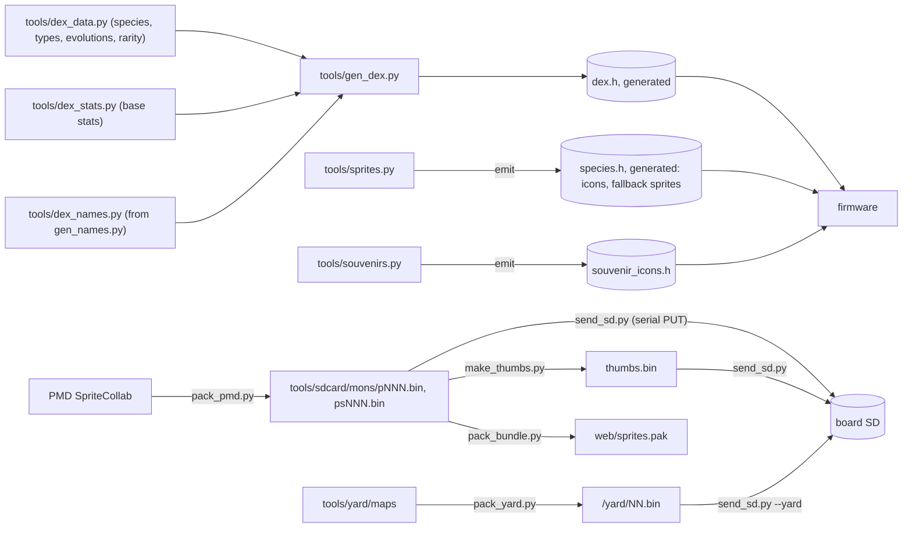

- **Species data.** Edit the Python sources, then run `python3 tools/gen_dex.py` and commit the regenerated `dex.h`
  with them. **Never hand-edit `dex.h` or `species.h`**: CI's `generated` job fails on any diff.
  - `DEX_TBL[152]` holds the name, evolution, level, rarity, base stats, types, biome and base form.
  - `dexName()` returns the localised name.
  - Starters are `STARTER_DEX = {1,4,7}` (`TamaPoke.ino:321`).
- **Sprites** (`sdmon.cpp`). All 151 species and their shinies are loaded from the SD into PSRAM.
  - `PmdMon` is the TPK2 multi-action sprite (`PMD_IDLE, WALKL, WALKR, SLEEP, EAT, HURT, ATTACK, POSE, HOP, NOD,
    BREATH, SIT, WALKU, WALKD`; ids are append-only).
  - `SdThumbs` holds the 40×40 thumbnails.
  - `ensureMon()` (`TamaPoke.ino:496`) reloads the sprite when the species, the shiny flag or the SD contents change.
- **i18n.** `i18n.h` has `enum Lang` (ES, EN, FR, DE, IT, PT, JA, KO) and `enum StrId`; `i18n.cpp` has
  `STRINGS[LANG_COUNT][STR_COUNT]`, with one block per language in the same order.
  - **To add a string:** add an `S_xxx` before `STR_COUNT`, add an entry at the same position in all 8 rows, then
    run `python3 tools/test_i18n_formats.py`. A short row compiles but crashes at runtime. Only EN and ES need care
    (CLAUDE.md).
  - **Latin-script text** uses single-byte CP437 octal escapes, not UTF-8, because centring uses `strlen*6`.
  - **JA and KO** use UTF-8 with U8g2 fonts (`applyLangFont` `TamaPoke.ino:2310`).

---

## 16. Serial debug commands

These are typed at 115200 baud and handled by `handleSerial()` (`TamaPoke.ino:812`). `sdSerialCommand`
(`sdmon.cpp:260`) is tried first for `PUT`, `LS` and `SDINFO`. Every command answers `DONE`. They are the fastest way
to test on the board (see also the memory note on opening the port without resetting the board).

| Area | Commands |
|---|---|
| Pet state | `STATS` (full dump), `SPEC n`, `LVL n`, `AGE m` (4320 = farewell ready), `SHINY`, `NICK s`, `NEED i v` (0 food, 1 hyg, 2 joy, 3 ene), `POOP`, `CAREDAY`, `REG` |
| Eggs | `HATCH`, `EGGT [min]`, `EGGS` (simulate 20 rolls), `EGG [n]` |
| Endings | `BYE` (farewell), `RELEASE`, `ABANDON` (needs to 0), `NEGLECT m`, `DYING m`, `DIE`, `REVIVES [n]` |
| Time | `TIME [epoch]` (RTC + pet), `RTCSET epoch` (RTC only, simulates time off), `NIGHT` |
| Box | `BOX`, `STORE k`, `WAKE k`, `BOXFILL`, `BOXCLR k`, `NVS` |
| Games | `BALL [n]`, `DASH? / DASH [s] / STEER deg\|OFF`, `ZEN? / ZEN [s] / HOLD 1\|0\|OFF` (`DASH`/`ZEN`/`BALL` here pay nothing) |
| Battles | `BATTLE`, `STAGE n`, `STAGEDAY` (re-arm today's boss rewards), `BADGES mask` |
| Encounters | `ENC?`, `ENC [dex]`, `ENCEND`, `BALLS n` |
| Economy and travel | `COINS [n]`, `SHOP`, `BUY id`, `BUYMAP n`, `GIFTS`, `GIFT item`, `TRAVEL [slot map tier]`, `TRAVELT m`, `TRAVELEND`, `SOUV [mask]` |
| Steps and IMU | `STEPS n`, `IMU`, `IMULOG s`, `SHAKE`, `FACEDOWN [0]` |
| Screen and UI | `TAP x y` (simulated touch, mode-aware), `BACK`, `PWR`, `SAVER`, `GAL`, `BRIGHT [n]`, `ORBIT [n]`, `BIOME [n]`, `YARDBG [n]`, `YARDUI [p]`, `FX name`, `PERF` |
| System | `HEALTH`, `VOL [n]`, `BEEP`, `WIPE` (factory reset + restart) |
| SD | `PUT path size`, `LS`, `SDINFO` |

---

## 17. Tests and developer workflow

- **Build and flash:** `pio run -e tamapoke [-t upload]`. `pio run -e bringup -t upload` flashes the hardware test.
  Versions are pinned in `platformio.ini` and `.github/workflows/ci.yml`.
- **Host tests:** `./test/run_tests.sh [--asan]`, or `cd test && make [FILTER=name]`.
  - They compile `pet.cpp`, `i18n.cpp` and the pure headers against shims in `test/shim/` (Arduino, an in-memory
    NVS with power-cut simulation, a fake clock), with one `test_*.cpp` per module.
  - **A new pure header or test file must be added to `SOURCES` and the dependency list in `test/Makefile`.**
  - `test/test_tools.py` checks the tools, regenerates `dex.h` and replays IMU captures.
  - `tools/test_i18n_formats.py` checks the translation tables.
- **Screens on the PC:** `tools/render/render.sh [outdir] [scene…]` compiles the real `.ino` (via `ino2cpp.py`) and
  writes 480×480 PNGs to `.pio/render/screens/`. To render a new screen, add a scene to `tools/render/render.cpp`.
- **CI jobs:** arduino-cli build, PlatformIO build, render, generated-files diff, `ruff check tools/`, host tests
  with ASan, and i18n.
- **Release bump:** `FW_VERSION` (`TamaPoke.ino:61`), `web/manifest.json`, `CHANGELOG.md`, and
  `bash tools/build_web.sh` for `web/firmware/tamapoke.bin`. **Also update the version and commit line at the top of
  this guide.**
- **Board checks:** `docs/PENDING_TESTS.md` (numbered open checks) and `docs/DEVICE_TESTS.md` (procedures). EN and
  ES only.
- **Other docs:** `docs/NEXT_FEATURES.md` (FX/BOX/OTA spec; OTA lives on branch `feature/ota`),
  `docs/GAMEPLAY_TUNING.md`, `docs/NEW_GAMES.md`, `docs/FEATURES.md` (steps, motion tricks, link), `docs/AMOLED-2.16.md`
  (port notes), `docs/yard-prototype/DESIGN_YARD_UI.md`.

---

## 18. Gotchas and known doc/code mismatches

**Code gotchas**

1. **`.ino` prototype conversion.** The Arduino/PlatformIO converter puts auto-generated prototypes before struct
   definitions and skips pointer-returning functions. That is why some structs sit at the top of the file
   (`YardBody`), why `encOpen()` is a macro, and why some functions are forward-declared by hand.
2. **Never call `save()` from a tick, IMU or step path.** It freezes the board for about 1 s. Set `pendingSave`
   instead.
3. **`isEgg()` is true for a vacant home.** Check `isVacant()` first.
4. **Item ids and the `PetRecord` layout are save formats.** Only append new items, and bump `PET_RECORD_VER` with a
   migration if the record changes.
5. **Box write order matters** (§6). Keep `eggH` before `boxT` and `uid` last in `save()`, and extend the power-cut
   loop in `test_box.cpp` when touching it.
6. **Evolution and farewell never auto-fire,** not even after offline catch-up.
7. **Hour windows differ by feature.** Sleepy and the night floors use 22–08, `nightSleep` starts at 20, face-down
   bedtime uses 20–06, and the night id is anchored at 08:00. The RTC is read as local time, with no timezone.
8. **`travelCheck` and `encCheck` run before the tick's early return,** so they advance even when the home is vacant
   or dying.
9. **The daily coin cap applies only to games and repeat stage clears.** First clears, walk goals and trips are
   uncapped.
10. **`practiceJoy` uses `millis()`,** so it resets on reboot. The daily boss mask uses the calendar day; with no
    clock, "day 0" lasts until the clock is set.
11. **Yard positions are RAM-only** (poops, gifts, egg, food) and are re-scattered on every boot.
12. **`wind.h` belongs to the old side-view scene,** not the v2.0 yard.

**README / comments versus code** (the code is the truth)

- README "Care slip-up … 30-min cooldown". The code sets `mistakeCooldown = 60` awake ticks (`pet.cpp:418`).
- Comments at `pet.h:438` and `pet.cpp:441` say the farewell comes at "7 días". `FAREWELL_AGE_MIN` is 3 days.
- Comments at `TamaPoke.ino:459` and `:7586` say the egg takes "4 h". `EGG_HATCH_MIN` is 120 (2 h).
- `test/README.md` gives old battle numbers (5–25 % hits, 30 % special, 6 languages). The code is 2–60 %, special
  70 %, 8 languages.
