# TamaPoke game logic

> **Written from firmware v2.3, commit `364621f` (main, 2026-11-17); updated for `tuning.h` (branch `feature/tuning`, 2026-11-17)
> and for v2.4 egg colours (branch `feature/egg-colors`, 2026-11-17) v2.5 full-screen yard (branch
> `feature/full-yard`, 2026-11-17), v2.6 hungry-pet food fix (branch `fix/hungry-food`, 2026-11-17) and v3.0 two
> live home pets (`84b2acf`) and v3.1 no hygiene, stale poops drain JOY (`6e10c31`), v3.2 coloured berries (`b7f7d9c`),
> v3.3 pet menu, Play/Bag/Shop dock (`c8015f8`) and v3.4 player medals, USER page (branch `feature/two-homes`,
> 2026-11-18), v3.5 yard 2.4x, v3.6 4.4x yard rolled back in v3.7, v3.8 pets 2.6x + pet-menu need bars, v3.9 in a box, v3.10 bigger labels, v3.11 tuning pass (`feature/tuning-v311`), v3.12 sleeping pets fight, v3.13 slower night, v3.14 Lure, v3.15 four new maps and 45 souvenirs (branch `feature/new-maps`), v3.16 faster ball game, v3.17 ball 3.5x at 100 + hint + SPD on the result, v3.18 ball miss thud + dust, v3.19 Box keeps night sleep vs nap (branch `fix/box-night-sleep`) (2026-11-22).**
> If `FW_VERSION` in `TamaPoke.ino` or `git log` is past this, sections may be stale. The rule (CLAUDE.md) is that
> every commit that changes game logic updates this guide in the same commit, including this line.

This guide has two jobs:

1. Explain how the game works: the loop, the pet's life, the screens and the systems around them.
2. Tell a developer, or Claude Code, **where each piece lives**, so a task starts from the right file and function
   instead of a read of the whole repo.

Pointers are `file:line` at the commit above. Line numbers drift, so **search by the function or constant name**
and treat the line as a hint. Player-facing numbers are in `README.md` ("Game manual"). This guide gives the code
side and flags where the README and the code disagree (§18).

**Every balance number quoted here (drain rates, timers, odds, rewards, prices) is defined in [`tuning.h`](../tuning.h).**
To tune the game, change it there (see §17, "Tuning").

---

## Contents

0. [Where is X? (quick lookup)](#0-where-is-x-quick-lookup)
1. [Architecture](#1-architecture)
2. [The runtime: setup, loop, tick, render](#2-the-runtime-setup-loop-tick-render)
3. [Screens and input](#3-screens-and-input)
4. [The pet simulation (per-minute tick)](#4-the-pet-simulation-per-minute-tick)
5. [Life cycle: eggs, evolution, endings](#5-life-cycle-eggs-evolution-endings)
6. [The Box](#6-the-box)
7. [The yard (home screen)](#7-the-yard-home-screen)
8. [Minigames](#8-minigames)
9. [Battles and stages](#9-battles-and-stages)
10. [Wild encounters](#10-wild-encounters)
11. [Steps, items, gifts and coins](#11-steps-items-gifts-and-coins)
12. [Travel and the Collection](#12-travel-and-the-collection)
13. [Persistence and offline catch-up](#13-persistence-and-offline-catch-up)
14. [Power, screen, celebrations, audio](#14-power-screen-celebrations-audio)
15. [Data pipeline, sprites, i18n](#15-data-pipeline-sprites-i18n)
16. [Serial debug commands](#16-serial-debug-commands)
17. [Tests and developer workflow](#17-tests-and-developer-workflow)
18. [Gotchas and known doc/code mismatches](#18-gotchas-and-known-doccode-mismatches)

---

## 0. Where is X? (quick lookup)

| I want to change… | Look at |
|---|---|
| **The two home pets** (which one an action hits, focus, slot 1 save) | §4 "Two home pets"; `Pet::focus` `pet.cpp:10`, `FocusGuard` `:19`, `uiFocus` `TamaPoke.ino:539`, `homeFocusTick` `:550`; `petlife.h`, `homerec.h` |
| **Player medals** (19 × Bronze/Silver/Gold, coins) | `medals.h` (table, tiers, `pm` blob); `Pet::medalValue` `pet.cpp:700`, `medalsUpdate` `:741`, `medalsMigrate` `:780`; thresholds `MEDAL_T` and coins `MEDAL_COINS` in `tuning.h` |
| **Any balance number** (a rate, timer, probability, reward or price) | **`tuning.h`**, grouped by system. Not there: the level curve (`growth.h`), minigame physics (`ballgame.h`, `zengame.h`, `dashgame.h`), the 8 stages (`stage.h`) |
| How fast needs drain, poops, slip-ups, neglect | `Pet::tick` `pet.cpp:448`, `sleepMinute` `pet.cpp:1161`, numbers in `tuning.h` |
| Level curve / growth | `growth.h` (`levelCost`, `levelFor`, `addLevels`); `growMin` in `Pet` |
| Night / sleep schedule | `Pet::nightMinute` `pet.cpp:1196`, `goToBed` `pet.cpp:1182`, hours in `tuning.h` |
| Feeding, cake, poops, pet it | `feedFood` `pet.cpp:1011` (gate `canFeed` `:1003`; foods, favourite and effects in `food.h`), `eatCake` `:1032`, `cleanPoop` `:1227`, `clearPoops` (waterfall), `caress` `:1246`; stale poops: `stalePoops` `petlife.h:197` |
| Egg odds, shiny odds, genes | `pickEggSpecies` `pet.cpp:590`, `shinyOdds` `:337`, `hatch` `:939`, `newEgg` `:130` |
| Evolution rules | `canEvolveNow` `pet.cpp:970`, `evolve` `:977` |
| Farewell / release / death / Revive | `canFarewellNow` `pet.cpp:854`, `release` `:929`, `startDying` `:872`, `revive` `:889`, `letGo` `:906`, `endLife` `:255` |
| Box store/wake and power-cut safety | `Pet::store` `pet.cpp:2970`, `wake` `:3005`, `boxBoot` `:3086`, `box.h` |
| A minigame's rules | `ballgame.h`, `zengame.h`, `dashgame.h` (pure); the bag is only in `TamaPoke.ino` (`startSack` `:3035`) |
| A minigame's reward | `Pet::playResult` `pet.cpp:1036`, `trainStrength` `:1057`, `zenResult` `:1083`, `dashResult` `:1104` |
| Battle damage / types / special | `battle.h` (`hitDamage` `:113`, `TYPE_CHART` `:39`, `SpecialMeter` `:245`) |
| Stages, foes, team | `stage.h` (`STAGES` `:49`, `stageRollFoes` `:88`, `StageRun` `:115`) |
| Stage rewards / loot | `Pet::stageDone` `pet.cpp:1939`, `rollBattleItem` `:1647`, `BDROP_*` in `tuning.h` |
| Wild encounters | `encounter.h` (rolls, level, species), `Pet::encCheck` `pet.cpp:2049`, `encounterDone` `:2164`, `captureWild` `:2220` |
| Coins, prices, daily cap | `economy.h`; `Pet::addCoins` `pet.cpp:1724`, `spendCoins` `:1743`, `buyItem` `:1750` |
| Items, Backpack, gifts | `IT_*` enum `pet.h:61`, `useItem` `pet.cpp:1558`, `giveGift` `:1432`, `openGift` `:1475` |
| Steps and walk rewards | `steps.h` (counter), `Pet::addSteps` `pet.cpp:1287`, `goalReward` `:1380` |
| Travel and souvenirs | `travel.h` (`travelRoll` `:83`), `Pet::startTravel` `pet.cpp:1820`, `travelComplete` `:1854` |
| Yard movement, food walking | `yard.h` (`yardStep` `:420`, BFS paths, food phases); `renderYardHome` `TamaPoke.ino:9859` |
| Yard maps / backgrounds | `yardbg.h` (TPY1), `yardEnsureMap` `TamaPoke.ino:8833`, `tools/pack_yard.py` |
| A screen's drawing or taps | §3 table; everything UI is in `TamaPoke.ino` |
| A string / translation | `i18n.h` (`StrId`), `i18n.cpp` (8 rows), `tools/test_i18n_formats.py` |
| Species data | `tools/dex_data.py` + `tools/gen_dex.py` → `dex.h` (generated) |
| Save format / NVS keys | `Pet::save` `pet.cpp:2255`, `Pet::load` `:2438` |
| Brightness, dim, saver, PWR | `power.h`, `burnin.h`, `pwrPress` `TamaPoke.ino:~724`, `updateBrightness` `:~754` |
| Celebrations / "+N" floaters | `fx.h`, `fxCollect` `TamaPoke.ino:4325`, `fxFrame` `:4406` |
| Sounds | `audio.h` (`Sfx` enum), `sfxPlay` |

---

## 1. Architecture

The firmware is an Arduino sketch: `TamaPoke.ino` at the repo root (about 10.5 k lines) plus top-level `.h`/`.cpp`
files. PlatformIO builds with `src_dir = .` and `build_src_filter = -<*> +<*.ino> +<*.cpp>`, so **any new top-level
`.cpp` goes into the firmware**. Comments in the code are in Spanish.

The code is split into three layers:

- **Tuning.** `tuning.h` holds every balance number and only those. The modules below include it.
- **Pure logic, host-tested.** These are header-only modules plus `pet.cpp`. They have no hardware access and are
  compiled on the PC by `test/Makefile`.
- **State and rules.** The `Pet` class (`pet.h`, `pet.cpp`) holds the two home pets (since v3.0: itself is the
  focused one, `other` the second, §4), player-wide state (steps, coins, badges, Backpack, Pokédex, souvenirs), the
  Box, and the NVS save.
- **Glue, screens and input.** `TamaPoke.ino` holds `setup()`, `loop()`, every screen, touch and button handling,
  the battle and minigame UI, and the yard drawing. It is not host-tested; it is checked with the renderer and on
  the board.

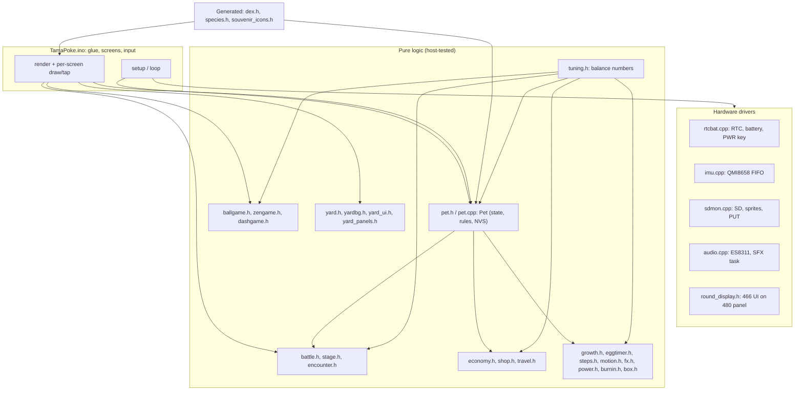

### Source files

| File | Lines | Role |
|---|---|---|
| `TamaPoke.ino` | 10553 | Whole runtime: setup/loop, input, every screen, games and battle UI, yard, encounters |
| `tuning.h` | 378 | **Every balance number**: needs, sleep, eggs, care, bond, steps, games' rewards, battle, encounters, coins, prices, trips |
| `pet.h` / `pet.cpp` | 622 / 2864 | `Pet`: tick, growth, sleep/night, eggs, Box, NVS save/load/migrations, items, steps, travel, encounters, rewards; focus between the two home pets |
| `petlife.h` | 238 | `struct PetLife` (v3.0): every per-pet field and its const queries; `Pet` derives from it |
| `homerec.h` | 109 | `HomeRec` (v3.0): home slot 1 as one NVS blob `hm1` (version + CRC) |
| `growth.h` | 164 | Level curve (growth minutes ↔ level), `gcv` migration helpers |
| `eggtimer.h` | 57 | Yard egg: hatches after `EGG_HATCH_MIN` real minutes, shakes cut it |
| `eggcolor.h` | 91 | Egg colours by type (v2.4): per-type body/shade table, the ( / ) two-type blend |
| `box.h` | – | `PetRecord` (55 B packed + CRC), slot states |
| `battle.h` | 277 | Battle engine: stats, gen-1 type chart, damage, special meter |
| `stage.h` | 222 | 8 stages, foe rolls, `StageRun` (team carry-over), wild runs |
| `encounter.h` | 165 | Wild encounters: daily rolls, species, level, lifetime |
| `ballgame.h` / `zengame.h` / `dashgame.h` | 87 / 160 / 251 | Ball (SPD), waterfall (DEF) and sled (SPD) logic and physics |
| `economy.h` / `shop.h` | 57 / 52 | Coin formulas and price lookups (values in `tuning.h`); shop checks, map picker |
| `travel.h` / `travel_ui.h` | 248 / 198 | Trips and souvenirs; travel screen geometry, Collection pages, Bag tabs |
| `yard.h` / `yardbg.h` / `yard_ui.h` / `yard_panels.h` | 700 / 131 / 133 / 71 | Yard walk planner, food in front, menu step-aside; TPY1 maps; HUD and dock kit; Play panel, pet menu, food list and pet picker geometry |
| `fx.h` | 348 | Celebration queue, "+N" overlays, change watchers |
| `power.h` / `burnin.h` | 133 / 69 | Dim, saver, frame pacing, light sleep; AMOLED orbit and saver path |
| `steps.h` / `motion.h` / `imu.h` / `imu.cpp` | 101 / 292 / 42 / 250 | Software step counter; shake, face-down, tilt; IMU reader |
| `rtcbat.h/.cpp`, `batcurve.h` | – | RTC, AXP2101, PWR key; voltage → % curve |
| `audio.h/.cpp`, `volume.h` | – | Sound effects (`Sfx` enum), 4-level volume |
| `sdmon.h/.cpp` | 66 / 327 | SD mount, PMD sprite (TPK2) / thumbs / yard map loaders, serial `PUT` |
| `i18n.h` / `i18n.cpp` | 141 / 877 | 8-language string tables |
| `dex.h`, `species.h`, `souvenir_icons.h` | – | **Generated** (see §15); do not hand-edit |
| `round_display.h`, `roundmask.h`, `ui_frame.h`, `blit.h`, `board_amoled_216.h` | – | Display layer, pins |
| `wind.h` | 49 | Grass sway for the old side-view scene (not the v2.0 yard) |
| `button.h` | 27 | Key debounce |

`bringup/main.cpp` is a separate hardware-test firmware (`pio run -e bringup`).

---

## 2. The runtime: setup, loop, tick, render

### setup() — `TamaPoke.ino:395-510`

1. Serial: 8 KB RX buffer and **`setTxTimeoutMs(0)`**, so printing never blocks without a host (`:396-401`).
2. `loadLang()`, then I²C at 400 kHz with a 50 ms timeout. One bus is shared by touch, PMU, RTC, codec and IMU.
3. Display `gfx->begin` (QSPI 40 MHz) and `roundDisplayBegin`, then brightness from NVS `"bri"`, then `applyLangFont()`.
4. Touch CST9220: 3 begin attempts, `touch.reset()`, and an interrupt on the INT pin (`touchIsr`, `gTouchIrq`).
5. USER and BOOT keys.
6. `pet.timedEggs = true`, then `pet.begin()` (NVS load, migrations, `boxBoot`), then `sdBegin()` and `thumbs.load()`.
7. `rtcBegin`, `batBegin`, `pwrSetup`, `imuBegin`.
8. If the RTC is invalid, it is seeded from the saved `"seen"` epoch, so time never goes backwards (`:472-487`).
9. **`fxArmWatches()` before `pet.syncClock()`**, so levels gained while off are announced once.
10. `pet.syncClock(epoch)` runs the offline catch-up (§13).
11. `audioBegin()` plays the boot jingle.

### loop() — `TamaPoke.ino:512-638`

There is no scheduler; every pass runs this list in order:

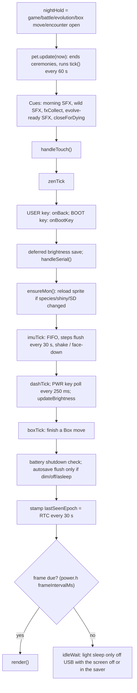

**Game time.** One game minute is one real minute. `Pet::update` (`pet.cpp:423`) calls `tick()` every `PET_TICK_MS =
60000` (`pet.h:11`) using `millis()`, and loops to catch up. The RTC is used only for offline catch-up, the
real-time timers (yard egg, travel, Revive window, encounters, cake) and the hour of day.

**Render.** `render()` (`TamaPoke.ino:2719`) does three things:

- It expires dialog timers, then dispatches by priority (§3).
- "Static" screens (Box, menus) hash a `screenKey()` (`:2395`) and redraw only when it changes.
- The home path draws the yard background, the yard (`renderYardHome`), fx overlays, the evolve or farewell
  button, celebration banners, walk news, the return banner and dialogs, then calls `gfx->flush()`.

The canvas is a 466×466 `RoundCanvas` centred on the 480×480 panel, with a round mask and the burn-in orbit shift.
Since v2.5 the yard frames call `yardShowFull()`, and that flush fills the canvas corners and the panel border with
the yard map instead of black (`RoundCanvas::showUnder`, §14).

---

## 3. Screens and input

There is **no single screen enum**. Each screen is a global flag (`galleryOpen`, `boxOpen`, `stagesOpen`,
`teamOpen`, `gameOpen`, `sackOpen`, `zenOpen`, `dashOpen`, `bt.phase`, `encUi`, `kbOpen`, `clockOpen`, `cardOpen`,
`bagOpen`, `panelKind`, …; most are declared at `TamaPoke.ino:90-390`). `render()`, `onTap()` and `onBack()` check
them in the same priority order:

> saver → starter → yardDemo → gallery → encounter → team → stages → box → ball → sack → sled → waterfall → battle →
> keyboard → clock → card → pet picker → bag/shop → panel (Play/Travel) → home (yard, egg, vacant, ceremony, dying;
> inside the yard, an open pet menu takes taps first)

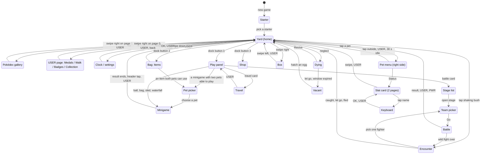

Independently of the screen, the display has its own views: **game → screensaver → screen off → game** (short PWR
press), and an idle ladder: dim at 90 s, saver at 120 s.

### Screen map

| Screen | Flag | Draw | Tap / open |
|---|---|---|---|
| Yard (home) | default; `yardHomeNow()` `:7633` | `renderYardHome` `:8604` | `yardTap` `:8618` (dock → egg → wild → poop → gift → pets) |
| Starter choice | `pet.awaitingStarter()` | `renderStarterSelect` `:2234` | `onTap` `:1695` → `pet.chooseStarter` |
| Gallery | `galleryOpen`, `galleryPage`, `galleryDetail` | `renderGallery` `:5535` | `galleryTap` `:5605` |
| Box | `boxOpen`, `boxAsk`, `boxMove` (one page since v3.4) | `renderBox` `:6443` | `boxTap` `:6056`, `boxTick` `:6115` |
| Stat card (Status in the pet menu) | `cardOpen`, `cardPage` | `renderCard` `:5629` → Profile `renderCardProfile` `:4813` (needs, streak, bond, berry, age, evolution line, slip-ups), Stats `renderCardStats` `:4911` | swipes (`onSwipe` `:1535`); tap the name to rename |
| USER page (v3.4, swipe up) | `userOpen`, `userPage`, `userMedalPage`, `userMedalTip` | `renderUser` `:5784` → Medals `renderUserMedals` `:5732`, Walk `renderUserWalk` `:4950`, Badges `renderUserBadges` `:7148`, Collection | `openUser` `:5654`, `userTap` `:5821` |
| Rename keyboard | `kbOpen` | `renderKeyboard` `:5414` | `keyboardTap` `:5439` |
| Clock / settings | `clockOpen` | `renderClock` `:3860` | `clockTap` `:3919` (time, brightness, language, volume) |
| Pet menu + food list (v3.3) | `petMenuOpen` (slot + 1), `petMenuView` | `drawPetMenu` `:7680` (inside the yard frame) | `openPetMenu` `:7520`, `petMenuTap` `:7810`, `petMenuCheck` `:7554` (closes it when the pet can't use it any more), `closePetMenu` `:7536`; food → `yardFeedFront` |
| Pet picker (v3.3) | `petPick` (game or item) | `renderPetPick` `:7402` | `openPetPick` `:7391`, `petPickTap` `:7445`; then `uiFocus` + the game, or `bagUseOn` `:5544` |
| Play / Travel panel | `panelKind` (`TamaPoke.ino:226`; kinds in `yard_panels.h`) | `renderPlayPanel` `:7633`, `renderTravelSetup` `:8332`, `renderTravelTrip` `:8414` | `playPanelTap` `:7670`, `travelTap` `:8485` |
| Bag / Shop | `bagOpen`, `bagTab` (0 items, 1 shop) | `renderBag` `:5439`, `renderShop` `:4962`, `renderPicker` `:5035` | `bagTap` `:5546`, `shopTap` `:5095`, `pickerTap` `:5057` |
| Stages / team | `stagesOpen`, `teamOpen`, `teamWild` | `renderStages` `:6438`, `renderTeam` `:6545` | `openStages` `:6337`, `openTeam` `:6346`, `teamTap` `:6574` |
| Battle | `bt.phase` (`BT_INTRO/FIGHT/SWAP/END`, `:9360`) | `renderBattle` `:10106` | `battleTap` `:9631`; `closeBattle` `:9481` |
| Encounter | `encUi` (`ENCU_INTRO/BALL/THROW/DONE`, `:149`) | – | `openEncounter` `:10332`, `encTap` `:10368` |
| Minigames | `gameOpen`, `sackOpen`, `zenOpen`, `dashOpen` | `renderGame` etc. | §8 |
| Release dialog | `confirmUntil` | inline in `render()` `:2632` | long press 3 s on pet (`:1482`) |
| Evolve / farewell dialog | `choiceKind` 1 / 2 | `drawChoiceDialog` `:8765` | the Evolve / Farewell row of the pet menu (v3.3); a '!' floats over a ready pet |
| Dying / Revive | `pet.isDying()` | `drawDyingScreen` `:8873` | `dyingTap` `:8925` |
| Screensaver | `saverOn()` `:1890` | `renderScreensaver` `:9857` | any touch, key or shake wakes |

### Input routing

- **Touch.** `handleTouch` (`TamaPoke.ino:1627`) is polled every 20 ms and gated by the INT line. Coordinates are
  shifted by the orbit offset.
  - Some screens take raw presses first: bag (every press is a hit), waterfall (finger held), sled (header only),
    battle (any press charges the meter).
  - Everything else goes through a gesture machine:
    - a horizontal swipe (|dx| > 80, < 800 ms) → `onSwipe` `:1773`;
    - a vertical swipe → `onSwipeV` `:1751`;
    - a tap (< 1500 ms, < 40 px) → `onTap` `:1948`;
    - a 3 s still hold on the pet → the release dialog.
  - A touch on a dim or dark screen only wakes it (`swallowGesture`).
- **USER key** = back. `onBack` (`:1866`) peels the topmost layer. Quitting a game or battle with USER pays nothing.
- **BOOT key** = brightness. `onBootKey` (`:1856`) → `cycleBright` (4 levels, NVS `"bri"`).
- **PWR short.** `pwrPress` (`:~724`) cycles game → saver → off. Entering saver or off abandons a battle, an
  encounter, the waterfall and the sled. **PWR long (4 s)** is a hardware power-off; the RTC keeps time.
- **IMU.** In `imuTick`:
  - Shake → `onShake` (`:761`): wakes the screen; with the screen on, the pet wakes grumpy or gets dizzy, and the
    yard egg wobbles and loses 5 min.
  - Face-down for 3 s → `onFaceDown` (`:775`): the pet goes to bed if the hour is 20–06, and the screen goes dark.
  - Tilt drives the yard walk and the sled.

---

## 4. The pet simulation (per-minute tick)

### Data model (`PetLife` in `petlife.h`, `Pet` in `pet.h`)

| Group | Fields | Notes |
|---|---|---|
| Needs 0–100 | `fullness`, `joy`, `energy` (start 80/80/80), `poops` (≤ `POOP_MAX` 3, each with a pet-age stamp `poopAt[]`), `weight`. `hygiene` (v3.1) is kept for the save format only, always 100 | `lowestStat()` `petlife.h:176`; `mood()` `petlife.h:180` |
| Identity | `speciesId` (−1 = egg or vacant), `vacant`, `shiny`, `nick[12]`, `uid` (0 for egg/vacant), `berryKnown` | `isEgg()` is **also true for a vacant home**; use `isVacant()` |
| Time | `ageMinutes` (real age), `growMin` (level comes only from this), `lastSeenEpoch` | `level() = levelFor(growMin)` |
| Battle | `geneAtk/Def/Spe` (90–110), `trAtk/Def/Spe` (0–100) | §9 |
| Care | `careMistakes`, `mistakeCooldown`, `sleeping`, `satedUntil` (cake) | |
| Bond and records | `bond`, `bondToday/bondDay`, `streak`, `bestStreak`, `lastCareDay`; per pet `counted` (v3.4: which player medals it already counts for) | |
| Ending | `ceremony`, `lastEnd` (`CER_*` `pet.h:36`), `dying`, `dyingMin`, `neglectMin`, `deathMin`, `deathEgg` | `busyEnding()` blocks most actions |
| Egg | `eggTarget`, `eggShiny`, `eggTaps`, `eggPlaced`, `eggHeldFlag`, capture queue `capN/capDex` | |
| Player-wide (survive a new pet) | steps, `items[]`, gifts, coins, badges, dex bitmaps, souvenirs, owned maps, high scores | |

### Two home pets (v3.0)

Home has two slots (`HOME_SLOTS`); each is a pet, an egg or vacant. Every per-pet field above lives in
`struct PetLife` (`petlife.h`), and `class Pet : public PetLife`, so `pet.fullness` and friends are **the focused
slot** (`pet.focusSlot`). The other slot is `pet.other`.

- `focus(s)` (`pet.cpp:10`) swaps the base subobject with `other`; nothing is saved. `home(s)` is a const view of
  slot s whatever the focus (the yard draws both pets with it), `slotRef(s)` a mutable one.
- Logic that must act per slot runs under an RAII `FocusGuard` (`pet.cpp:19`), which restores the focus: `tick`
  (per-slot part in `tickHome`), `update` (ceremony end), `syncClock`, `addSteps`/`goalReward`, `stageDone`,
  `encounterDone`, `store`/`wake`, `boxBoot`, `shaken`/`wakeGrumpy`/`sleepDeferred`. `onSlot(s, f)` does the same for
  UI actions on a given pet (poop tap, food). A nested guard for the other slot is refused (its body is skipped,
  `focusErrors++`; on the host it aborts).
- `save()`/`load()` never depend on focus: slot 0 uses the old keys, slot 1 the `hm1` blob (§13).
- The UI changes focus only with `uiFocus(s)` (`TamaPoke.ino:539`), refused while a game, battle, card, keyboard,
  dialog, gallery, Box screen, dying screen or ceremony is open (`uiModalOpen`). `homeFocusTick` (`:550`) moves the
  focus to a dying pet and away from a vacant slot.
- **Player-wide, not per pet:** the streak (`registerCare` gives each pet its own first-care bond through
  `careDay`, NVS `pcd` for slot 0), `lastEnd`, `starterPick`, steps, items, gifts, coins, Pokédex, badges, team,
  travel, encounter, `nightHold`, `morningWake`.
- Walk perks (JOY, weight, bond, goal levels) go to every awake hatched home pet; finds, eggs and coins once.
  Shake and face-down act on both. Hourly stage JOY goes to both home pets; wild-win JOY to the one that fought.
- Existing v2.x saves have no `hm1`: slot 1 starts vacant.

### One tick — `Pet::tick` `pet.cpp:448`, per slot in `tickHome` `:466`

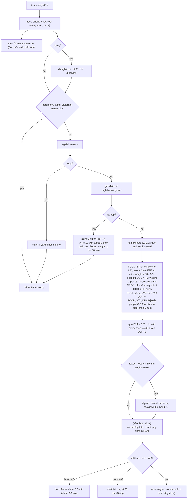

**Sleep drain** (`sleepMinute`, `pet.cpp:1161`): ENE +6/min (`SLEEP_ENE_GAIN`), or `BED_ENE_GAIN[bed tier]` =
7 / 8 / 10 with a bed (v3.20, naps too).

| | FOOD, JOY |
|---|---|
| Day nap | −1 every 4 min (`NAP_FOOD_JOY_EVERY`), floors 30 / 35 |
| Night (22:00–09:00) | −1 every 16 min (`NIGHT_FOOD_JOY_EVERY`, v3.13), floor 50 |

`dropTo(v, d, floor)` (`pet.cpp:356`) applies the floors. No poops, stale-poop drain, slip-ups or neglect happen while asleep.

### Sleep and night (needs the clock)

Constants are in `tuning.h`: `EVENING_HOUR` 20, `SLEEPY_HOUR` 22, `BED_HOUR` 23, `WAKE_HOUR` 9 (v3.11; was 8),
`NIGHT_RESLEEP_MIN` 30, `BED_BOND` 3.

- **22:00** `sleepy()` (`pet.h:213`): a "zzz" bubble. Putting the pet to bed now gives **+3 bond**, once a night
  (`goToBed`, `pet.cpp:1182`).
- **23:00** auto-sleep (`nightMinute`, `pet.cpp:1196`). If it is woken before 09:00, it sleeps again after 30 min
  awake. `nightHold` delays this while a game, battle, evolution or Box move is open.
- **09:00** a night sleep (`nightSleep`, set for bedtimes 20:00–08:59) wakes by itself and plays `SFX_MORNING`. A
  nap is not woken. A nap that reaches bed hours (23:00–08:59) becomes a night sleep. The Box keeps the
  difference (`REC_NIGHT`, v3.19; home slots use `nslp` / `HRF_NIGHT`): a napping pet woken out of the Box in the
  day keeps napping, a night sleeper woken out of it after 09:00 wakes on the next minute.
- Shaking the board while the pet sleeps calls `wakeGrumpy()` (`pet.cpp:1607`): −5 JOY.
- **Good-morning bonus (v3.20, beds).** `UpgSlot::sleptMin` (in `"upg"`, so a reboot mid-night keeps it) counts
  the minutes slept while `nightSleep`, saturating at `BED_MORNING_MIN_SLEEP` 360. Every sleep start (`goToBed`,
  the 23:00 auto-sleep, a pet coming out of the Box via `fromRecord`) and every wake (`toggleLight`, `wakeGrumpy`,
  any awake `nightMinute`) resets it. When the 09:00 auto-wake fires with the counter at 360 and a bed owned, the
  pet gets `BED_MORNING_JOY[tier]` = +5 / +10 / +15 JOY and the counter goes back to 0 (once a night). Live, it
  pushes `HE_MORNING` (a = JOY actually added) to the home event queue; offline it pays silently. A nap, a
  manual early wake or a shake wake pay nothing.

### Home upgrades in the tick (v3.20)

`Pet::homeMinute(h, day, live)` (`pet.cpp:1845`) runs once per awake minute of each home slot: from `tickHome`
right after the sleep branch (with `today()`), and from `syncHome`'s offline awake branch with the **replayed
minute's day** (`(seen + (i+1)*60) / 86400`), so the daily caps roll over correctly in a long replay. It does
nothing without a clock, at night (`nightHour`: 22:00–08:59), asleep, for an egg/vacant slot, during an ending,
an evolution or the starter pick, and (live only) while `nightHold` is set (game, battle, encounter, Box move).
It is not care: no streak, bond or coins.

- **Per-slot counters** `UpgSlot {uid, day, gymGains, toyPlays, sleptMin}` (`upgrade.h`), keyed by the pet's
  `uid`: `upgSlotNow()` (`pet.cpp:1824`) wipes them when the slot holds another pet. `day` resets `gymGains` and
  `toyPlays`, not `sleptMin`.
- **Gym** (tier g): each minute with every need ≥ `GYM_NEED_MIN` 40 adds 1 to the RAM-only `gymMin[slot]`; at
  `GYM_EVERY_MIN[g]` 60 / 45 / 30 the lowest of `trAtk/trDef/trSpe` still below `GYM_CAP[g]` 25 / 40 / 60 gets +1
  (`gymPick`, ties ATK → DEF → SPD; a stat above the cap is never lowered), ENE −`GYM_ENE_COST` 3 (`dropTo`, floor
  `GAME_FLOOR`), at most `GYM_DAY_MAX[g]` 4 / 6 / 8 a day. Live it pushes `HE_GYM` (a = 0/1/2); the "+1 ATK"
  popup already comes from `fxTrainW`.
- **Toy** (tier t): with JOY < `TOY_JOY_BELOW` 70, `random(100) < TOY_PLAY_CHANCE` 2 → +`TOY_JOY[t]` 3 / 4 / 5
  JOY, at most `TOY_DAY_MAX[t]` 3 / 5 / 7 a day. Live it pushes `HE_TOY` (a = JOY added).
- **Events** go to a RAM ring of `HOME_EVT_Q` 8 (`HomeEvtRing`, oldest dropped); the UI drains it with
  `takeHomeEvt` (`pet.cpp:1813`).

### Care actions

| Action | Code | Effect |
|---|---|---|
| Plain berry | `feedFood(FOOD_PLAIN)` `pet.cpp:1011` | Free and unlimited: +20 FOOD (`PLAIN_BERRY_FOOD`) |
| Coloured berry (6, v3.2) | `feedFood(FOOD_BERRY0..5)` | Spends one `IT_BERRY_*`: +30 FOOD, +3 JOY. The line's favourite (`favBerryOf(dex)` in `food.h`, from the **base form**, so it survives evolution) gives +35 FOOD, +12 JOY, bond +2 and reveals it (`berryKnown`) |
| Cake | `eatCake` `:910` (= `feedFood(FOOD_CAKE)`) | FOOD 100 and kept full for 180 min (`satedUntil`), +12 JOY, +12 weight |
| Tap a poop | `cleanPoop` `:1103` | Removes that poop (the only way, besides the waterfall); counts as the day's care; works asleep |
| Pet it (heart) | `caress` `:1125` | +20 JOY (`CARESS_JOY`); bond +1 at most every 15 min; awake only |
| Light | `toggleLight` `:1145` | Sleep or wake |
| Item | `useItem` `:1306` (gate `canUseItem` `:1293`) | Foods go through `feedFood` (Golden Berry +50 FOOD +15 JOY); vitamins +3 training; Rare Candy +1 level |

In the yard, food is not applied when tapped. It **drops, the pet walks to it and eats it**, and only then does
`yardFoodEaten` (`TamaPoke.ino:9104`) call `feedFood`, which spends the item only then, never on the drop (§7).

### Bond, streak, medals

- **`registerCare()`** (`pet.cpp:527`) runs on the first care of each calendar day. It updates the streak (+1 if
  yesterday, else 1), gives bond +4 (outside the cap), and records milestones at 3, 7, 30 and 100 days.
- **`addBond()`** (`pet.cpp:554`) enforces `BOND_DAY_CAP` 10 per day. Outside the cap: the first care of the day,
  bedtime +3, walk goals, stage boss +5.
- **Bond losses:** −1 per slip-up (floor 1), and the neglect fade.
- **`careBonus()`** (`pet.cpp:520`) = min(streak, 30)/3 + bond/25, at most 14. It improves egg and shiny odds.

### Player medals (v3.4)

Per-pet medals are gone. 19 player medals (`medals.h`), each with Bronze / Silver / Gold at the thresholds in
`MEDAL_T` (`tuning.h`), paying `MEDAL_COINS` 25 / 75 / 200 with `addCoins(n, false)` (outside the daily cap).

- **Sources.** *Pet* medals (0-6: pets to Lv 10/25/50, bond 100, final form, in shape, favourite found) count each
  pet once: the pet carries `counted` bits (`pmc` for slot 0, `PetRecord.medals` with `REC_V3` for slot 1 and the
  Box), so Box moves never count it twice; a pet that grows in the Box counts when woken. *Event* medals
  (evolutions, farewells, 10 000-step days, wild wins, captures, trips) bump a counter at the event; wild wins and
  captures remember the encounter id so a replay after a power cut doesn't count again. *Derived* medals (species,
  shinies, best streak, total steps, badges, souvenirs) read live state.
- **`medalsUpdate()`** (`pet.cpp:738`) runs at the end of `tick` and `addSteps` and at the start of `save()`. It never
  writes flash: it counts, pays reached tiers and queues `MedalNews` banners (`FXB_MEDAL`: medal, tier, coins).
- **NVS `pm`** (`PlayerMedals`, version + CRC): tier paid per medal, counters, encounter ids, and a list of
  `{uid, bits}` recorded at migration for Box pets. Written before `cn`, so a power cut can lose a payout but never
  pay twice. If `pm` fails to write, `save()` stops there with `pendingSave`.
- **Migration** (`medalsMigrate` `:780`, in `begin()`): with **no** `pm` key, count both home pets and every Box
  record once, pay every reached tier in full and queue the banners, then remove the old `medal`/`tmedal` keys. An
  **existing but unreadable** `pm` is recounted without paying (tiers set to those reached). Any `PM_VER` bump needs a
  real migration.

### Growth and level

- Level comes from `growMin`, which counts every minute alive (awake or asleep, and offline). Care does not speed
  it up.
- **Cost per level** (`growth.h` `levelCost` `:56`): 20 min for levels 1–10, the `LV_COST[]` table for 11–90
  (20 → 120 min, log curve), and 120 min from 90.
- **Jumps:** `addLevels` keeps the bar fill. It is used by Rare Candy, walk goals (+1/+1/+2) and, via growth
  minutes, by stage bosses and wild wins (+60 min).
- **Migration:** `gcv` is the curve version. `migrateGrowthCurve` (`pet.cpp:2763`) converts the home pet, every Box
  slot and `boxT`, staged through `gmig` so it survives a power cut.
- **Level-up detection lives in the UI, not in `Pet`.** `fxLevelW` watches the level, `fxCollect` plays the jingle
  at once, and queues the banner for when the screen is visible.

---

## 5. Life cycle: eggs, evolution, endings

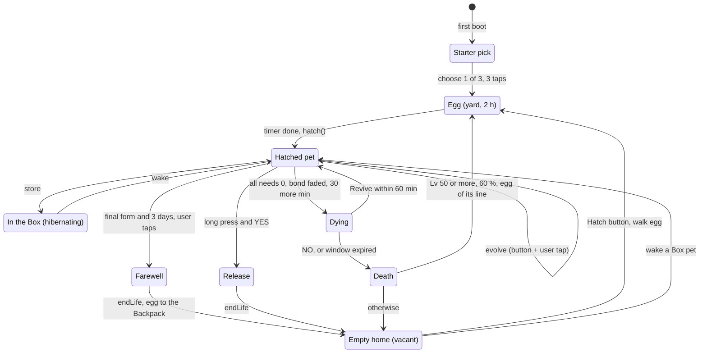

### Eggs

- **`newEgg()`** (`pet.cpp:63`) picks the species (`pickEggSpecies` `:590`) and rolls the shiny, spending the Shiny
  Charm if held. `placeEgg()` then puts it in the yard. With 0 registered species, the starter pick runs instead.
- **Yard egg timer** (`eggtimer.h`): `EGG_HATCH_MIN` 120 real minutes from `eggPlaced`, running with the board off.
  Each shake (`Pet::shaken` `pet.cpp:1605`) takes 5 min off, at most once per 30 s and 60 min in total. Crack stages
  come from `eggCracksFor`.
- **Rarity** (`pickEggSpecies`):
  - After a death, only Common.
  - Otherwise rare = (27, or 45 after a farewell) + `careBonus()`.
  - Legendary = 0 until 25 species are registered, then (3, or 10 after a farewell) + `careBonus()/3`.
  - Inside a tier it prefers lines with unregistered members.
  - Tiers are `R_EVO/R_COMUN/R_RARO/R_LEGENDARIO/R_ENCUENTRO` (`dex.h:33`). `R_ENCUENTRO` species (Omanyte, Kabuto,
    Aerodactyl, Dratini, Mew) never come from eggs.
- **Shiny** (`shinyOdds` `pet.cpp:337`): 1 in (48 − careBonus), 1 in 24 after a farewell, never better than 1 in 8.
  The charm divides the odds by 3.
- **Colour (v2.4, `eggcolor.h`):** an egg is painted with the type colours of the species it holds.
  `drawEggAt(cx, cy, s, cracks, dex)` (`TamaPoke.ino:4703`) walks `SPR_EGG` and asks `eggCellColor()` for each
  body cell (`y` body, `Y` shade, `g` spots; the outline keeps `spriteColor`). One type: all its colour. Two
  types: `type1` upper-left, `type2` lower-right, mixed over `EGG_BLEND_HALF` cells either side of the diagonal
  `col + row == EGG_DIAG_MID`. Spots are the colour under them mixed 50 % with white. `dex 0` = the classic
  cream egg. Callers pass `pet.eggSpecies()` (yard, saver, Box "now"), `pet.speciesId` (hatch fx, already
  hatched), `pet.deathEggSpecies()` and the capture's base form. Grey ghosts and the Backpack icon stay
  classic: a Backpack egg has no species until it comes home (captured ones aside).
- **`hatch()`** (`pet.cpp:711`): genes 90–110 per stat, training, bond and `counted` reset, a new `uid`, the Pokédex
  registration, then save.
- **Where eggs come from:**
  - walking, one every 8 000–15 000 steps (§11);
  - a farewell;
  - a gift egg when there is no egg anywhere and the Box is empty;
  - a death egg;
  - stage loot (3 %);
  - a wild capture: up to 4 queued (`capN`), hatching the base form at Lv 1 and leaving the Backpack first.

### Evolution

- **`canEvolveNow()`** (`pet.cpp:742`) needs all of: hatched, awake, not busy, `evolvesTo != 0`,
  `level() >= evolveLevel + careMistakes`, and **every need ≥ 40 right now**.
- It never fires by itself. `wantEvolveButton()` shows the red button, and the user taps then confirms
  (`choiceKind == 1`). "Keep form" sets `evoDeclinedLv`, so it is offered again at the next level.
- **`evolve()`** (`pet.cpp:749`): Eevee branches to 134–136, preferring an unregistered form. If the new form's
  favourite berry comes from the base form (v3.2), so it never changes and `berryKnown` is kept.

### Endings

All endings go through `endLife(cer)` (`pet.cpp:255`), for the slot that ends (the other pet is not touched). It
moves that slot's waiting incubator egg to the Backpack, adds the gift egg if needed, and leaves the slot
**vacant**. With two slots (v3.0):

- Gifts are unwrapped into the Backpack only when no hatched pet is left at home.
- The gift egg comes only if the other slot is vacant, no egg is owned or wrapped, and the Box is empty.
- A death heir egg is placed in the same slot.
- When an egg moves to the Backpack, `saveBag()` writes `bpack`/`cegg` **before** the slot's own save, so a power
  cut leaves at most an extra egg, never a lost one.

A vacant slot is filled with "Hatch an egg (N)" (`hatchFromBag` `pet.cpp:305`) or a Box wake.
`eggsOwned()` counts the Backpack plus both slots' incubator eggs.

| Ending | Trigger | Code |
|---|---|---|
| Farewell (good) | Final form and `ageMinutes >= FAREWELL_AGE_MIN` (3 days); button, then a dialog; "Stay together" postpones 1 day | `canFarewellNow` `:626`, `startFarewell` `:631` |
| Release (neutral) | Long press 3 s, then YES | `release` `:701` |
| Death by neglect (bad) | All needs 0 (awake, board on): bond fades over ~30 min, then 30 more min | `startDying` `:644` rolls `deathEgg` (Lv ≥ 50, 60 %) |
| Revive | Dialog with a 60-minute real-time window (`REVIVE_LIMIT_MIN`); YES spends a Revive, needs → 50, bond stays 0, counts a slip-up | `revive` `:661`; `letGo` `:678` |

A death sets `lastEnd = CER_DEATH`, which curses the next random egg to Common. A farewell blesses it.
`CER_RUNAWAY` is dead code, kept only because old saves may hold it.

---

## 6. The Box

There are 6 slots where pets **hibernate**: no ageing, growth, drain or slip-ups. The one exception is that stage
and wild rewards and trips add growth directly to the slot record.

- **Record.** `PetRecord` (`box.h:35-51`) is 55 bytes packed, with a version and CRC16. It is valid only if the
  version is known, the CRC matches, `uid != 0` and the species is 1–151. An invalid slot shows "?" and is never
  loaded or overwritten; only `WIPE` or `BOXCLR` clears it.
- **What is stored.** Only the individual goes into the record. Streak, steps, Backpack, Pokédex and the incubator
  egg stay at home. Flag `REC_CARED` (v3.0) keeps "had its first care today" so a pet woken the same day doesn't get
  that bond twice. `REC_SLEEP` keeps it asleep and `REC_NIGHT` (v3.19, same record version) marks a night sleep
  rather than a nap (`PetLife::record` / `loadRecord`); a record from before v3.19 loads a sleeping pet as a nap.
  The cake effect and cooldowns are not saved.
- **RAM copies.** `pet.boxRec[]` and `boxSt[]` mean the UI never reads flash.
- **NVS keys.** `box0`–`box5` hold the slots. `boxT` is a transfer copy whose presence means a move was cut off.
  `eggH` means an egg waits in slot 0 while a pet is out (slot 1 keeps that flag inside `hm1`). `boxTs` (v3.0)
  names the home slot of a cut wake (absent = slot 0). Also `vac` and `uid`.
- **Gates.** Every move names a home slot: `store(k, s)`, `wake(k, s)`, `canStore(k, s)`, `canWake(k, s)`; the
  one-argument forms use the focused slot. `canBoxMove()` = not ending, not evolving, not choosing a starter.
  `canStore` also needs an empty Box slot and a hatched pet. Pets on a trip cannot move.

**Power-cut-safe writes** (tested by `test/test_box.cpp` with a cut after every write). The rule is: write the full
copy of the moving pet first, delete the surplus last. A home slot commits at one key: `uid` for slot 0 (written
last among its keys), the atomic `hm1` blob for slot 1. At worst a pet exists twice, never zero times.

`save()` order (v3.4): `medalsUpdate()` in RAM → slot-0 keys (incl. `pcd`, `pmc`) → player keys → `uid` → `hm1`
(only if changed) → `pm` (only if changed) → `cn`/`cnD`/`cnT` (only if changed) → `bpack`/`bpk2`/`bpk3` → `ybgO`/`ybg` →
`gifts` → `eggH` → `cegg` → `ecap` → `enc` → `trvR`. If the `hm1`, `pm` or coin write fails, `save()` stops there and
keeps `pendingSave`; coins are cached as saved only when all three coin keys were written, so a purchase is never
free.

| Move (home slot s) | Write order |
|---|---|
| Store A into Box slot k | 1. `box k = A` · 2. slot s becomes an egg or vacant, `save()` (commit `uid` / `hm1`). A failed `hm1` write rolls RAM back and returns false |
| Wake B with A in slot s (swap) | 1. `boxTs = s` (slot 1 only) · 2. `boxT = B` · 3. `box k = A` · 4. B into s, `save()` · 5. delete `boxT` · 6. delete `boxTs` |
| Wake B into an egg or vacant slot s | 1. `boxTs` · 2. egg-held flag (`eggH`, or `hm1` with held = 1) **before** `boxT` · 3. `boxT = B` · 4. B into s, `save()` · 5. clear Box slot k · 6. delete `boxT` · 7. delete `boxTs` |

A failed commit keeps `boxT`/`boxTs`, so the next boot finishes or undoes the move.

`boxBoot()` (`pet.cpp:3086`, per slot in `boxBootSlot` `:3113`) reconciles at boot. It reads `boxTs`, finishes or
undoes a cut move in that slot, makes a Box copy win over a duplicate in either home slot, vacates slot 1 if it
duplicates slot 0 (bringing a waiting egg home), and clears stray keys and egg-held flags per slot.

**UI.** `boxTap` (`TamaPoke.ino:6734`) → `boxStartMove` (`:6712`, `BOXMV_STORE/WAKE/SWAP`). Storing with two
hatched pets asks which one goes in; a wake goes to the first vacant slot, then into an egg's slot (the egg waits in
its incubator), and otherwise asks which pet to swap with. The light animation
plays for 600 ms, then `boxTick` (`:6797`) calls `pet.store()` or `pet.wake()` while the last frame is on screen.

---

## 7. The yard (home screen)

Since v2.0 the home is a top-down 466×466 yard. `renderYardHome` (`TamaPoke.ino:9859`) does update and draw in one
call, every frame:

`yardSyncPets` (`:7874`) → `yardTick` (`:7960`) → `yardSyncThings` (`:8244`) → draw things, pets, Box appear,
bubble, food fx → `yardDrawHud` (`:8589`)

- **Walkers.** `YardWorld` (`yard.h`) holds `p[0]` and `p[1]`, home slots 0 and 1 (since v3.0 Box pets no longer
  walk), and `p[2]`, a returned traveller standing still with a suitcase and a "!". Sprites: `homeMon[2]`
  (`pmd` = the focused one), both loaded by `ensureMon`.
- **Per slot.** Each slot has its own yard egg, poops (a tap cleans the owner's through `onSlot`), bubble (the two
  take turns when the pets are close), fx overlays and level-up banners. Food is tied to the pet's uid and dropped
  if it changes. Tapping a pet focuses it (`uiFocus`) and opens its menu (v3.3); long press releases the pet under
  the finger. The dock is enabled if either pet can use it; games and Backpack items ask which pet when both can.
- **Movement.** `yardStep` (`yard.h:420`) decides between idle, walk and gesture. Targets are random free cells
  reached by a BFS path over the walk mask, at 30 px/s, keeping 64 px between pets. Tilting the board makes the
  pet walk or slide downhill.
- **Walk mask.** The map's 15×15 grid of cells (38.4 px since v3.5; `yardWalk`, `:7640`) keeps only the largest
  connected region. On load, `yardMaskFrame` (`yard.h`) re-blocks cells outside the circle or under the clock/dock
  with the current map scale, so `.bin` masks made for another scale stay safe. Cells 0 and 14 are off-canvas.
  `yardWalkNow()` (`:9086`) also blocks the egg and the wild-encounter cells.
- **Pet menu (v3.3).** Tapping a hatched pet opens a column on the right (`openPetMenu`): Sleep/Wake, Food, Care
  (heart), Status (card), plus Evolve or Farewell when ready. The pet steps out from under the column and holds
  still (`yardMenuHold` `yard.h:718`, retried from geometry; it wins over the sad pose); `avoidX` keeps walks and
  tilt out of the column. Tapping the other pet switches the menu, anything else closes it; it closes after 30 s.
  Above the column (v3.8, `pmName`): the name, then (v3.9) a box the colour of the rows with the 3 needs, each a
  size-2 label (v3.10) and a 64 px bar (FOOD, JOY, ENE; the card's colours via `needBarColor`). Placed by
  `petMenuNameY` / `petMenuNeedsY` / `petMenuBoxX` / `petMenuNameRight` (`yard_panels.h`, `PM_NEED_*`),
  right-aligned and pulled in where the circle narrows. The head must stay under the wallet (`PM_HUD_BOTTOM` 58):
  up to 4 rows the name is above the box and the column starts no higher than `PM_TOP_NAMED` (140); with 5 rows
  (Evolve/Farewell, `PM_MAX` 5) the name goes left of the box (`petMenuNameBeside`) and the column starts at
  `PM_TOP` (122) with a 3 px gap. The food list (`FOOD_PER_PAGE` 3 since v3.10) never passes 4 rows.
- **Food (v3.3).** The Food list (plain berry + owned foods, 3 per page since v3.10) calls `yardFeedFront(slot, kind)`: the
  food is placed in front of the pet (`yardFoodFront` `yard.h:653`, else the other side, else at its feet) and goes
  straight to `YF_EAT`, or waits until the step-aside ends. One food per slot (`yardFood[slot]`, tagged with the
  pet's uid); a chosen food not yet eaten is reserved, so the other pet can't be served the last one.
  `yardFoodEaten` (`:9104`) applies `onSlot(owner, feedFood)`, the only place the item is spent. The food waits while
  something else holds the pet (evolving, hatch, an emote, the eating pose) and is cancelled if the pet sleeps,
  leaves or changes.
- **Poops, gifts, egg.** Counts are saved in NVS; positions are RAM-only and re-scattered at boot. Up to 3 gift boxes
  are shown out of 8 held.
  - A poop tap calls `pet.cleanPoop`.
  - A gift tap calls `openGiftTap` (`:10477`).
  - An egg tap shows the time left (the starter egg needs 3 taps instead).
- **Bubbles.** `yardEventMsg` (`:9687`) picks a recent event; otherwise `yardNeedList` (`:9700`) lists needs below
  25 in rotation. The neglect text replaces all of them.
- **HUD.** Battery, coins, and the dock: Play (amber), Bag (blue), Shop (pink, v3.3; `openShop()` opens the Bag screen on its Shop tab) (`yDock` `:7489`; `yardDockOff`
  `:9833` greys buttons for an egg or sleep).
- **Panels** (`yard_panels.h`):
  - The Care panel is gone (v3.3): care is the pet menu.
  - Play: ball, battle, bag, sled, waterfall, travel. A minigame asks "Who plays?" (pet picker) when both home
    pets can play. With no home pet awake but someone who can fight (a sleeping home pet
    since v3.12, or a Box pet), Play jumps straight to the stages (`openPlayPanel`, `stagesCanOpen`).
- **Scale (v3.5, v3.8).** The map is `YBG_ZOOM10` 24 (`yardbg.h`, 2.4x). Pets are `YARD_PET_SCALE10` 13
  (`yard.h`, on top of the sprite's whole scale, 2 for almost all), so 2.6x since v3.8, a bit bigger than the map
  (v3.5 had them equal at 12).
- **Maps.** Files `/yard/NN.bin` on the SD in TPY1 format (`yardbg.h:9-12`, 240×240; since v3.5 its centre
  200×200 is zoomed 2.4x to 480, nearest neighbour, `yardBgSrcOf`; cell ↔ canvas via `yardCellOf` /
  `yardCellCenter` / `yardCellEdge`). `yardBg`
  keeps the whole 480×480 map (`yardBgExpandFull`); the canvas is its window at (7, 7) (`yardBgCanvasRow`), and
  since v2.5 the rest shows around the round frame on the 2.16 (§14). All yard logic, the walk mask and taps stay
  in canvas coordinates inside the circle. They are built by `tools/pack_yard.py`. There are 9 maps (`YARD_MAPS`, v3.15): meadow (free), quarry, forest,
  beach, ruins, volcano, power plant, sky tower, toxic district (`ECO_MAP_PRICE` in `tuning.h`, checked by a
  `static_assert` there). Maps 6-9 use the packer's v3.15 extras (several `hue:` lines, `sky:` void, a `decal:`
  layer of procedural painters). `MAP_BIOME` in `battleBiome` (`TamaPoke.ino`) gives a wild battle the backdrop of
  the map: volcano 3, power plant 6, sky tower 4 (mountain), toxic district 7 (swamp).
  - `yardEnsureMap` (`:8833`) chooses, in order: the serial override, the shop preview, the travel preview, then
    `pet.yardMapWanted()`. Without the SD it falls back to map 1, then to a plain floor.
  - The palette is tinted by hour (`yardTintAt`), and the result is cached in PSRAM.

---

## 8. Minigames

All four games are launched from the Play panel (`playPanelTap` `TamaPoke.ino:7670`). Each needs the pet awake and
not an egg or ending; the sled also needs the IMU.

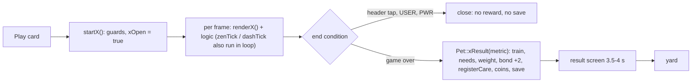

| Game | Stat | Logic | Rules | Reward (`pet.cpp`) |
|---|---|---|---|---|
| Ball | SPD | `ballgame.h`; `startGame` `:2955`, `stepGame` `:2992` | Tap the ball to keep it up; 3 floor misses end it. Each non-final miss plays `SFX_MISS` (a low 190 ms falling thump) and a 450 ms UI animation (`BALL_MISS_MS`: dust puffs and a squashed ball at the floor, the lost life dot blinks; `missX`/`missTime`, UI constants, not balance); the final miss keeps the game-over sound. Speed 1.5× at 1 point (v3.16), rising linearly to 3.5× at 100 points (`BALL_SPEED_TOP_AT`, v3.17), 3.5× is the cap. "Tap the ball!" hint (`S_TAP_BALL`) until the first hit; the result shows the SPD gain (`gameGainShown`, from `playResult`'s return value; `BALL <n>` shows what it would give) | `playResult` `:1036`: SPD += score/5 (no per-session cap), JOY +5…+35, ENE down, weight −score/2, coins |
| Training bag | ATK | `.ino` only; `startSack` `:2768` | 10 s of tapping | `trainStrength` `:827`: ATK += hits/4, cap 18, JOY +6, weight −hits/10, coins |
| Sled | SPD | `dashgame.h`; `startDash` `:3466` | Tilt to dodge rows. 2 s calibration takes the current angle as straight. Speed 1 + t/40 s, cap 3×. 3 hits end it | `dashResult` `:1104`: SPD += rows/6, cap 18, JOY +5…+35, weight −rows/8, coins |
| Waterfall | DEF | `zengame.h`; `startZen` `:3166` | Hold to raise the gauge, release to lower it; stay in the band for 45 s. The band narrows; from 30 s it drifts (bonus time). Surges push it down | `zenResult` `:1083`: DEF += min(8, t/3.5 s) + bonus min(3, …), **clears all poops of the pet that played** (v3.1), no weight burn, coins. **Only a full session pays** |

**Coins** (`economy.h`): `coinsForGame` gives 0 if the metric is 0, else 3 + metric/div, at most 8. The divisors
are ball 10, bag 8, sled 10, waterfall 2. Paid with `addCoins(n, capped=true)`, which counts toward
`ECO_DAILY_CAP` 150.

Every game also gives bond +2 and `registerCare()`. FOOD and ENE are lowered with `dropTo` (floor 5); FOOD is
skipped while cake-full.

---

## 9. Battles and stages

### Engine (`battle.h`, pure, deterministic for a given seed)

- **Stats** (`makeFighter` `:90`, same formula as `Pet::calcStat` `pet.cpp:823`):
  - `maxHp = baseHp + L + 10`;
  - ATK/DEF/SPD = `base × gene/100 + L + training`;
  - L is capped at 100.
- **Damage** (`hitDamage` `:113`): a gen-1-style formula × type effectiveness × a roll of 85–100 %; a crit (1 in
  16) is ×1.5.
  - Each hit is **clamped to 2–60 % of the target's max HP** (70 % for a special), so a fight is never over in
    fewer than 3 attacks.
  - Immune gives 0 damage. In a stage, if neither side can hurt the other, hits count as ×0.25.
- **Types** (`TYPE_CHART` `:39`): the 15 gen-1 types. The attacker uses **the better of its two types**
  (`bestEff4`); the defender's two types multiply.
- **Order:** the faster fighter opens each round; ties are a coin flip.
- **Sudden death:** from attack 21 (`SUDDEN_DEATH_AT` 20, zero-based), DEF counts as 1 and an attacker whose target
  survives takes 10 % recoil.
- **Special** (`SpecialMeter` `:245`): 5 taps arm it, it adds +30 % power, then rests for 2 attacks. The player
  charges it by tapping during `BT_FIGHT`. The AI gets `aiTaps` per attack: minion 1 has 0, minion 2 has 1, the
  boss has 2, a wild foe has 1.
- **How the `.ino` drives it** (`TamaPoke.ino:9360-9700`): `battleStep` (`:10877`) calls `run.attack()` once every
  `ATTACK_MS` 1300. After a KO, `battleAfterKo` (`:10855`) calls `run.advance()`. Phases are `BT_INTRO` (VS card) →
  `BT_FIGHT` ↔ `BT_SWAP` → `BT_END` (7 s; taps ignored for the first 1.8 s).

### Stages (`stage.h`)

- **Definitions.** `STAGES[8]` (`:49-66`) holds each stage's level and training ranges, boss and minion pool. The
  table with values is in the README.
- **Foes.** `stageRollFoes` (`:88`) makes 2 minions of different species with a random level and training each,
  plus the fixed boss at the top level. Foes have genes 100 and are never shiny.
- **Unlocking.** `stageUnlocked(s)` = `s == 0 || hasBadge(s−1)`. `badges` is an 8-bit mask, NVS `"bdg"`, and
  belongs to the player.
- **Team.** 1–4 fighters from the home pets (awake or asleep since v3.12; a sleeping one stays asleep) and the Box
  pets that are not travelling (`teamCanFight`
  `pet.cpp:1706`). The last team is pre-selected.

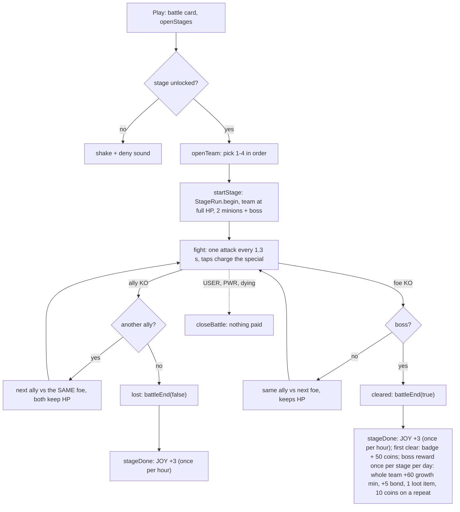

- **Rewards.** `Pet::stageDone` (`pet.cpp:1939`) pays once. It writes in a fixed order for power-cut safety: badge
  → daily mask → Box records → `save()`.
  - The daily boss mask is `stM`/`stD`, one bit per stage per day.
  - Box team members get their growth through `writeSlot`; they evolve once woken.
- **Loot** (`rollBattleItem` `:1647`, `BDROP_*` in `tuning.h`): cake 19, Golden Berry 18, vitamins 19, Lure 10 (v3.14), a coloured berry 8,
  Poké Ball 7, Rare Candy 7, Revive 5, charm 4, egg 3. It arrives as a wrapped gift, or straight into the Backpack when the home
  is vacant.

---

## 10. Wild encounters

`encounter.h` holds the pure rules; the state and rewards are in `pet.cpp`. Only **one in the yard at a time**, up to
4 a day (v3.11): one from the base or a trip roll (`ENC_ROLL_SPAWNED` then closes both for the day) plus one per
walk tier. A walk-tier spawn doesn't set `ENC_ROLL_SPAWNED`. A tier crossed while a wild is in the yard (also one
won with the ball still pending) rolls once the yard is free, the same day. `encStart` keeps each spawn's epoch
above the last medal ids, so two wilds in the same clock window both count for MD_WILD / MD_CATCH.

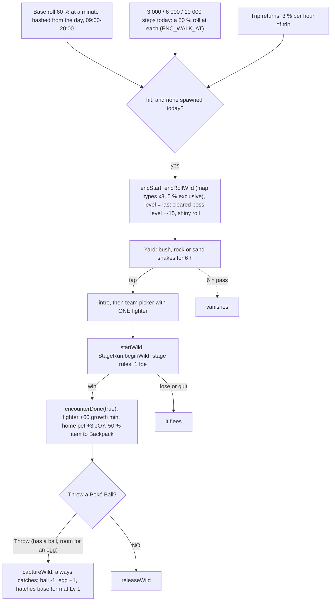

- **Rolls.** `Pet::encCheck` (`pet.cpp:2049`) is called from `tick`, `syncClock` and `addSteps`. It needs the clock
  set and someone able to fight.
- **Species.** `encPickBase` takes a common or rare base form (×3 weight if its type fits the map) or, 5 % of the
  time, an exclusive: Omanyte, Kabuto, Aerodactyl, Dratini (24 each), Mew (4).
- **Level.** The centre is the boss level of the highest stage cleared (10 with none). The species is evolved to
  fit the level (`evolveForLevel`).
- **State.** NVS `"enc"` (16 bytes). The object type depends on the map (`encMapObject`): rock for quarry, ruins
  and the v3.15 maps (volcano, power plant, sky tower, toxic district), sand for the beach, bush otherwise.
- **Map types** (`encMapTypes`, ×3 weight): meadow Normal/Grass, quarry and ruins Rock/Ground, forest Bug/Grass,
  beach Water, volcano Fire/Rock, power plant Electric, sky tower Flying, toxic district Poison.
- **Drops** (`WDROP_*` in `tuning.h`): cake 25, Golden Berry 25, a coloured berry 10, vitamins 21, Rare Candy 8, Revive 7, charm 4. A wild
  win never gives coins or Poké Balls.
- **Capture** (`captureBlock` `pet.cpp:2211`, `captureWild` `:2220`) fails only with no ball or no room (Backpack
  eggs at 9, or 4 captured eggs queued). You start with 3 balls (`BALL_START`); the Shop sells them for 100.

---

## 11. Steps, items, gifts and coins

### Steps

- **Counter** (`steps.h`): software peak detection on the QMI8658 FIFO (the chip's pedometer is dead on this
  board). It counts only after 8 steps in a row and pauses on a shake.
- **Flush.** `imuTick` calls `pet.addSteps()` every 30 s (`STEP_FLUSH_MS`).
- **`Pet::addSteps`** (`pet.cpp:1064`) never writes flash; it only marks a pending save. It gives:
  - Walk care, only if the pet is hatched and awake: +1 JOY per 100 steps (max 30 a day), −1 weight and +1 bond
    per 1 000.
  - Finds every 800–1 200 rewarded steps, up to 5 a day (`findItem` `:1417`): Golden Berry 28, cake 17, a coloured berry 10, vitamin
    30, charm 10, Revive 5. They arrive as **wrapped gifts**.
  - An egg every 8 000–15 000 steps. All steps count, even asleep. It goes straight home if the home is vacant,
    otherwise it is wrapped.
  - Goals 3 000 / 6 000 / 10 000 (`goalReward` `:1380`) give levels +1/+1/+2, JOY +10/+10/+15, bond 0/+2/+3,
    coins 10/20/40, a find on the first two, and a Marathon medal day on the third. Coins are always paid; the rest
    needs the pet awake.
  - Then `encCheck()`.

### Items and the Backpack

- **Item enum** `IT_*` (`pet.h:61`): GOLDEN, PROTEIN, IRON, CARBOS, CHARM, RARECANDY, EGG, CAKE, REVIVE, BALL, then
  BERRY_R, _B, _G, _Y, _P, _O (v3.2), LURE (v3.14). **It is a save format:** `items[]` is stored by position, the
  first `PACK_OLD` (10) in NVS `"bpack"`, the berries in `"bpk2"` (`PACK2_LEN` 6) and, from `PACK3_FIRST` (16, the
  Lure) on, `"bpk3"` (`PACK3_LEN` 8 bytes, one per item: 7 spare slots for future items), all written together by
  `putPack()` in that order. No blob ever grows, so older firmware still reads the ones it knows (`getBytes` reads
  nothing from a longer blob); a missing or wrong-size `bpk3` loads as 0 Lures, and bytes this firmware doesn't know
  are kept in `pack3Raw` and written back. New items go at the end, into `bpk3`'s spare slots.
  `economy.h` and `travel.h` have numeric tables checked by `static_assert`s (`pet.cpp:1507`).
- **Caps.** `itemCap(id)` (`economy.h`): `BERRY_MAX` 30 for each coloured berry (v3.11), `ITEM_MAX` 9 for every
  other item; the charm is capped at 1. Gifts, finds, trip items, wild drops, the Shop and the NVS load clamp all use it.
- **Lure (v3.14).** `lureBlock` / `useLure` (`pet.cpp`): using one (Backpack → "Use LURE?" → `bagUseLure` in
  `TamaPoke.ino`) spawns a wild at once with `encStart(…, false)` (it doesn't close the day's base or travel roll)
  and opens the encounter screen (`openEncounter`); backing out leaves it in the yard for its 6 h. Refused, Lure kept
  (`LURE_*` codes): none held, starter pick / a ceremony or dying pet, no clock, nobody able to fight now, or a wild
  already shown (active, or won with the ball pending). It writes `"enc"` before the Backpack, so a power cut can at
  worst leave one Lure too many. Not sold; drops from bosses (10 %) and trips (weight 10 of 100).
- **Not used by hand:** the charm (it boosts the next egg's shiny odds), eggs, the Revive (offered at death) and the
  Poké Ball (thrown after a wild win).
- **Gifts:** `giveGift` (`pet.cpp:1432`) holds up to 8 wrapped gifts (NVS `"gifts"`); beyond that an item goes
  straight to the Backpack. `openGift` (`:1475`) opens the first gift that fits. `unwrapGifts` (`:1498`) empties
  them into the Backpack when the home is freed.

### Coins and the Shop

- **Storage.** `Pet::coins`, NVS `"cn"`, max 9 999. The daily cap counter is `coinToday`/`coinDay`.
- **Functions.** `addCoins(n, capped)` (`pet.cpp:1724`) only marks a pending save. `spendCoins` and `buyItem`
  (`:1750`, `:1464`) and `buyMap` save at once.
- **Home upgrades (v3.20, `upgrade.h`).** Three lines (beds, gym, toy), 3 tiers each, player-wide, prices
  `UPG_PRICE` in `tuning.h` (600/1000/1500, 800/1200/1800, 500/800/1200). `upgCheck(line, tier, coins)` checks
  bad line, then MAX, then coins; `buyUpgrade(line)` (`pet.cpp:1805`) buys the next tier only (tier 2 needs tier
  1), spends the coins and saves at once. `save()` writes `"cn"` before `"upg"`, so a power cut in between loses
  the tier, never gives it free. Tiers are read with `upgTier(line)`.
- **Prices** (`ECO_ITEM_PRICE` `economy.h:39`, values in `tuning.h`): Golden Berry 30, coloured berries 25 for a pack of `BERRY_PACK` 5 (v3.11, `shopPackOf`), cake 40, vitamins 60, Revive 80, Poké Ball 100, Rare
  Candy 150. Maps 2-9 cost 150, 150, 200, 250, 250, 300, 350, 400 (owned mask NVS `"ybgO"`, u16: 9 maps fit). Purchases check, in order: not sold, then
  full (`have + pack > itemCap`), then not enough coins (`shopCheckItem`). Each Shop card (`shopCell`) shows
  the amount a purchase gives (x5 berries, x1 the rest), not how many you own; it turns warning-yellow when a
  purchase would not fit.

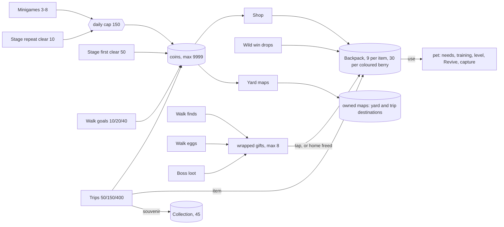

---

## 12. Travel and the Collection

- **Rules.** Only a Box pet travels (never the home pet), one trip at a time, to an owned map. Trips run on real RTC
  time, also with the board off, and need the clock set.
- **Code.** `canTravel` `pet.cpp:1806`, `startTravel` `:1820` (one 16-byte NVS record `"trv"` with a fixed seed),
  `travelCheck` `:1841` (from tick and syncClock), `travelComplete` `:1854`, `takeTravelResult` `:1893`.
- **Outcome.** `travelRoll` (`travel.h:83`) computes everything from the saved seed, so the result is the same
  whenever it is evaluated.

| Trip | Coins | Growth | Item | Souvenir | Log events |
|---|---|---|---|---|---|
| 1 h | 50 | 30 min | 25 % | 40 % | 1 |
| 3 h | 150 | 90 min | 50 % | 75 % | 2 |
| 8 h | 400 | 240 min | 100 % | 100 % | 3 |

- **Souvenirs.** 45 in all since v3.15 (`SOUV_COUNT` = `TRV_DESTS` 9 × 5; ids 25-44 are maps 6-9), 5 per map
  (id = (map−1)·5 + i; i 0–1 common, 2–3 uncommon, 4 rare). A duplicate is rolled again once, then becomes +10
  coins. The owned mask is a `uint64_t` (`souvBit(id)` = `1ull << id`). Stored in NVS `"souv2"` (u64) and
  `"souvD"` (one u32 date per souvenir, 180 bytes). Icons: `tools/souvenirs.py` → `souvenir_icons.h`
  (`SOUV_ICON[45]`); names `S_SOUV_0 + id` (the ids must stay consecutive: `static_assert`s next to
  `souvDestName` in `TamaPoke.ino` check `S_MAP_*`, `S_SOUV_*` and `S_TRV_EV_*` against the tables).
- **Save migration (v3.15).** `Pet::load` takes `souvLoadMask` (`travel.h`): `"souv2"` if present, otherwise the
  old u32 `"souv"` (v2.0-v3.14, 25 bits) in the low bits. `Pet::save` writes `"souv2"` and then removes `"souv"`
  (a power cut in between leaves both; `"souv2"` wins). `"souvD"` kept its key and grew from 100 to 180 bytes:
  the load reads `getBytesLength` bytes (an old 100-byte blob fills the first 25 dates, the rest stay 0; a longer
  one from a future firmware is read through a temporary buffer and cut). Older firmware reading a v3.15 save
  loses the Collection (no `"souv"`, `"souvD"` too long). Tests: `test_travel.cpp`
  (`migracion_de_la_coleccion_de_v3_14`, `souvLoadMask_migra_la_mascara_de_32_bits`).
- **Collection screen** (USER page, v3.4; it was a Bag tab before). v3.15: two pages of 5 map rows (maps 1-5,
  maps 6-9; `SOUV_PAGES`, `souvPage`, `souvAt(page, x, y)` in `travel_ui.h`), with the "1/2" under the title
  (tap it: next page), the side chevrons of the background picker (`yChevronHit`) and a vertical swipe
  (`userSwipeV`). The title stays "Collection n/45".
- **Trip log templates** (`TRV_TPL_MASK`, `travel.h`): `uint16_t` since v3.15 (bits 0-8 the maps, `TRV_ARG` bit
  15, `TRV_ANY` `0x1FF`). 17 templates: maps 1-5 fit the same 13 as before (a trip running across the update keeps
  its log); maps 6-9 join some of them and each has its own (13-16: lava, static spark, gust of wind, smog).
  `TRV_SPECIES` has a row of Gen-1 species per map (fire, electric, flying, poison for 6-9).
- **Collector medal** (`MEDAL_T` in `tuning.h`): 5 / 20 / 45 since v3.15 (was 5 / 15 / 25), so a new player needs
  all 45 souvenirs for Gold. **Tiers already earned are kept** (`medalsUpdate` never lowers `pm.tier`): an old save
  with Silver at 15-19 souvenirs or Gold at 25 keeps it, and is neither paid again nor charged back. The Medals page
  copes with "paid tier above the reached tier" through `medalShownTier` / `medalNextShown` / `medalBarFill`
  (`medals.h`): the bar goes towards the first tier above both, starts at the reached tier's threshold, is full when
  Gold is paid, and never divides by zero. This holds for any medal whose thresholds are raised later.
- **Write order** in `travelComplete` (comment `:1558-1564`): growth goes to the Box record, then `"trv"` is
  removed, then coins, item and souvenir are paid, then the result is stored (`"trvR"`). Coins can never be paid
  twice after a power cut; growth can be (accepted).
- **Item pool** (`TRV_POOL_ID` `travel.h`, weights `TRV_POOL_W` in `tuning.h`): Golden Berry 20, cake 10, each
  vitamin 9, Rare Candy 9, Revive 5, Poké Ball 9, a coloured berry 10, Lure 10 (v3.14).
- **Encounter.** A completed trip also rolls a wild encounter (`encTravelRoll`).

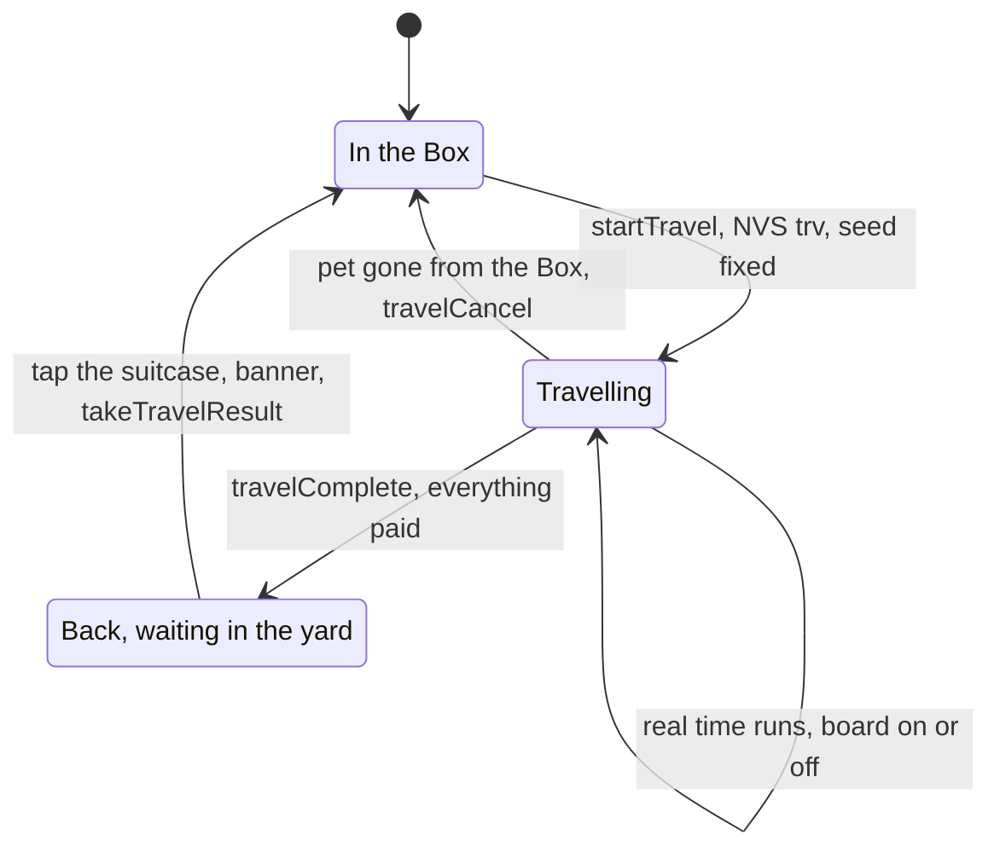

**UI.** `openTravel` (`TamaPoke.ino:8257`) opens `PANEL_TRAVEL`. A running trip shows a countdown and a log
(`travelEvent`) and cannot be cancelled. The returned pet is found by `trvBackSlot` (`:8555`); the banner is
`drawReturnBanner` (`:8570`).

---

## 13. Persistence and offline catch-up

- **NVS namespace `"tamapoke"`** holds one key per field, not a single struct. See `Pet::save` (`pet.cpp:2255`) and
  `Pet::load` (`:2438`) for the full list. Common keys:
  - Needs: `full`, `joy`, `ene`, `poop`, `poopA` (slot 0's poop stamps, v3.1; missing = fresh). `hyg` is still written (100) but ignored.
  - Growth and time: `age`, `grow`, `seen`.
  - Care: `bond`, `strk`.
  - Items and gifts: `bpack`, `bpk2` (v3.2 berries), `bpk3` (v3.14 Lure and later items), `gifts`.
  - Favourite berry known: `fk` for slot 0 (v3.2; the old `bk` is ignored); `REC_FAV6` in the record for slot 1 and the Box.
  - Progress: `dexreg`, `bdg`.
  - Coins and yard: `cn`, `ybg`, `ybgO`.
  - Home upgrades (v3.20): `upg`, one `UpgSave` blob (`upgrade.h`, 30 B: `ver`, 3 tiers, per home slot
    `{uid u32, day u32, gymGains u8, toyPlays u8, sleptMin u16}`, CRC-16). Written right after `cn`, only when
    it changed (`saveUpg`, copy in `upgSaved`); a failed write sets `pendingSave` and stops the save there.
    Missing, another version, bad CRC or a tier > 3 = nothing owned (no migration: a new save is expected). The
    gym's minute counter `gymMin` is RAM-only.
  - Systems: `trv`, `trvR`, `enc`, `souv2` (v3.15, u64; replaces the u32 `souv`, migrated on load), `souvD`, `team`, `cegg`.
  - Box: `box0-5`, `boxT`, `boxTs` (v3.0), `eggH`, `vac`.
  - Home slot 1 (v3.0): `hm1`, one `HomeRec` blob (`homerec.h`, 97 B, version + CRC): kind (vacant/egg/pet), the
    `PetRecord`, egg/incubator fields, cake, dying and night state, `careDay`, poop stamps. Missing or invalid =
    slot 1 vacant. Slot 0's first-care day is `pcd` (missing = `lastCareDay`).
  - Identity and versions: `uid` (written last), `init`, `gcv`.
  - Kept outside `Pet`: `bri` (brightness), `vol` and `snd` (audio), `lang`.
- **Save cadence.**
  - User actions call `save()` at once (`persist(true)`).
  - Ticks, steps and IMU events only set `pendingSave`, plus a periodic mark every 5 ticks.
  - The loop calls `flushSave()` **only when the screen is dim or off, or the pet sleeps**, because an NVS write
    freezes both cores for about 1 s.
  - `lastSeenEpoch` is stamped into RAM every 30 s and saved with the next write.
- **Migrations.**
  - A new game writes `gcv` before `init`.
  - `migrateGrowthCurve` is staged through `gmig`.
  - The one-shot flags `rvg` (3 Revives) and `ballg` (3 Poké Balls) are written after the data, so a power cut
    re-runs them.
  - Old saves without a `uid` get one.
- **Offline catch-up** (`Pet::syncClock`, `pet.cpp:276`, called once from `setup`). Minutes off = (RTC − `seen`)/60.
  - Travel and encounters are checked first.
  - The Revive window keeps counting.
  - It is skipped if under 2 min, ending or dying, starter pick or vacant. The cap is 14 days.
  - It replays minute by minute: age, the egg timer, growth, `nightMinute` at that minute's hour, and sleep drain or
    awake drain (the same beats as live, hungry JOY drain included) with **floors of 16** (`OFFLINE_FLOOR`, v3.11:
    above the need alarm's 15)
  - One poop per 240 awake minutes, made inside the replay so its stamp is right; the stale-poop JOY drain runs
    there too, with the same floor (v3.1).
  - Home upgrades (v3.20): the bed's ENE and morning bonus come through `sleepMinute`/`nightMinute`; the gym and
    toy run in the awake branch through `homeMinute(h, day of that minute, false)`. Offline minutes push no
    events.
  - **Not applied offline:** evolution (left ready for the user), slip-ups, neglect, death, weight burn and the
    12 h DEF bonus.

---

## 14. Power, screen, celebrations, audio

- **Idle ladder** (`power.h` `dimStageFor` `:51`): at 90 s the screen dims (DIM_LOW); at 120 s the **screensaver**
  starts (pet and clock on a Lissajous path). Face-down drops the brightness to 8, with no saver.
- **Brightness** (`brightnessFor` `:85`): the user level (4 levels, BOOT key) is the ceiling. On battery it is
  capped at 100 below 20 % and at 60 below 10 %.
- **Frame interval** (`frameIntervalMs` `:101`):

  | State | Interval |
  |---|---|
  | Screen off | 0 (no frames) |
  | A game or battle open | 85 ms |
  | Default | 100 ms |
  | Idle 60 s | 150 ms |
  | Pet asleep | 500 ms |
  | Low battery | doubled |

- **Sleep.** Light sleep for 200 ms only when off USB with the screen off or in the saver (woken by the touch INT,
  USER or BOOT). There is **no deep sleep**.
- **Burn-in** (`burnin.h`): the whole canvas orbits over 9 positions, 4 px apart, moving every 3 min.
- **Full-screen yard** (v2.5, `TP_FULL_YARD` in `ui_frame.h`, on when the panel is bigger than the 466 canvas). The
  yard home and the map picker call `yardShowFull()`, which hands `yardBg` to `RoundCanvas::showUnder` for that one
  flush. The round mask then copies the map into the canvas corners and blends the edge into it
  (`RoundMask::apply(fb, under, stride)`, `blend565`), so whatever was drawn is still cut at the same circle.
  The panel border (the bands around the canvas) is painted from the same map, following the orbit, and is only
  sent again when the map key, the tint or the canvas position changes; any other screen gets it black again.
  Serial `YARDFULL 0|1` switches it at runtime. On a round 466 panel (the 1.75) it is a no-op.
- **Celebrations** (`fx.h`):
  - `FxQueue fxq` shows level-up, player medal (v3.4: tier + coins; medal news leave 2 slots free for other
    events), streak milestone and walk goal one at a time, only when the screen is
    visible, and merges consecutive level-ups.
  - `FxOverlays fxo` draws the small "+N", heart, "ATK +3", deny shake and similar.
  - `FxWatch` watchers detect changes from any source.
  - Code: `fxCollect` (`TamaPoke.ino:4325`) every loop, `fxFrame` (`:4406`), `drawFxBanner` (`:4575`),
    `drawFxOverlays` (`:4781`).
- **Audio** (`audio.h`): `sfxPlay(Sfx)` queues a non-blocking sound to a FreeRTOS task on core 0. Ids include TAP,
  EAT, HATCH, EVOLVE, LEVELUP, MEDAL, DENY, BATTLE, HIT, WIN, LOSE, MORNING, WILD, …. There are 4 volume levels
  including off (`volume.h`, NVS `"vol"`).
- **Need alarm (v3.11).** `NeedAlarm` / `needCritical` (`fx.h`), called in `loop()` after `fxCollect`: while any
  awake, hatched home pet that isn't ending or `neglected()` has `lowestStat() <= NEED_ALARM_AT` (15), `SFX_NEED`
  (two low beeps) plays every `NEED_ALARM_EVERY_MS` (2 s), also with the screen off (which blocks light sleep while it
  runs). `pet.nightHold` (game, battle, encounter, evolution, Box move) pauses it. `OFFLINE_FLOOR` (16) stays above
  the threshold, so a boot after time off doesn't start it. `SFX_ALERT` (three beeps) still marks a need hitting 0.

---

## 15. Data pipeline, sprites, i18n

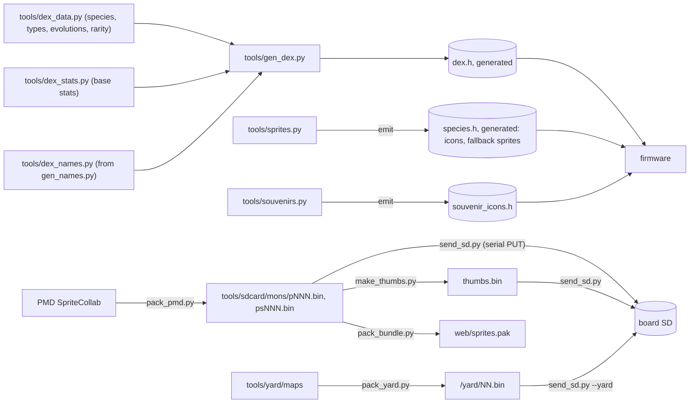

- **Species data.** Edit the Python sources, then run `python3 tools/gen_dex.py` and commit the regenerated `dex.h`
  with them. **Never hand-edit `dex.h` or `species.h`**: CI's `generated` job fails on any diff.
  - `DEX_TBL[152]` holds the name, evolution, level, rarity, base stats, types, biome and base form.
  - `dexName()` returns the localised name.
  - Starters are `STARTER_DEX = {1,4,7}` (`TamaPoke.ino:321`).
- **Sprites** (`sdmon.cpp`). All 151 species and their shinies are loaded from the SD into PSRAM.
  - `PmdMon` is the TPK2 multi-action sprite (`PMD_IDLE, WALKL, WALKR, SLEEP, EAT, HURT, ATTACK, POSE, HOP, NOD,
    BREATH, SIT, WALKU, WALKD`; ids are append-only).
  - `SdThumbs` holds the 40×40 thumbnails.
  - `ensureMon()` (`TamaPoke.ino:567`) reloads the sprite when the species, the shiny flag or the SD contents change.
- **i18n.** `i18n.h` has `enum Lang` (ES, EN, FR, DE, IT, PT, JA, KO) and `enum StrId`; `i18n.cpp` has
  `STRINGS[LANG_COUNT][STR_COUNT]`, with one block per language in the same order.
  - **To add a string:** add an `S_xxx` before `STR_COUNT`, add an entry at the same position in all 8 rows, then
    run `python3 tools/test_i18n_formats.py`. A short row compiles but crashes at runtime. Only EN and ES need care
    (CLAUDE.md).
  - **Latin-script text** uses single-byte CP437 octal escapes, not UTF-8, because centring uses `strlen*6`.
  - **JA and KO** use UTF-8 with U8g2 fonts (`applyLangFont` `TamaPoke.ino:2567`).

---

## 16. Serial debug commands

These are typed at 115200 baud and handled by `handleSerial()` (`TamaPoke.ino:910`). `sdSerialCommand`
(`sdmon.cpp:260`) is tried first for `PUT`, `LS` and `SDINFO`. Every command answers `DONE`. They are the fastest way
to test on the board: `~/.platformio/penv/bin/python tools/board.py cmd STATS ...` sends them without restarting it
(skill `tamapoke-board-test`).

| Area | Commands |
|---|---|
| Pet state | `STATS` (full dump), `SPEC n`, `LVL n`, `AGE m` (4320 = farewell ready), `SHINY`, `NICK s`, `NEED i v` (0 food, 2 joy, 3 ene; 1 answers "hygiene removed"), `POOP`, `CAREDAY`, `REG`, `FEED f` (v3.2: 0 plain, 1-6 berries, 7 cake, 8 golden; STATS shows `berries=` and `fav0/fav1`) |
| Medals and USER page (v3.4) | `MEDALS` (every medal: value, tier, next threshold; counted bits per pet), `MEDAL i v` (set a pet or event medal's counter and pay), `USER [0-3]` (open the USER page) |
| Eggs | `HATCH`, `EGGD <dex>` (home egg's species, for its colour), `EGGT [min]`, `EGGS` (simulate 20 rolls), `EGG [n]` |
| Endings | `BYE` (farewell), `RELEASE`, `ABANDON` (needs to 0), `NEGLECT m`, `DYING m`, `DIE`, `REVIVES [n]` |
| Time | `TIME [epoch]` (RTC + pet), `RTCSET epoch` (RTC only, simulates time off), `NIGHT` |
| Home slots (v3.0) | `FOCUS n` (the home pet the other commands act on); `STATS`, `BOX` and `EGGS` show both slots |
| Box | `BOX`, `STORE k [s]` (default: focused), `WAKE k [s]` (default: first vacant, then an egg, then focused), `BOXFILL`, `BOXCLR k`, `NVS` |
| Games | `BALL [n]`, `DASH? / DASH [s] / STEER deg\|OFF`, `ZEN? / ZEN [s] / HOLD 1\|0\|OFF` (`DASH`/`ZEN`/`BALL` here pay nothing) |
| Battles | `BATTLE`, `STAGE n`, `STAGEDAY` (re-arm today's boss rewards), `BADGES mask` |
| Encounters | `ENC?`, `ENC [dex]`, `ENCEND`, `BALLS n`, `LURE` (use one and open the encounter), `LURE n` (set the count) |
| Home upgrades (v3.20) | `UPG` (the 3 tiers and each slot's counters: uid, day, gym, toy, slept, gymMin), `UPG <line> <tier>` (0 bed, 1 gym, 2 toy; sets the tier, saved with the next flush) |
| Economy and travel | `COINS [n]`, `SHOP`, `BUY id`, `BUYMAP n`, `GIFTS`, `GIFT item`, `TRAVEL [slot map tier]`, `TRAVELT m`, `TRAVELEND`, `SOUV [mask]` (64-bit mask, `0x..` or decimal; printed as `%llX`) |
| Steps and IMU | `STEPS n`, `IMU`, `IMULOG s`, `SHAKE`, `FACEDOWN [0]` |
| Pet menu (v3.3) | `MENU s` (open the menu for slot s; `MENU` prints the rows with their tap points), `PICK s` (choose in the pet picker); actions print `MENU s food\|care\|…`, `FOOD front …`, `PLAY <game> slot=s`, `ITEM <id> slot=s` |
| Screen and UI | `TAP x y` (simulated touch, mode-aware), `BACK`, `PWR`, `SAVER`, `GAL`, `BRIGHT [n]`, `ORBIT [n]`, `BIOME [n]`, `YARDBG [n]`, `YARDFULL 0\|1`, `YARDUI [p]`, `FX name`, `PERF` |
| System | `HEALTH`, `VOL [n]`, `BEEP`, `WIPE` (factory reset + restart) |
| SD | `PUT path size`, `LS`, `SDINFO` |

---

## 17. Tests and developer workflow

- **Build and flash:** `pio run -e tamapoke [-t upload]`. `pio run -e bringup -t upload` flashes the hardware test.
  Versions are pinned in `platformio.ini` and `.github/workflows/ci.yml`.
- **Tuning:** change the value in `tuning.h`, then run the host tests.
  - Tests that check a mechanism read the value from `tuning.h`, so they keep passing (for example the egg timer,
    the per-minute drain, the encounter odds).
  - A few tests pin a deliberate design promise on purpose, and fail when a change breaks it. Example:
    `night.apagado_toda_la_noche_duerme_y_amanece` checks that a pet put to bed well cared for wakes with every
    need at 50 or more. If one fails, either the change is wrong or the promise changes: then update the test, the
    README's "Game manual" and this guide.
  - Values that set the size of something saved in flash (`GIFT_MAX`, `CAP_EGG_MAX`, item ids, the Box record)
    are not in `tuning.h` on purpose: changing them needs a save migration.
- **Host tests:** `./test/run_tests.sh [--asan]`, or `cd test && make [FILTER=name]`.
  - They compile `pet.cpp`, `i18n.cpp` and the pure headers against shims in `test/shim/` (Arduino, an in-memory
    NVS with power-cut simulation, a fake clock), with one `test_*.cpp` per module.
  - **A new pure header or test file must be added to `SOURCES` and the dependency list in `test/Makefile`.**
  - `test/test_tools.py` checks the tools, regenerates `dex.h` and replays IMU captures.
  - `tools/test_i18n_formats.py` checks the translation tables.
- **Screens on the PC:** `tools/render/render.sh [outdir] [scene…]` compiles the real `.ino` (via `ino2cpp.py`) and
  writes 480×480 PNGs to `.pio/render/screens/`. To render a new screen, add a scene to `tools/render/render.cpp`.
- **CI jobs:** arduino-cli build, PlatformIO build, render, generated-files diff, `ruff check tools/`, host tests
  with ASan, and i18n.
- **Release bump** (skill `tamapoke-release`; `tools/release.py bump X.Y` / `row` / `pointers --fix` / `check` do the
  mechanical parts): `FW_VERSION` (`TamaPoke.ino:62`), `web/manifest.json`, `CHANGELOG.md`, and
  `bash tools/build_web.sh` for `web/firmware/tamapoke.bin`. **Also update the version and commit line at the top of
  this guide.**
- **Board checks:** `docs/PENDING_TESTS.md` (numbered open checks) and `docs/DEVICE_TESTS.md` (procedures). EN and
  ES only.
- **Other docs:** `docs/NEXT_FEATURES.md` (FX/BOX/OTA spec; OTA lives on branch `feature/ota`),
  `docs/GAMEPLAY_TUNING.md`, `docs/NEW_GAMES.md`, `docs/FEATURES.md` (steps, motion tricks, link), `docs/AMOLED-2.16.md`
  (port notes), `docs/yard-prototype/DESIGN_YARD_UI.md`.

---

## 18. Gotchas and known doc/code mismatches

**Code gotchas**

1. **New balance numbers go in `tuning.h`,** not as a literal in the code or a `#define` in the module. Keep
   values that size saved data (NVS blobs, item ids) out of it.
2. **`.ino` prototype conversion.** The Arduino/PlatformIO converter puts auto-generated prototypes before struct
   definitions and skips pointer-returning functions. That is why some structs sit at the top of the file
   (`YardBody`), why `encOpen()` is a macro, and why some functions are forward-declared by hand.
3. **Never call `save()` from a tick, IMU or step path.** It freezes the board for about 1 s. Set `pendingSave`
   instead.
4. **`isEgg()` is true for a vacant home.** Check `isVacant()` first.
5. **Item ids and the `PetRecord` layout are save formats.** Only append new items, and bump `PET_RECORD_VER` with a
   migration if the record changes.
6. **Box write order matters** (§6). Keep `eggH` before `boxT` and `uid` last in `save()`, and extend the power-cut
   loop in `test_box.cpp` when touching it.
7. **Evolution and farewell never auto-fire,** not even after offline catch-up.
8. **Hour windows differ by feature.** Sleepy and the night floors use 22–09, `nightSleep` starts at 20, face-down
   bedtime uses 20–06, and the night id is anchored at `WAKE_HOUR` (09:00). The RTC is read as local time, with no timezone.
9. **`travelCheck` and `encCheck` run before the tick's early return,** so they advance even when the home is vacant
   or dying.
10. **The daily coin cap applies only to games and repeat stage clears.** First clears, walk goals and trips are
   uncapped.
11. **`practiceJoy` uses `millis()`,** so it resets on reboot. The daily boss mask uses the calendar day; with no
    clock, "day 0" lasts until the clock is set.
12. **Yard positions are RAM-only** (poops, gifts, egg, food) and are re-scattered on every boot.
13. **`wind.h` belongs to the old side-view scene,** not the v2.0 yard.

**README / comments versus code** (the code is the truth)

None known. The ones found when this guide was written (slip-up cooldown in the README, "7 días" farewell and "4 h"
egg comments, old battle and language numbers in `test/README.md`) were fixed right after. List any new mismatch
here until it is fixed.
